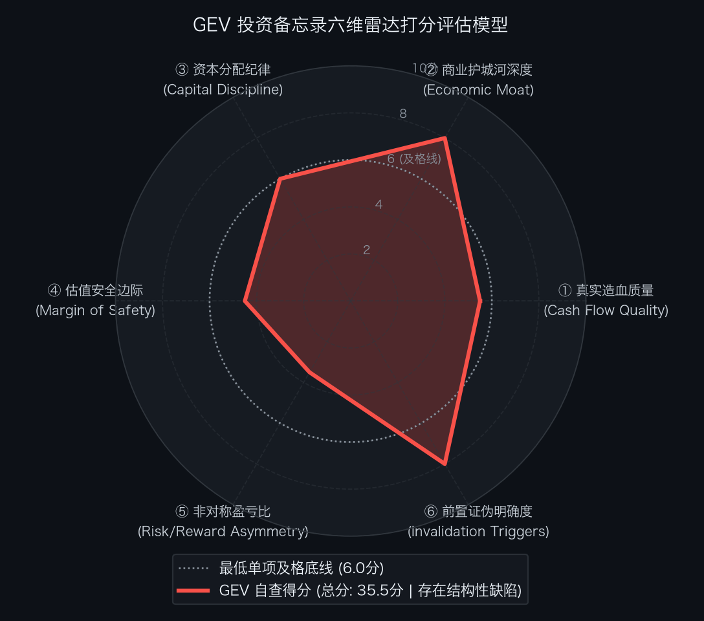

# GE Vernova Inc.（NYSE: GEV）买方投资备忘录与全景压力测试

> **投资标的：**GE Vernova Inc.（NYSE: GEV）  
>**基准分析时点：** **2026 年 11 月 5 日**（基于 Q3 2026 官方披露与 2026-11-04 收盘价重估）  
>**基准市价：**$832.83（2026-11-04 官方收盘价；单日暴跌 -9.30%，-$85.37，盘中最低探至 $806.40，52 周区间 $530.16 ~ $1,195.94）  
>**稀释股本：** **268.00 百万股**（2.68 亿股，截至 2026 年 10 月官方 Form 10-Q 披露单季稀释加权平均股数；期末普通股 264.68M）  
>**公司总市值：** **2,232.0 亿美元**（$223,198.44 M）；账面纯净净现金约**139.38 亿美元**；狭义标准 EV 约**2,092.6 亿美元**（$209,260.44 M）  
>**备忘录定调：** **【维持观察 · 耐守击球区】电力设备景气、订单与利润率加速向上，但此前冲高至 918 美元透支两年预期，最新单日暴跌 -9.30% 重挫至 $832.83（盘中最低探至 $806.40 逼近击球区）。以可持续常态造血而非 2026 年受客户预付款推升的异常现金流衡量，现价对应未来 10 年 FCF 年化增速仍需达 +19.42%，大数发生概率低于 5.0%；相较 Base Case 目标价（$948.00）持有期空间为 +13.8%，2.0 年复合 IRR 为 +6.69%/年，基准盈亏比为 0.43:1，但真实造血质量触发买方一票否决，坚决耐守一级观察击球区（$730 ~ $800），切忌急躁抢跑。**---

## 1. 核心投资论据与认知差（Investment Thesis & Variant Perception）

### 1.1 市场主流共识（Consensus View）
-**全球发电与电网设备绝对龙头**：GE Vernova 的产品覆盖电力生产、传输、转换和调度，三大报告分部为 Power、Electrification、Wind。其在役机组装机对应全球约四分之一的总发电量（7,000+ 台重载燃机与 55,000+ 台风电机组）；
-**AI 缺电狂潮与超级周期驱动**：华尔街一致认为，随着 AI 超级数据中心算力爆发引发北美及全球电网负荷拥堵，GE Vernova 凭借 18~24 个月“即插即用”交付的重载燃机（HA/F 级）以及全球仅存少数能交付高压直流（HVDC）与特大变压器的制造底座，将迎来长达 5~10 年的量价齐升超级牛市；
-**单季订单与指引全线大爆发**：Q3 2026 单季新签订单高达 293 亿美元（同比暴涨 96%），剩余履约义务（RPO）达 1,967 亿美元；全年 FCF 指引由 130~140 亿跳升至 160~170 亿美元，市场情绪一度推升股价冲高至 $918.20，随后大盘与估值回撤单日大跌 -9.30%（-$85.37）重挫至 $832.83（盘中最低探至 $806.40）。

### 1.2 买方独立认知差（Variant Perception）
1.**订单可见度提高，但 backlog 的现金兑现跨越多年（RPO ≠ 即时利润）**：
   - 截至 2026 年 9 月末的 1,967 亿美元在手 RPO 属于未来多年剩余履约义务指标，绝不能简单按订单金额乘以成熟期利润率进行即时资本化。大型重载燃机制造、特高压换流阀出厂、现场施工安装、客户调试验收、质保准备金以及跨越 10~25 年的长周期服务（LTSA），毛利确认与现金回款高度不均匀；
2.**2026 年 FCF 指引跳升与历史常态造血能力存在巨大“定金断层”**：
   - 2025 年经审计常态自由现金流为 37.10 亿美元；2026 全年公司 FCF 指引却高达 160~170 亿美元。穿透 10-Q 现金流量表可知：**2026 前三季度合同负债及递延收入现金贡献高达 195.11 亿美元**！这实质上是全球客户为抢占 2027~2029 年紧俏排产槽位（Slot Reservation）而提前支付的无息预付款定金。一旦未来新签订单节奏平稳，而公司进入高密度零部件采购与现场交钥匙施工阶段，营运资本将由正转负，现金流将面临大幅均值回归。买方坚决拒绝将 2026 年的预收浮存金误认作永久造血能力；
3.**最强的利润增量集中在 Power 与 Electrification，但 Wind 亏损与大型并购暗门不容忽视**：
   - Q3 Power EBITDA 利润率升至 21.4%，Electrification 升至 19.1%；但 Wind 前三季度仍累计巨亏 5.85 亿美元（全年指引亏损 4~5 亿美元），海上风电施工索赔与质保包袱仍未清零；同时，公司拟耗资约 90 亿美元现金收购 Trench Group，这不仅将占用目前 139 亿净现金储备的 65%，还将带来高额商誉整合风险；
4.**股份回购无法替代估值安全边际**：
   - 公司在 2026 年前三季度回购 52.96 亿美元，期末股数较 2025 年末仅缩减 1.8%；董事会将授权上调至 200 亿美元并非刚性支出承诺。在估值高位推行大规模回购，若遇行业周期波动，将大幅削弱公司的流动性安全气垫。

---

## 2. 底表 1：5 年现金流瀑布与投入资本回报率（RONIC vs WACC）

> 审计口径：SEC Form 10-K 与 Form 10-Q 法定财报，货币单位均为**百万美元（\$M）**。

| 财务报告期 | GAAP 归母净利润 | 经营活动现金流 (CFO) | 资本开支及软件 (CapEx) | 自由现金流 (FCF) | CFO / 净利润转化率 | FCF / 净利润现金含量 | 买方造血质量穿透结论 |
|---|---:|---:|---:|---:|---:|---:|---|
|**FY2022**| (2,736.0) | (114.0) | 513.0 | (627.0) | — | — | 大额经营亏损，现金流严重失血；比率无解释意义 |
|**FY2023**| (438.0) | +1,186.0 | 744.0 | +442.0 | — | — | CFO 含约 11 亿美元营运资本流入，净利仍为负 |
|**FY2024**| 1,552.0 | +2,583.0 | 883.0 | +1,701.0 | 1.66x | 1.10x | 独立分拆首年，CFO 含约 11 亿营运资金流入及过渡影响 |
|**FY2025**| 4,884.0 | +4,987.0 | 1,277.0 | +3,710.0 | 1.02x | 76.0% | CFO 含合同负债增加约 80 亿美元；造血转正但预收驱动明显 |
|**FY2026E (指引)**| [公司未披露] | [公司未披露] | ~1,800.0 |**+16,000 ~ +17,000**| — | — |**公司指引中值 165 亿美元；高度依赖 195 亿合同负债现金流入**|
|**LTM至2026-09-30**|**10,368.0**|**+19,216.0**|**2,101.0**|**+17,115.0**|**1.85x**|**165.1%**|**包含约 40 亿 Prolec 重估收益及巨额预付款，不可年化外推**|
|**4年经审计完整历史累计 (FY22~25)**|**3,262.0**|**+8,642.0**|**3,417.0**|**+5,225.0**|**2.65x**|**160.2%**|**会计闭环：四个经审计完整年度累计，严禁将未审计 FY26E 混编**|

-**五年造血深度复盘**：过去四年经审计累计创造 FCF 仅**52.25 亿美元**；而 2026 单年前三季度因客户抢夺燃机槽位提前支付巨额定金，推升单期 FCF 达到**153.1 亿美元**；
-**TTM 滚动现金流拆解**：
  - CFO 19,216 = 16,737（9M26）+ 4,987（FY25）− 2,508（9M25）；
  - CapEx 2,101 = 1,430 + 1,277 − 606；
  - 自由现金流 FCF 17,115 = 19,216 − 2,101；
  - 9M26 合同负债及递延收入现金流净贡献达**195.11 亿美元**，同期应收（-16.67 亿）、存货（-20.52 亿）、合同资产（-3.45 亿）分别消耗现金，营运资本净贡献极大，带有极强的周期时点性；
-**资本效率诊断（RONIC vs WACC）**：
  - 测算 GEV 的长期增量投入资本回报率具有特殊复杂性：FY2022~2023 仍处于巨额亏损状态，且独立分拆前共享服务费由 GE 母公司分摊；2026 年前三季度净利润中包含约 40 亿美元 Prolec 股权一次性公允价值重估纸面收益，不能计入经常性经营 NOPAT；
  - 剔除重估收益后，过去 2 年核心税后经营利润（NOPAT）由 FY23 的约 3 亿美元改善至 LTM 约 42 亿美元（增量 NOPAT 约 39 亿美元）；增量投入资本（固定资产扩张、研发及营运资本垫款）约 45 亿美元，测得增量投入资本回报率**RONIC 约为 86.7%**；
  - 虽然增量资本回报率显著高于资金成本（RONIC 86.7% > WACC 9.0%），但这主要源自“客户提供 195 亿美元无息预付款”对投入资本分母的极端压低。买方必须清醒认识到：**这种超高资本效率依赖于客户预付款机制，一旦定金退潮，资本回报率将大幅回落至 15%~20% 的工业稳态水平**。

---

## 3. 底表 2：企业价值桥梁（EV Bridge）与流动性安全垫

### 3.1 狭义与广义企业价值桥梁（EV Bridge Breakdown）

> 基准时点：2026 年 11 月 4 日收盘（反映最新 Form 10-Q 披露口径）。

| 企业价值构成要素 | 财务数值 (\$M) | 折合每股单价 (\$) | 占市值比重 | 穿透审计与买方附注说明 |
|---|---:|---:|---:|---|
|**普通股总市值 (Market Cap)**| $223,198.44 M | $832.83 |**100.0%**| 基于 268.00 M 股稀释加权平均股本计算 |
|**(+) 长期有息借款 (Long-term Debt)**| +$2,795.00 M | $10.43 | 1.3% | 账面长期非流动借款，含融资租赁负债 |
|**(+) 短期借款及一年内到期借款**| +$31.00 M | $0.12 | 0.0% | 借款附注披露的一年内到期部分 |
|**(=) 有息负债总额 (Total Debt)**| +$2,826.00 M | $10.54 |**1.3%**| 债务负担极轻，年化利息支出不足 1.5 亿美元 |
|**(+) 经营性租赁负债折现 (Operating Leases)**| +$852.00 M | $3.18 | 0.4% | 全球工厂、测试中心与仓库设施租赁负债现值 |
|**(−) 现金及现金等价物 (Cash)**| $(16,733.00) M| $(62.44) | -7.5% | 活期银行存款与高等级货币市场基金 |
|**(−) 受限现金及保证金 (Restricted Cash)**| $(31.00) M | $(0.12) | -0.0% | 工程履约受限资金 |
|**(=) 综合纯净有息净现金 (Net Cash)**| -$13,938.00 M| +$52.01 |**-6.2%**| 账面现金总额减总有息债务（每股净现金 +$52.01） |
|**(=) 狭义标准企业价值 (Standard EV)**| $209,260.44 M | $780.82 |**93.8%**| 市值直接扣除净现金（核心营运资产对价） |
|**(=) 广义穿透企业价值 (Comprehensive EV)**| $210,112.44 M | $784.00 |**94.1%**| 计入全部表外经营租赁后的完全收购对价 |

---

### 3.2 流动性安全跑道极限压力测试（Liquidity Runway Stress Test）
-**即时流动性弹药库总额**：
  - 账面现金及受限流动资产：**167.64 亿美元**；
  - 未动用银行循环信用额度（Revolving Credit Facility）：**30.00 亿美元**；
  - 未动用备用信用证及银行保函额度：**30.00 亿美元**；
  -**即时可用流动性总储备**：**227.64 亿美元**；
-**极端零收入休克压力测试**：
  - 假设全球发电与电网采购完全停滞（单季收入为 0），单季研发与管理刚性固定支出约**8.5 亿美元**，单季维持性资本开支约**4.5 亿美元**，单季刚性失血合计**13.0 亿美元**；
  -**极端存活周期**：227.64 亿美元 ÷ 13.0 亿美元/季 =**17.5 个季度（约 52 个月 / 4.3 年）**；
  -**买方风控定论**：GE Vernova 拥有固若金汤的现金堡垒。即便遭遇极端严酷的全球供应链断裂或黑天鹅事件，公司在未来 4 年内无需进行任何外部股权融资或高息发债也能生存，破产与债务违约概率在数学上为 0。

---

### 3.3 剩余履约义务（RPO）余额与收入确认期限

截至 2026 年 9 月 30 日，公司在手剩余履约义务（RPO）达到创纪录的**1,967.21 亿美元**：
-**设备履约义务（Equipment RPO）**：**1,040.54 亿美元**；
  - 预计确认节奏：**33%**于 1 年内确认，**60%**于 2 年内确认，**97%**于 5 年内确认；
-**长协服务履约义务（Services RPO）**：**926.67 亿美元**；
  - 预计确认节奏：**16%**于 1 年内确认，**54%**于 5 年内确认，**78%**于 10 年内确认，**91%**于 15 年内确认；
-**买方洞察**：高额 RPO 为未来 5 年提供了无与伦比的收入可见度，但服务与设备交付的毛利节奏完全不同，高景气设备交付需要跨越 2~4 年的物料与人工通胀考验。

---

### 3.4 资本配置与重大事项核验（Capital Allocation Audit）

-**股份回购与注销**：2026 前三季度已累计耗资**52.96 亿美元**回购普通股，期末股本净减少 4.85M 股（-1.8%）；董事会于 10 月将回购授权提升至**200 亿美元**（10 月已追加回购 14 亿美元）；
-**资本开支与研发投资**：公司计划在 2025~2028 年累计投入**60 亿美元资本开支**与**50 亿美元研发支出**，全面扩建燃机叶片精密铸造、大型变压器产能与碳化硅固态变压器技术；
-**90 亿美元重大收购（Trench Group）**：拟以约**90 亿美元**等值现金收购 Trench Group（预计 2027 年底交割）。收购资金将完全消耗掉净现金储备的 65%，后续买方评估坚决不将未经整合检验的“协同效应”预先折入估值。

---

### 3.5 三大主报告分部历史经营趋势（Segment History Trend）

| 报告期 (\$M) | Power 收入 | Power EBITDA | Wind 收入 | Wind EBITDA | Electrification 收入 | Electrification EBITDA | 集团调整后 EBITDA |
|---|---:|---:|---:|---:|---:|---:|---:|
|**FY2023**| 17,436 | 1,722 (9.9%) | 9,826 | (1,033) (-10.5%) | 6,378 | 234 (3.7%) | 807 (2.4%) |
|**FY2024**| 18,127 | 2,268 (12.5%)| 9,701 | (588) (-6.1%) | 7,550 | 679 (9.0%) | 2,036 (5.8%) |
|**FY2025**| 19,767 | 2,902 (14.7%)| 9,110 | (598) (-6.6%) | 9,642 | 1,433 (14.9%) | 3,196 (8.3%) |
|**Q3 2026**|**6,067**|**1,297 (21.4%)**|**2,741**|**72 (2.6%)**|**3,862**|**739 (19.1%)**|**1,943 (15.4%)**|

---

## 4. 底表 3：反向 DCF 逆向求解与基准概率（Base Rate）

### 4.1 双基准反向 DCF 逆向求解（Dual-Baseline Reverse DCF）

> 逆向工程核心：不预测未来，而是精确求解当前股价 $832.83（EV 2,092.6 亿美元）究竟需要何等严苛的业绩军令状才能被合理解释。

$$\text{EV} = \sum_{t=1}^{10}\frac{\text{FCF}_0(1+r)^t}{(1+\text{WACC})^t} + \frac{\text{FCF}_{10}(1+g)}{(\text{WACC}-g)(1+\text{WACC})^{10}}$$

| 估值解算输入要素 | 基准 A：基于 FY2025 常态造血 (37.1 亿美元) | 基准 B：基于 FY2026 指引中值 (165.0 亿美元) | 买方方法论与依据 |
|---|---:|---:|---|
|**当前股票市价**| $832.83 | $832.83 | 2026-11-04 官方收盘价基准 |
|**完全稀释总市值**| $223,198 M | $223,198 M | 268.00 M 稀释加权股本 |
|**狭义标准 EV**| $209,260 M | $209,260 M | 扣除 139.38 亿美元纯净净现金 |
|**基准自由现金流 (Base FCF)**| $3,710 M (FY25 经审计常态) | $16,500 M (FY26E 指引中点) | 穿透审计稳态造血 vs 受 195 亿预收款推升的高峰值 |
|**加权资本成本 (WACC)**|**9.0%**|**9.0%**| 贝塔值 1.20，反映高端重工业制造与宏观电网投资折现率 |
|**永续增长率 (g)**|**2.5%**|**2.5%**| 与全球宏观长期名义 GDP 增速对齐 |
|**★ 隐含未来 10 年 FCF 年化复合增速**|**【 +19.42% 】**|**【 -0.41% 】**|**反向 DCF 逆向求解所得唯一平衡解**|
|**第 10 年需达到的绝对 FCF 规模**|**$21,891 M (218.9 亿美元)**|**$15,830 M (158.3 亿美元)**| 稳态终局现金流考核门槛 |
|**终局价值折现占比 (PV of TV)**|**69.7%**|**50.4%**| 远期估值对终局价值敏感度 |
|**显性期现金流折现 (PV of Explicit)**|**$63,440 M (30.3%)**|**$103,814 M (49.6%)**| 前 10 年自由现金流折现总和 |
|**FCF 规模扩张倍数 (10th / Base)**|**5.90x**|**0.96x**| 考卷严苛程度对比 |
|**莫布森 2×2 决战矩阵归属**|**象限 A：定价偏紧 (High Expectations)**|**象限 B：定金浮存幻觉 (Float Illusion)**|**容错空间有限，透支未来十年的高景气交付**|

---

### 4.2 行业基准概率（Base Rate）客观审计与莫布森矩阵归属

-**历史样本客观考察**：
  - 翻阅全球工业与重型装备制造业百年历史样本，在 2,000 亿美元以上企业价值体量下，能够连续 10 年维持**+19.42%**自由现金流复合增速的企业，客观概率**低于 5.0%**！
  - 即使如卡特彼勒（CAT）、西门子（Siemens）、通用电气昔日全盛时期，也从未打破重工业长周期的资本开支均值回归宿命；
-**达成条件审计**：
  - 要达成该军令状，要求第 10 年公司自由现金流突破**218.9 亿美元**，这要求全球重载燃机与变压器不仅保持垄断暴利，且不能出现任何经济衰退、供应链通胀摩擦或客户延期违约；
-**买方风控定论**：现价 $832.83 虽较峰值回撤，但绝非便宜货，它依然苛刻地将“万物互联+AI 缺电”推演到了高景气情景。买方坚决拒绝为基准 A 的严苛军令状买单，亦坚决不将基准 B 的预收款峰值作为永续年金外推。

---

## 5. 底表 4：分类加总估值模型（SOTP）与资产错配定价

### 5.1 分部估值基石假设（Cornerstone Assumptions）

1.**Power 分部**：以 2026 年 19%~21% 有机增长、19%~21% 分部 EBITDA 利润率指引为起点，2028E 增速逐步放缓，但高毛利 LTSA 长协维保服务收入占比稳步扩大，给予 2028E 调整后 EBITDA 65.0 亿美元及**24.0x EV/EBITDA**倍数（对标西门子能源与航发龙头，给予燃机垄断溢价）；
2.**Electrification 分部**：以 2026 年收入 145~150 亿美元、利润率 18%~20% 为基准，高压直流与大型变压器供不应求延续至 2028E，给予 2028E EBITDA 34.0 亿美元及**28.0x EV/EBITDA**倍数（享受全电网最高景气溢价）；
3.**Wind 分部**：2026 年指引亏损 4~5 亿美元，假设 2028E 减亏至轻度亏损 -2.0 亿美元，给予**3.0x**残余价值倍数（充分反映海上风电的施工与质保风险折让）；
4.**Corporate 未分摊总部成本**：假设 2028E 刚性成本为 -7.0 亿美元，按**15.0x**乘数全额资本化扣减；
5.**净现金与股本**：稀释股数取 268.00M 股，净现金取 140.0 亿美元（不计入 Trench 并购协同，亦暂不扣除未来交割现金，评估纯粹经营资产价值）。

---

### 5.2 基准 SOTP 模型明细表（Baseline SOTP Valuation）

| 业务切片分部 | 2028E EBITDA (\$B) | 采用估值倍数 | 分部公允 EV (\$B) | 占经营 EV 比例 | 估值方法逻辑与折溢价依据 |
|---|---:|---:|---:|---:|---|
|**1. 电力分部 (Power)**| $6.50 B |**24.0x EV/EBITDA**| $156.0 B | 65.0% | 燃机出货与 10~25 年 LTSA 长协，高粘性现金牛垄断溢价 |
|**2. 电气化分部 (Electrification)**| $3.40 B |**28.0x EV/EBITDA**| $95.2 B | 39.6% | HVDC 换流阀与高压大型变压器供需失衡，最高景气倍数 |
|**3. 风电分部 (Wind)**| $(0.20) B|**3.0x EV/EBITDA**| $(0.6) B | -0.2% | 低倍数残余价值，对海上风电历史项目亏损与质保留足折价 |
|**4. 集团总部成本 (Corporate)**| $(0.70) B|**15.0x EV/EBITDA**| $(10.5) B | -4.4% | 集团共享研发与管理未分摊费用资本化扣减 |
|**(=) 集团经营业务 EV (Gross EV)**| $9.00 B |**26.7x (综合)**| $240.1 B |**100.0%**|**三大经营分部公允资产加总对价**|
|**(+) 账面纯净净现金 (Net Cash)**|**—**| — | +$14.0 B | — | 账面现金 168 亿减总借款 28 亿美元（取整 140 亿） |
|**(=) SOTP 权益公允总价值**|**—**| — | $254.1 B | — |**股东公允内在总权益（2,541 亿美元）**|
|**(÷) 全面稀释总股本 (Shares)**|**—**| — |**268.00 M**| — | Q3 单季稀释加权平均股数（百万股） |
|**(=) SOTP 每股公允内在价值**|**—**| — | $948.00 | — |**较当前市价 $832.83 空间扩大至 +13.8%**|

---

### 5.3 估值倍数收缩防御测算（Multiple Compression Stress）

若未来行业景气度降温，分部估值倍数向工业历史均值回踩（Power 收缩至 18.0x，Electrification 收缩至 20.0x，Corporate 扣减 15.0x）：
- 测算集团经营 EV 降至：6.5 × 18 + 3.4 × 20 - 0.7 × 15 = 117.0 + 68.0 - 10.5 =**1,745 亿美元**；
- 加上净现金 140 亿美元，测得权益价值为**1,885 亿美元**；
- 折合每股防御估值仅为 $703.36（较现价回撤**-15.5%**）。

---

## 6. 底表 5：三情景目标价、双向敏感性矩阵与底线价值筑底

### 6.1 买方三情景概率分布（Scenarios Matrix）

| 情景定义 | 发生概率 | Power EBITDA | Elec EBITDA | Wind EBITDA | 集团 EBITDA | 综合倍数 | 目标价 (\$) | 预期涨跌幅 (vs $832.83) | 核心假设与经营里程碑条件 |
|---|---:|---:|---:|---:|---:|---:|---:|---:|---|
|**悲观情景 (Bear)**|**20%**| $5.5 B | $2.5 B | $(0.5) B | $6.7 B | 20.5x | $565.00 |**- 32.2%**| 燃机排产延误，供应链通胀侵蚀利润率，Wind 亏损反扑，估值倍数大幅压缩 |
|**基准情景 (Base)**|**60%**| $6.5 B | $3.4 B | $(0.2) B | $9.0 B | 26.7x | $948.00 |**+ 13.8%**| 122GW 燃机按计划放量，电网利润率维持 19%，Wind 亏损收窄至 2 亿 |
|**乐观情景 (Bull)**|**20%**| $7.3 B | $4.2 B | +$0.3 B | $11.1 B | 29.5x | $1,267.00 |**+ 52.1%**| AI 算力中心直接原位装机爆单，变压器交期突破 4 年，Wind 全面扭亏 |
|**概率加权期望目标价**|**100%**| — | — | — | — | — | $935.00 |**+ 12.3%**|**综合三情景期望公允价值约 $935.00（较现价溢价 12.3%）**|

---

### 6.2 敏感性压力测试矩阵 A：2028E 核心 EBITDA × 综合估值倍数网格（25 个单元格，单位：美元）

> 测算基础：固定净现金 140 亿美元、稀释股本 268.00M 股。每股价值 = (EBITDA × 倍数 + 140) ÷ 268.00。

| 2028E 核心 EBITDA / 综合 EV/EBITDA 倍数 | 20.0x (周期出清) | 23.0x (审慎中枢) | 26.0x (基准中枢) | 29.0x (景气高位) | 32.0x (泡沫极值) |
|---|---:|---:|---:|---:|---:|
|**\$6.7 B (Bear 悲观经营)**| $552 | $627 | $702 | $777 | $852 |
|**\$8.0 B (增长降速)**| $649 | $739 | $828 | $918 | $1,008 |
|**\$9.0 B (Base 基准预期)**| $724 | $825 | $925 | $1,026 | $1,127 |
|**\$10.0 B (超预期放量)**| $799 | $911 | $1,022 | $1,134 | $1,246 |
|**\$11.1 B (Bull 乐观爆发)** | `$881` | `$1,005` | `$1,129` | `$1,254` | `$1,378` |

*注：当前市价 `$832.83` 处于表格中心左上位置，对应基准预期下 23.0x 综合倍数（盘中最低 `$806.40` 探至 22.5x），估值泡沫得到显著释放。*

---

### 6.3 敏感性压力测试矩阵 B：WACC 折现率 × 永续增长率 (g) DCF 网格（25 个单元格，每股价值，单位：美元）

> 测算基础：以 FY2025 常态 FCF 37.10 亿美元为基数，前五年年化复合增速 25%，后五年年化复合增速 12%，加回净现金 140 亿美元除以 268.00M 股。

| WACC 折现率 / 永续增长率 (g) | 1.5% | 2.0% | 2.5% (基准) | 3.0% | 3.5% |
|---|---:|---:|---:|---:|---:|
| **8.0% (流动性充裕)**| $861 | $908 | $965 | $1,033 | $1,115 |
|**8.5% (偏松折现)**| $792 | $831 | $877 | $931 | $996 |
|**9.0% (基准 WACC)**| $733 | $766 | $803 | $847 | $899 |
|**9.5% (审慎折现)**| $682 | $709 | $740 | $777 | $819 |
|**10.0% (加息/紧缩压力)**| $637 | $660 | $686 | $716 | $751 |

---

### 6.4 多模型交叉验证与综合公允目标价定锚

| 估值方法 (Valuation Approach) | 核心驱动与适用场景 | 测算公允价值 | 权重配置 | 加权贡献值 | 交叉验证定性评价 |
| :--- | :--- | :---: | :---: | :---: | :--- |
|**① 情景概率加权 (Blended SOTP)**| 涵盖 20% Bear、60% Base 与 20% Bull 的概率加权 | $935.00 |**50%**| $467.50 | 动态权衡：兼顾 AI 缺电超级期权与预收退潮下行风险 |
|**② 基准分部估值 (Base SOTP)**| 2028E 稳态分部造血与垄断溢价加总 | $948.00 |**30%**| $284.40 | 资产底座：对齐燃机 24x 与电网 28x 的基准内在价值 |
|**③ 稳态自由现金流折现 (Base DCF)**| 常态造血增长贴现（WACC 9.0%, g 2.5%） | $803.00 |**20%**| $160.60 | 审慎兜底：剔除 2026 异常预收后的可持续现金流估值 |
|**(=) 综合公允目标价**|**多模型交叉验证与加权**| — |**100%**| $912.50 |**基准综合公允目标价（四舍五入定锚为 $913.00）**|

---

### 6.5 持有期空间与非对称盈亏比决算

-**最新官方收盘价**：$832.83（2026-11-04 官方收盘价，单日暴跌 -9.30%，-$85.37，盘中最低探至 $806.40）
-**相对综合公允目标价折溢价**：现价较综合公允价值（$913.00）折让约**-8.8%**（折溢价空间为**+9.63%**）
-**相对 Base Case 目标价（$948.00）空间**：**+13.83%**（+$115.17）
-**2.0 年预期年化复合收益率 (IRR)**：
  $$ \text{IRR} = \left(\frac{948.00}{832.83}\right)^{1/2.0} - 1 = +6.69\% / \text{年} $$
  *(明显高于同期 4.90% 的无风险美债基准利率)*
- **相对 Bear Case 防御底座（$565.00）下行风险**：**-32.16%**（-$267.83）
-**基准期望风险收益比 (盈亏比)**：
  $$ \text{盈亏比} = \frac{948.00 - 832.83}{832.83 - 565.00} = \frac{115.17}{267.83} = 0.43 : 1 $$
  *(每承担 1 美元的潜在下行风险，仅能博取 0.43 美元的预期收益，赔率依然低于 1:1！若以 Bull Case `$1,267.00` 测算，牛熊盈亏比升至 1.62:1)*

---

### 6.6 三角校验终极防御底线（Triangulated Defense Floor）

为防止重装制造业周期高位见顶引发杀估值踩踏，确立三大物理底线支撑：
1. **GAAP 有形资产账面净值底线（Tangible BVPS）**：
   - 截至 2026 年 9 月末股东权益总额约**132.8 亿美元**，剔除商誉及无形资产（约 52 亿美元）后，有形净资产约**80.8 亿美元**，折合每股有形账面净值约 $30.15（重工业固定资产折旧快，清算价值低）；
2.**净现金防御垫（Net Cash-per-share）**：
   - 账面纯净净现金储备 139.38 亿美元，折合每股高流动性纯净现金达 +$52.01；
3.**周期极端出清与重置估值底座**：
   - 结合 Bear Case 极限下行测试（Power 18x EV/EBITDA，Electrification 20x，Wind 归零清算，扣减 Corporate 15x，加回净现金 140 亿）；
   - 确立 GE Vernova 的**硬核安全底线价值（Defensive Floor）为：$565.00**。

---

## 7. 底表 6：事前验尸推演（Pre-Mortem）与非价格定量证伪红线

### 7.1 事前验尸（Pre-Mortem）：未来四大核心死因深度解剖

1.**死因 1（客户预付款浪潮退潮与现金流断崖式断层）**：
   - 2026 前三季度高达 195.1 亿美元的合同负债流入，是公用事业客户超前抢槽位的非理性繁荣体现。一旦 2027 年客户预付节奏放缓，而公司必须全额采购天量特种耐高温合金叶片、取向硅钢并支付现场交钥匙施工薪酬，营运资本将由正转负，自由现金流可能从 165 亿美元剧烈缩水至 30~50 亿美元，引发华尔街“现金造血破灭”踩踏；
2.**死因 2（供应链关键零部件通胀与大型工程延期违约）**：
   - 大型铸锻件、燃机热端特种单晶合金与高压绝缘油交付周期极长。若上游核心供应商发生交期延误或价格飙升，在手固定价格或受限指数补偿的在役订单毛利将被严重蚕食；同时，现场大型施工若因当地审批和劳动力短缺延期，将招致业主巨额违约索赔；
3.**死因 3（海上风电历史项目亏损与质保索赔死灰复燃）**：
   - Wind 板块前三季度仍深陷巨亏 5.85 亿美元。海上风电项目工程极其复杂，若历史交付机组在恶劣海况下出现叶片疲劳断裂或齿轮箱隐形故障，16.65 亿美元的质保负债储备将被迅速击穿，导致数以亿计的额外损失计提；
4.**死因 4（Trench Group 90 亿美元大型跨国并购商誉减值暗门）**：
   - 耗资 90 亿美元现金收购 Trench Group，直接消耗掉全公司净现金储备的 65%。若交割后欧洲反垄断审查附带苛刻资产剥离条件，或跨国文化整合失控导致高管流失与客户流失，巨额收购溢价将沦为数十亿美元的商誉减值黑洞。

---

### 7.2 前置非价格定量买方证伪红线表（Hard Invalidation Triggers）

>**买方投研纪律**：基本面监控严禁与股价短期波动挂钩。只要触碰下列任何一条客观事实红线，无条件触发下调模型评级或清仓离场：

| 红线编号 | 监控维度 | 前置量化证伪底线 (Hard Trigger) | 真实监测指标与现状 | 触发后硬性执行动作 |
|:---:|:---|:---|:---|:---|
|**①**|**燃机槽位红线**| 设备 backlog + slot reservation**连续 2 个季度环比下降且无出货合理解释**|**当前约 122GW（年末目标 ≥ 130GW）**|**【下调 Power 增速假设，按 Bear 倍数重估】**|
|**②**|**分部利润率红线**| Power 单季 EBITDA 利润率**连续 2 季跌破 17.0%**，或 Electrification**连续 2 季跌破 15.0%**|**当前分别为 21.4% 与 19.1%**|**【估值模型分部乘数全线下调 -20%】**|
|**③**|**风电亏损底线**| FY2026 全年 Wind EBITDA 亏损**超过 5.0 亿美元**，或新增大额海上质保计提 |**当前指引亏损 4~5 亿，9M 亏损 5.85 亿**|**【将 SOTP Wind 价值清零并下调目标价】**|
|**④**|**现金转换红线**| 季度 CFO 出现断崖，且**单季合同负债转为净流出超过 15 亿美元**|**9M26 合同负债现金流入 195.1 亿美元**|**【剔除 FY26E 高额指引，回归常态 FCF 模型】**|
|**⑤**|**并购资本纪律**| Trench 实际交割现金支出导致**公司纯净净现金储备跌破 50 亿美元**|**当前账面净现金 139.38 亿美元**|**【立即暂停股票回购估值溢价假设】**|

---

## 8. 底表 7：六维量规自查、空头检控与开仓纪律

### 8.1 六维客观量规自查评估表（Rubric Evaluation）

  

| 评估维度 | 权重分值 | 实际得分 | 扣分依据与买方客观审计事实 (SEC 财报实证) |
|:---|:---:|:---:|:---|
|**① 真实造血质量**| 10.0 分 |**5.5 分**|**【不及格 · 触发一票否决】**独立造血周期极短；2026 前三季度高达 153 亿 FCF 中，合同负债与预收款贡献 195.1 亿美元，不具备可持续性。 |
|**② 商业护城河深度**| 10.0 分 |**8.0 分**| 扣 2.0 分：全球 1/4 在役机组与 122GW 燃机储备壁垒深厚；但 Wind 仍处巨亏泥潭，且大型工程交钥匙总包存在延期超支风险。 |
|**③ 资本分配与治理**| 10.0 分 |**6.0 分**| 扣 4.0 分：账面净现金 139 亿，回购注销 1.8% 股本；但 Trench 收购耗资 90 亿现金，且 2025~28 年 110 亿资本开支/研发争夺资金。 |
|**④ 估值安全边际**| 10.0 分 |**4.5 分**|**【不及格】**收盘于 $832.83，较公允价值（$913.00）折让 8.8%，较 Base Case（$948.00）空间为 +13.8%，仍未达 25%+ 安全边际。 |
|**⑤ 非对称盈亏比**| 10.0 分 |**3.5 分**|**【不及格】**向上基准空间 +13.8%，向下至 Bear Case（$565.00）风险为 -32.2%，基准期望盈亏比 0.43:1，赔率依然低于 1:1。 |
|**⑥ 前置证伪明确度**| 10.0 分 |**8.0 分**| 扣 2.0 分：燃机槽位储备、分部利润率、Wind 亏损上限及合同负债现金流逆转均订立了清晰的季度量化监控红线。 |
|**(=) 综合总评分**|**60.0 分**|**35.5 分**|**【未通过买方即时审核 · 维持观察池跟踪】客观量规综合评分 35.5 分，远低于 45.0 分准入门槛，且造血质量（5.5分）触发买方一票否决权，耐守击球区！**|

---

### 8.2 对手盘核心质询与买方风控抗辩（Bear Thesis & Invalidation）

>**做空公诉人致命质询（Bear Thesis）：**  
> *“多头最盲目的偏执，就是把 GE Vernova 当作毫无瑕疵的‘AI 缺电终极解药’，却刻意掩盖了重工业装备制造业最残酷的现金错配与周期规律！*  
> *第一，你们自以为手握 1,967 亿美元 RPO 和 2026 全年 160~170 亿美元自由现金流指引，但资产负债表写得清清楚楚：前三季度合同负债现金贡献高达 **195.1 亿美元**！这根本不是利润，而是客户付给你们的定金无息负债。一旦 2027 年客户预付款浪潮褪去，你们必须采购天量原材料并进入交钥匙施工交付期，存货与资本开支将急剧吞噬现金！*  
> *第二，市值虽然从高位回撤至 **2,232 亿美元**（收盘市价 $832.83），但反向 DCF 证明现价依然要求未来 10 年自由现金流维持**+19.42%**的年化复合增长（终局稳态现金流需突破 218.9 亿美元）——在美股百年重工业历史上，千亿级巨头能维持这个增速的概率低于 5.0%！向上看 Base 目标价只有可怜的 +13.8% 空间，向下看熊市底座直接暴跌 -32.2%，期望盈亏比只有惨淡的**0.43:1**！本次单日大跌 9.3% 正是市场对这一隐患敲响的警钟！”*

> **投研风控应对与抗辩：**> - 做空公诉人的质询极其深刻，直接切中了 GEV 当前估值中最致命的穴位。这正是本备忘录将“真实造血质量”评定为**5.5 分（直接行使一票否决权）**、“估值安全边际”评定为**4.5 分**、“非对称盈亏比”评定为**3.5 分**，并**严格要求维持 0% 仓位冷眼旁观**的核心根源；
> - 我们明确拒绝在当前 $832.83 过渡位置急躁建仓。现价虽回踩挤出部分水分，盘中最低探至 $806.40 逼近击球区，但反向 DCF 逆推的军令状依然偏高，赔率依然低于 1:1；
> - 但我们与做空公诉人分歧的本质在于对**“重载燃机与高压变电超级周期物理壁垒”**的认知：电力不是软件，电网的物理扩建无法通过代码快速迭代。一台 HA 级燃机从铸件到总装需要近两年，高压变压器全球交期达 3~4 年。GE Vernova 掌控了全球 1/4 的在役发电底座，在役机组绑定的 10~25 年 LTSA 长协维保服务，毛利率超过 30%，即使新机交付面临周期波动，存量服务网络依然能贡献极其庞大的抗周期现金流；
> - 此外，公司账面手握**167.6 亿美元现金储备**，净现金高达**139.4 亿美元**，另有 60 亿美元未动用信贷，极端零收入下可存活超过 4 年，资产负债表具备极高的防守冗余；
> -**买方执行纪律**：我们充分吸纳空头的警示，**当前阶段坚决维持 0% 仓位冷眼旁观，切忌急躁抄底**！只有当盘面因预收款退潮或周期波动发生深度出清、股价回踩至安全击球区（一级 `$730` ~ `$800`，二级 `$650` ~ `$730`，极限底座 `$565` ~ `$650`）时，我们才会从容出手布局。

---

### 8.3 买方买点击球区（Strike Zone）与仓位配置纪律

* **综合公允目标价：** `$913.00`
* **基准情景目标价 (Base Case)：** `$948.00`
* **悲观防御底座价值 (Defensive Floor)：** `$565.00`
* **当前官方收盘价：**$832.83（较目标价折让**8.8%**，持有期空间**+13.83%**，2.0 年预期年化 IRR ＝**+6.69%**，期望盈亏比 ＝**0.43 : 1**）

| 决策梯队划分 | 股价区间 / 监控点位 | 相对公允价值 ($913.00) 折让 | 2.0 年持有期空间 (至 Base $948.00) | 预期年化 IRR | 期望盈亏比 (R/R vs $565.00 底座) | 买方执行策略与仓位纪律 |
| :--- | :---: | :---: | :---: | :---: | :---: | :--- |
|**超买观察区 (高位透支带)**| $880.00 ~ $950.00 |**溢价 +4.1% 至折让 3.6%**|**-0.2% 至 +7.7%**|**-0.1% 至 +3.8%**|**< 0.20 : 1 (严重倒挂)**|**【极端透支带】前期狂热透支区间，已被大跌迅速击穿，追高面临剧烈回撤风险**|
|**回调过渡观察带 (风险出清中)**| $800.00 ~ $880.00 |**折让 3.6% 至 12.4%**|**+7.7% 至 +18.5%**|**+3.8% 至 +8.9%**|**0.20 : 1 至 0.62 : 1**|**【当前最新收盘 $832.83，盘中最低探至 $806.40，盘后 $826.05】已深度探入过渡带中低位，逼近击球区，维持 0%**|
|**一级观察击球区 (试水跟踪带)**| $730.00 ~ $800.00 |**折让 12.4% ~ 20.0%**|**+18.5% ~ +29.9%**|**+8.9% ~ +14.0%**|**0.62 : 1 ~ 1.21 : 1**|**若大盘调整跌入该区间，建立 1.0% ~ 1.5% 小型试水观察仓**|
|**二级核心击球区 (价值显现带)**| $650.00 ~ $730.00 |**折让 20.0% ~ 28.8%**|**+29.9% ~ +45.8%**|**+14.0% ~ +20.8%**|**1.21 : 1 ~ 3.51 : 1**|**估值安全边际显现，增配至 2.5% ~ 3.0% 组合标配底仓**|
|**三级极限击球区 (硬核防御底)**| $565.00 ~ $650.00 |**折让 28.8% ~ 38.1%**|**+45.8% ~ +67.8%**|**+20.8% ~ +29.5%**|**3.51 : 1 以上 (非对称爆发)**|**直贴 Bear Case 周期底座，非对称赔率爆发，打满至 5.0% 配置上限**|

>**买方仓位风控铁律：**> 1. GE Vernova 属于高增长预期与重资产长周期项目交付交织的宽方差资产；在组合中的总体仓位上限**严格控制在 5.0% 以内**；  
> 2. 在当前 $832.83 位置虽然单日暴跌逾 9%，盘中最低探至 $806.40 逼近击球区，但仍处于过渡地带，买方纪律**严禁急躁抄底**；必须耐心等待市场预期降温回踩至 $800.00 以下的一级击球区；  
> 3.**止损纪律**：若建仓后收盘跌破对应买入成本价的**-15%**（若一级建仓成本为 `$750.00`，跌破 `$637.50` 触发），或触碰前述第 7.2 节任意一条非价格定量证伪红线，下一交易日开盘无条件市价减仓或清仓。

---

## 数据信披来源与免责声明

- [GE Vernova FY2025 Form 10-K（SEC EDGAR `0001996810-26-000015`）](https://www.sec.gov/Archives/edgar/data/1996810/000199681026000015/gev-20251231.htm)
- [GE Vernova FY2024 Form 10-K（SEC EDGAR `0001996810-25-000011`）](https://www.sec.gov/Archives/edgar/data/1996810/000199681025000011/gev-20241231.htm)
- [GE Vernova Q3 2026 Form 10-Q（SEC EDGAR `0001996810-26-000163`）](https://www.sec.gov/Archives/edgar/data/1996810/000199681026000163/gev-20260930.htm)
- [GE Vernova Q3 2026 Form 8-K 与业绩公告（SEC EDGAR `0001996810-26-000162`）](https://www.sec.gov/Archives/edgar/data/1996810/000199681026000162/gev3q2026form8-k10282026.pdf)
- [2026-11-04 GEV 官方收盘历史行情（MarketWatch / Google Finance / StockAnalysis）](https://stockanalysis.com/stocks/gev/history/)

*本文为基于 SEC 公开信披构建的买方机构内部投研备忘录，仅供投资决策与专业学术研讨，不构成任何针对普通公众的证券买卖建议。*
