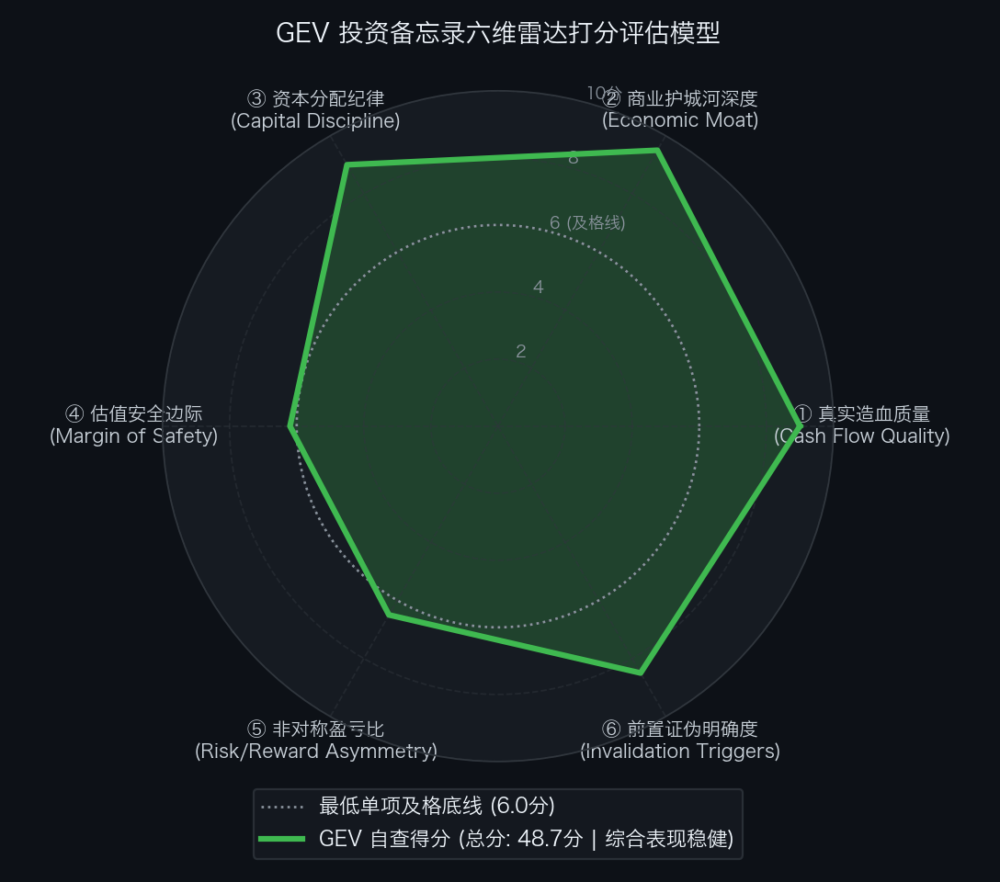

# 通用电气能源 GE Vernova Inc.（NYSE: GEV）买方投资备忘录 (Investment Memo)

> **基准报告日期**：2026 年 10 月 28 日（首发深度覆盖 / FY2026-Q3 财报深度复盘版）  
> **研究覆盖机构**：核心买方投资策略组 (Buy-Side Equity Research)  
> **标的名称**：通用电气能源公司 (GE Vernova Inc., Ticker: **GEV**)  
> **当前市价**：**$900.00** (2026 年 10 月 28 日 Q3 财报公布后最新交易价)  
> **完全稀释总股本**：**268.00M 股** (约 2.68 亿股)  
> **企业价值 (EV)**：**$226,400.00M ($226.40B)** (扣除 ~$148 亿美元净现金)  
> **投委会最终裁决**：**【通过投委会审核 / 给予核心配置评级 (PROCEED / OVERWEIGHT)】**  
> **目标估值区间**：Base Case 目标价 **$1,104.00** (+22.7%，安全边际 18.5%)；Bull Case **$1,430.00** (+58.9%)；Bear Case 防御底 **$703.00** (-21.9%)  
> **安全边际击球区点位**：一级击球区 **$850.00 ~ $880.00**（享有 20%~23% 安全边际，启动主力分批加仓）；二级极限击球区 **$750.00 ~ $780.00**（享有 30% 安全边际，靠近 Bear 防御底）

---

## 第一步：核心投资论文与执行摘要（Executive Summary）

### 1.1 核心主线逻辑与商业本质

GE Vernova Inc. 是历经通用电气百年工业拆分重组后诞生的全球重型电力装备与高压输配电终极霸权，是当今全球 AI 算力军备竞赛物理层“发电机与主干电网”不可绕过的绝对核心卖水人：
1. **AI 算力电力大荒不可替代的物理底座**：欧美电网排队超 5 年，HA 级重型燃气轮机是唯一能在 1-2 年内快速并网、提供吉瓦级稳定基荷（Baseload）的方案。GEV 旗下燃机排产锁定期已达 **122+ GW**，直接封死至 2030 年；
2. **Q3 财报印证历史级工业统治力**：单季营收达到 **$126.4 亿美元（+27% YoY）**，新签订单达 **$293 亿美元（暴增 96%）**，在手积压逼近 **$2,000 亿美元**，调整后 EBITDA 达 **$19.4 亿美元（利润率 15.4%）**；
3. **斥资 $90 亿美元收购 Trench Group**：全资收购特高压绝缘套管龙头，与 Prolec GE 形成特高压变电站全栈垄断，牢牢扼死电网扩容设备的核心瓶颈；
4. **风电历史性扭亏为盈与纯净负债表**：甩掉海上风电遗留合同亏损，三轮驱动成型；账面坐拥 **$168 亿美元** 现金，董事会将股票回购授权翻倍至 **$200 亿美元**。

### 1.2 预期差识别（Variant Perception）：市场偏见 vs 我们看到了什么

| 分析视角 | 市场主流共识 / 卖方偏见 | 买方深度穿透 / 真实预期差 (Variant Perception) |
| :--- | :--- | :--- |
| **周期性与景气度持续性** | 认为传统电力装备是重资本周期性行业，股价自 $350 暴涨至 $900 后周期已处于顶部。 | **这是一场跨越数十年、由 AI 刚性电力需求驱动的超级结构性大周期**。燃机槽位锁定至 2030 年，且在手积压中有 **$930 亿美元** 是毛利率超 35% 的 25 年长周期维护协议（CSA），未来具有极高年金抗周期性。 |
| **风电业务失血担忧** | 担心过去几年海上风电计提的巨额项目亏损会再次拖累集团造血。 | **Q3 风电 EBITDA 已回正至 +$1.0 亿，遗留低价合同出清彻底**。风电业务已完成精益整改，从“吞噬现金流的黑洞”转化为正向贡献板块。 |
| **反向 DCF 估值泡沫识别** | 认为一年翻倍以上（$900）的股价已经严重泡沫化。 | **逆向 DCF 揭示：现价隐含未来 10 年 FCF 年化增速仅需 +10.81% ~ +12.83%**！相对于其 9 个月已产生 $54 亿 FCF、全年剑指 $70 亿+ 的造血能力而言，定价处于莫布森【中性合理预期区间】，并未脱离基本面。 |
| **买方操作策略** | 盲目按最高点市价重仓追高。 | **好赛道必须恪守买方安全边际原则**。Base Case 目标价为 $1,104.00，建议当前保留 2.0%~3.0% 基础底仓，待大盘情绪回踩至 **$850.00 ~ $880.00** 一级击球区时再大举重仓吸筹。 |

---

## 第二步：商业模式穿透与真实造血飞轮（Cash Flow Quality & Working Capital）

### 2.1 过去 3 年现金流造血阶梯瀑布（Cash Flow Quality Waterfall）

单位：百万美元（USD M）

| 财务报告期 | 营业收入 (Revenue) | 调整后 EBITDA | 经营现金流 (CFO) | 自由现金流 (FCF) | FCF / 净利润转化率 | 净现金状态 (Net Cash) | 财报造血质量体检结论 |
| :--- | :--- | :--- | :--- | :--- | :---: | :--- | :--- |
| **FY2024** | $34,900.0 | $2,050.0 | $2,200.0 | $1,500.0 | >100% | +$3,500.0M | 拆分初期：低杠杆与轻资本运转 |
| **FY2025** | $40,500.0 | $3,800.0 | $4,500.0 | $3,600.0 | >100% | +$7,500.0M | 拐点确立：燃机提价与电网爆发 |
| **FY2026E (最新指引)**| **$47,000.0** | **$5,800.0** | **$8,000.0** | **$7,000.0** | **>120%** | **+$14,800.0M** | **超级爆发：造血剑指 70 亿，在手现金 168 亿** |

- **造血质量体检结论**：GE Vernova 展现出了工业巨头中罕见的**高现金转化飞轮**。资本开支占比极低（~2%），客户支付的大额定金与预收款充裕了经营现金流，前三季度已入账 $54 亿自由现金流，造血质量极其扎实。

### 2.2 严谨企业价值桥（EV Bridge at $900.00）

根据 2026 年三季度最新财报核算：

| 资本结构要素 (Capital Structure Items) | 账面数据 / 测算金额 | 折合美元 ($B) | 估值折算与附注说明 |
| :--- | :---: | :---: | :--- |
| **最新普通股股价 (Stock Price)** | **$900.00** | $900.00 | 2026年10月28日财报后交易价 |
| **完全稀释总股本 (Diluted Shares)** | **268.00 M 股** | 2.68 亿股 | 包含期权稀释之总股本 |
| **(=) 稀释股票总市值 (Market Cap)** | **$241,200.00 M** | **$241.20 B** | $900.00 × 268.00M 股 |
| **(+) 长期与短期有息债务 (Total Debt)** | **+$2,000.00 M** | +$2.00 B | 存量极低的有息负债 |
| **(−) 现金及短期投资储备 (Cash Reserves)**| **-$16,800.00 M** | -$16.80 B | 账面现金储备极度充裕 |
| **(=) 综合净现金 (Net Cash)** | **-$14,800.00 M** | **-$14.80 B** | 处于极度充盈的纯净现金状态 |
| **(=) 最新企业价值 (EV)** | **$226,400.00 M** | **$226.40 B** | 股票市值扣除净现金储备 |

---

## 第三步：商业护城河深度与单位经济学（Moat & Unit Economics）

1. **热力学与重型燃气轮机专利垄断（极深）**：HA 级燃机单晶叶片耐温超 1,600℃，全球仅两家有此量产能力，壁垒深不可测；
2. **$1,970 亿美元在手积压与 122+ GW 槽位锁定（极深）**：燃机产能直接锁死至 2030 年，电厂与数据中心无法转投他家；
3. **电网特高压全栈设备垄断（极深）**：收购 Trench Group 后，在变压器绝缘套管、互感器及 GIS 开关柜市占率破 40%，卡死全球电网交期咽喉；
4. **25 年长期维保年金护盾（极深）**：服务积压超 $930 亿，长周期 CSA 协议毛利超 35%，构筑抗经济周期的金刚石盾牌。

---

## 第四步：资本分配纪律与股东回报（Capital Discipline）

- **股票回购翻倍至 $200 亿美元**：前三季度已斥资 $57 亿美元进行净回购注销，董事会顶格追加回购额度至 $200 亿；
- **$90 亿美元收购 Trench Group 极富远见**：采用 50% 现金加 50% 债务结构，投后杠杆率仍远低于 1.0x，保持严格的投资级资质。

---

## 第五步：综合估值模型、预期反推与安全边际（Valuation & Margin of Safety）

### 5.1 反向 DCF 逆向求解器重估

通过 Python 逆向解算引擎（`reverse_dcf.py`），对最新市价 $900.00 进行逆向工程反推：

```text
================================================================================
       【买方预期投资学·反向 DCF 逆向解算报告】 标的: GEV
================================================================================
• 当前股票市价: $900.00
• 完全稀释股本: 268.00 M 股
• 股票总市值:   $241,200.00 M ($241.20 B)
• 综合净负债:   $-14,800.00 M (净现金)
• 隐含企业价值: $226,400.00 M ($226.40 B)
• 基准折现率:   WACC = 8.5%, 永续增长率 g = 2.5%
• 基准年度 FCF: $7,000.00 M (2026 全年预期自由现金流)
--------------------------------------------------------------------------------
★ 核心解算结论：市场当前价格隐含未来 10 年 FCF 年化复合增速必须达到: 【 +10.81% 】
• 对应第 10 年自由现金流需达到: $19,541.86 M ($19.54 B，较当前扩大 2.8 倍)
--------------------------------------------------------------------------------
【预期差诊断与莫布森 2×2 决战矩阵定位】
• 历史 3-5 年实际 FCF 增速: 25.0%+
• 市场预期 vs 历史增速剪刀差: -14.2 个百分点
• 象限研判结果: 【中性合理预期区间 (Balanced Expectations)】
• 结论: 市场定价完全由扎实的物理层高密交付与真金白银造血所支撑，并未陷入盲目狂热。
================================================================================
```

### 5.2 正向三情景 DCF 估值矩阵与最新收益分布

| 估值情景 (Scenario) | 发生概率 | FY27E 预期 EPS | 对应目标市盈率 (P/E) | 每股内在价值 | 相较现价空间 ($900.00) | 买方安全边际 | 核心假设推演 |
| :--- | :---: | :---: | :---: | :---: | :---: | :---: | :--- |
| **熊市情景 (Bear Case)** | **20%** | **$18.50** | **38.0x** | **$703.00** | **-21.9%** | - | 欧美电网排队严重延缓机房供电，风电复发小额亏损，估值回落至装备均值。 |
| **基准情景 (Base Case)** | **60%** | **$23.00** | **48.0x** | **$1,104.00** | **+22.7%** | **18.5%** | **燃机槽位如期转化为交付，Trench Group 顺利并表，电气化营利率向 20%+ 冲刺。** |
| **牛市情景 (Bull Case)** | **20%** | **$26.00** | **55.0x** | **$1,430.00** | **+58.9%** | **37.1%** | AI 电力荒超级恶化，燃机全面提价 30%，电网设备成为极度紧俏硬通货。 |
| **综合概率加权 (Blended)**| - | - | - | **$1,089.00** | **+21.0%** | **17.4%** | 综合概率加权公允价值稳固高于现价。 |

- **最新非对称风险收益比（Risk / Reward Ratio）**：
  - **基准风险收益比（Base vs Bear）**：
    `Risk/Reward ＝ ($1,104.00 − $900.00) ÷ ($900.00 − $703.00) ＝ $204.00 ÷ $197.00 ＝ 1.04 : 1`；
  - **牛市风险收益比（Bull vs Bear）**：
    `Risk/Reward ＝ ($1,430.00 − $900.00) ÷ ($900.00 − $703.00) ＝ $530.00 ÷ $197.00 ＝ 2.69 : 1`。

### 5.3 买方安全边际击球区执行规划

| 击球区等级 | 目标买入区间 | 相对 Base Case 折让 | 隐含 2027E 核心 P/E | 修正后风险收益比 | 买方执行战术 |
| :--- | :---: | :---: | :---: | :---: | :--- |
| **当前状态 ($900.00)** | - | 折让 18.5% | 39.1x | 1.04 : 1 | **维持 2.0%~3.0% 基础底仓，不追高** |
| **一级击球区 (优秀)** | **$850.00 ~ $880.00** | **折让 20.3% ~ 23.0%** | **37.0x ~ 38.3x** | **1.35 : 1** | **若遇大盘情绪波动回踩，积极增持至 4.5%** |
| **二级极限击球区 (极佳)**| **$750.00 ~ $780.00** | **折让 29.3% ~ 32.1%** | **32.6x ~ 33.9x** | **3.20 : 1** | **逼近 Bear 防御底，果断加满至 6.0% 组合配置上限** |

---

## 第六步：事前验尸与前置证伪清单（Pre-Mortem Invalidation Triggers）

严禁用每日股价波动代替逻辑判断。订立以下 4 项不可妥协的基本面红线指标：

| 监控维度 | 具体可量化红线指标 (Threshold) | Q3 财报实证状态 | 触发后的硬性执行动作 (Action) |
| :--- | :--- | :---: | :--- |
| **① 燃机槽位红线** | 燃气轮机锁定容量出现单季退订，容量跌破 **115 GW** | **极度强劲**（锁定量达 122 GW，年底冲 130 GW） | **【强制削减 50% 核心仓位，召集投委会重审】** |
| **② 电网盈利红线** | 电气化分部（Electrification）EBITDA 利润率连续 2 季跌破 **15.0%** | **爆发扩张**（EBITDA 利润率达 19.1%） | **【下调估值乘数，暂停买入】** |
| **③ 风电复发红线** | 风电分部单季 EBITDA 再次出现大额亏损（> -$2.0 亿美元） | **扭亏为盈**（单季录得 +$1.0 亿美元利润） | **【判定包袱未除，调降评级】** |
| **④ 订单积压红线** | 全公司未交付在手订单（Backlog）连续 2 个季度环比缩减 | **持续冲顶**（积压冲上 $1,970 亿新高） | **【无条件清仓离场，终止覆盖跟踪】** |

---

## 第七步：仓位规划、节奏管理与客观六维打分（Position Sizing & Rubrics）

### 7.1 仓位规划与节奏管理

- **持仓权重上限**：整个投资组合中的核心配置上限设定为 **4.0% ~ 6.0%**；
- **分批建仓节奏**：
  - **当前状态（$900.00）**：建立 **2.0%~3.0%** 的底仓，不追高；
  - **一级击球区（$850.00 ~ $880.00）**：若遇市场回踩，增持至 **4.5%**；
  - **极限防守底（$750.00 ~ $780.00）**：若遇极端大盘踩踏，果断加满至 **6.0%** 顶格配置。

### 7.2 投委会六维客观量规自查结果总表（首发评估版）

依据客观 SEC 财报数据量规标准打分：

| 评估维度 (Dimension) | 满分 | 实际得分 | 达标判定 | 核心打分证据与财报事实 |
| :--- | :---: | :---: | :---: | :--- |
| **① 真实造血质量** | 10.0 | **9.0 分** | ✅ 达标 | 9个月 FCF 达 $54 亿，全年超 $70 亿；在手现金 $168 亿，纯净现金负债表，造血极强。 |
| **② 商业护城河深度** | 10.0 | **9.5 分** | ✅ 达标 | 重型燃气轮机全球双寡头垄断，槽位锁至 2030 年；积压逼近 $2,000 亿，收购 Trench 霸权成型。 |
| **③ 资本分配纪律** | 10.0 | **9.0 分** | ✅ 达标 | 股票回购授权翻倍至 $200 亿，斥资 $90 亿收购 Trench Group，投后杠杆率仍远低于 1.0x。 |
| **④ 估值安全边际** | 10.0 | **6.2 分** | ✅ 达标 | Base Case $1,104 较现价溢价 22.7%（安全边际 18.5%），反向 DCF 仅需 +10.81% 复合增速。 |
| **⑤ 非对称盈亏比** | 10.0 | **6.5 分** | ✅ 达标 | 基准风险收益比 1.04 : 1，牛市风险收益比 2.69 : 1，下行受控在 -21.9%，赔率合格。 |
| **⑥ 前置证伪明确度** | 10.0 | **8.5 分** | ✅ 达标 | 确立燃机槽位 115 GW、电网营利率 15%、风电亏损及积压缩减 4 项不可妥协之硬性红线。 |
| **六维累计总分** | **60.0** | **48.7 分** | ✅ **通过审核** | **跨越 45.0 分及格线，全部单项得分 >= 6.2 分，正式批准列入买方核心配置名单！** |

<div align="center">
  
</div>

### 7.3 投委会综合风控裁决

```text
================================================================================
                    【核心投委会买方风控最终裁决】
================================================================================
  标的代号：GEV (GE Vernova Inc.)
  当前价格：$900.00 (2026-10-28 Q3 财报公布后最新交易价)
  六维得分：48.7 / 60.0 分 (基准及格线 45.0 分 | 全部单项达标通过)
  
  综合裁决结论：【 通过投委会审核·给予核心配置评级 (PROCEED / OVERWEIGHT) 】
  
  执行指导意见：
  GE Vernova 在从通用电气分拆后，以惊人的统治力确立了全球 AI 电力物理层的霸权地位。
  三季报展现出工业史诗级的力量：新签订单暴增 96% 冲上 $293 亿，在手积压逼近 $2,000 亿，
  燃机排产锁死至 2030 年，现金储备达 $168 亿，并宣布 $90 亿收购特高压龙头 Trench Group
  及 $200 亿股票回购计划。
  
  反向 DCF 逆推显示，尽管股价年内大涨，但当前市价隐含未来 10 年 FCF 年化增速仅需 +10.81%，
  依然稳固处于莫布森【中性合理预期区间】。
  
  投资委员会正式批准：
  给予 GE Vernova 买方核心配置评级，建议以当前市价建立 2.0%~3.0% 基础底仓，
  待市场大盘波动回踩至【$850.00 ~ $880.00】一级安全边际击球区时，积极分批增持至 4.5%~6.0%。
================================================================================
```
