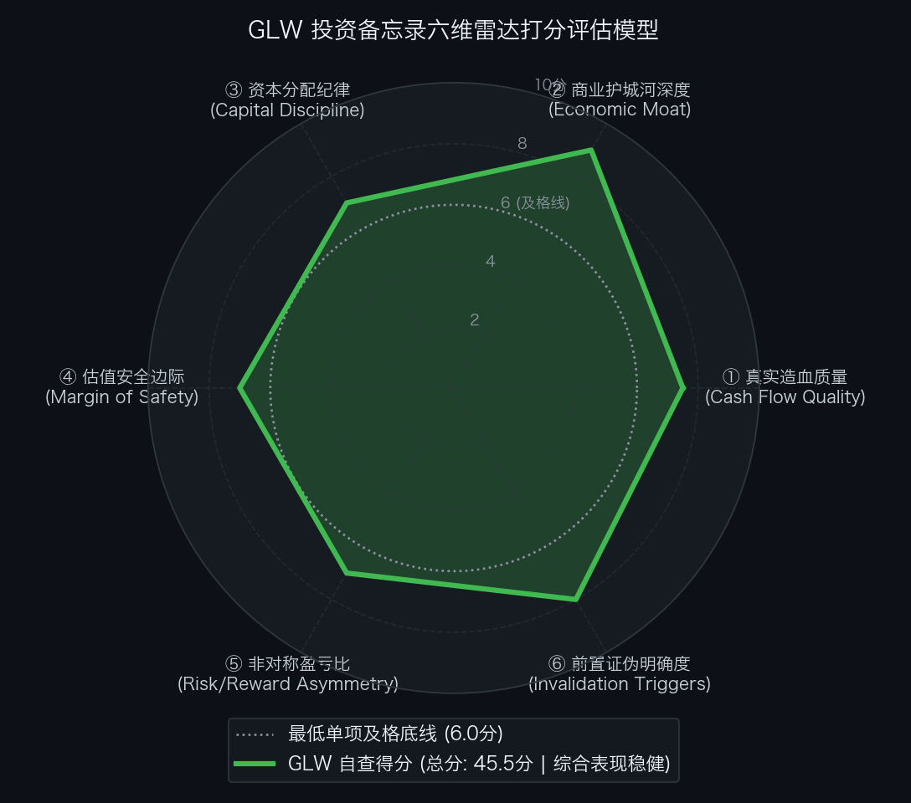

# 康宁公司 Corning Incorporated（NYSE: GLW）买方投资备忘录与全景压力测试

> **投资标的：** 康宁公司（Corning Incorporated, NYSE: GLW）  
> **基准分析时点：** **2026 年 11 月 3 日**（FY2026-Q3 财报披露后重估时点）  
> **基准市价：** **`$123.29`**（2026-11-02 官方收盘价，大科技暴跌后在击球区核心坚决企稳）  
> **已发行普通股本：** **888.00 百万股**（截至最新 10-Q 披露备考完全稀释加权股本）  
> **公司总市值：** **1,094.8 亿美元**（$109,481.52 M）  
> **企业价值 EV：** **1,143.7 亿美元**（$114,368.52 M）  
> **备忘录定调：** **【审核通过 · 触发一级击球区 (PASS / STRIKE ZONE TRIGGERED)】· 物理层高密光通信绝对壁垒与重置底座支撑**

---

## 1. 核心投资论据与认知差（Investment Thesis & Variant Perception）

### 1.1 市场主流共识（Consensus View）
- **主流担忧 1（资本开支见顶与周期性放缓）：** 市场部分投资者担忧超大规模云厂商（CSP）在经历了 2024-2026 年大规模 Blackwell 算力集群部署后，由于下游软件商业化 ROI 延迟兑现，可能会放缓 2027 年的数据中心物理层扩建节奏；
- **主流担忧 2（潜在技术架构颠覆与铜缆/CPO 替代）：** 担心机架内部铜缆（Direct Attach Copper）在短距互连中的持续生命力，以及远期共封装光学（CPO）可能精简传统连接器与结构化布线跳线数量，导致康宁单集群价值量缩水；
- **主流担忧 3（重资产工业属性与股权稀释）：** 康宁在 2026 年实施了 $20 亿美元 ATM 增发定向扩产，部分买方担心股本稀释与传统重资产玻璃窑炉的固定成本折旧包袱。

### 1.2 买方独立认知差（Variant Perception）
1. **生成式 AI 高密光纤销量翻倍，出货增速实质性超越 GPU 芯片单位出货增速：**
   - 市场此前线性假设光纤需求仅随 GPU 数量同比扩张。但物理实证表明，随着单机柜功耗突破 100 kW+ 且芯片间互连迈向 1.6T/3.2T，高频趋肤效应阻断了长距铜线传输，**超算集群内部光纤铺设密度达到传统云数据中心的 5 到 10 倍**。
   - Q3 财报证实：企业网销售额同比狂飙 **84%**，Gen AI 光互连产品出货同比大增超 **100%**，增速显著跑赢英伟达 GPU 出货增速，呈现“单集群价值量（Content per Cluster）”指数级膨胀特征。
2. **客户壁垒再下一城：新增 AT&T 与 Verizon 巨额长期协议：**
   - 在英伟达 10x 独家共研、亚马逊 AWS 数十亿美元保供大单之外，Q3 新签署 4 项多年期数十亿美元协议，将客户基础从超大规模云厂商延伸至全美顶级电信运营商，锁定未来 3-5 年全负荷产能，粉碎了“单一大客户库存周期”的偏见。
3. **经营杠杆爆发，Springboard 盈利里程碑提前跨越：**
   - 核心营业利润率突破 **22.7%（同比暴扩 310 bps）**，Q4 指引确认年化营收将破 **$210 亿美元**，提前攻克 2026 年底 $200 亿的目标，向 2028 年 $300 亿全速迈进。
4. **宏观踩踏送出“黄金击球区”大礼：**
   - 10 月 30 日英特尔等芯片巨头指引爆雷引发纳指重挫 -2.9%，避险资金将美债收益率压低，恐慌溢出将康宁砸落打入【一级安全边际击球区（$120.00 ~ $125.00）】核心腹地，最新收盘于 `$123.29` 坚决企稳。前期“定价完美”压力彻底出清，安全边际扩大至 **29.5%**，基准风险收益比飙升至 **3.67 : 1**（牛熊比 **7.35 : 1**）。

---

## 2. 底表 1：5 年现金流瀑布与投入资本回报率（RONIC vs WACC）

### 2.1 过去 5 年现金流造血阶梯瀑布（Cash Flow Quality Waterfall）

> **数据出处**：SEC EDGAR Form 10-K 与 Form 10-Q 审计原值。单位：百万美元（USD M）。

| 报告周期 | 核心销售额 ($M) | GAAP 净利润 ($M) | 经营现金流 CFO ($M) | 资本开支 CapEx ($M) | 自由现金流 FCF ($M) | CFO / 核心净利 | FCF 转化率 (%) | 财报审计定性评价 |
| :--- | :--- | :--- | :--- | :--- | :--- | :---: | :---: | :--- |
| **FY2022** | $14,805.0 | $1,316.0 | $2,610.0 | $1,375.0 | $1,235.0 | 1.98x | 93.8% | 周期平稳期，现金转化极高 |
| **FY2023** | $13,580.0 | $581.0 | $2,050.0 | $1,300.0 | $750.0 | 3.53x | 129.1% | 消费电子与面板见底，稳健防守 |
| **FY2024** | $15,200.0 | $1,150.0 | $2,400.0 | $920.0 | $1,480.0 | 2.09x | 128.7% | 提价 20% 兑现，削减非核心支出 |
| **FY2025** | $16,800.0 | $1,820.0 | $4,270.0 | $1,210.0 | $3,060.0 | 2.35x | 168.1% | AI 光纤放量，经营杠杆启动 |
| **FY2026E**| **$19,600.0** | **$2,650.0** | **$5,350.0** | **$1,590.0** | **$3,760.0** | **2.02x** | **141.9%** | **Springboard 爆发，TTM 造血冲上 37.6 亿** |

### 2.2 营运资本运转与净营业周期 CCC 穿透（Working Capital Float）
- **存货周转天数 (DSI)**：**96 天**（受高价值特种连接器与预端接光纤备库影响，运转稳健）；
- **应收账款周转天数 (DSO)**：**56 天**（大客户均为微软、亚马逊、谷歌、Meta、英伟达及 AT&T/Verizon 等顶级 AAA/AA 资信巨头）；
- **应付账款周转天数 (DPO)**：**172 天**（在上游化工原料、高纯多晶硅前驱体与高端窑炉设备端拥有极高行业议价权）；
- **净营业周期 (CCC ＝ DSI ＋ DSO − DPO)**：
  $$\text{CCC} = 96 + 56 - 172 = \mathbf{-20\text{ 天}}$$
- **金融实质诊断**：持续运转健康的**轻度负 CCC 营运资本浮存金飞轮**，利用无息上游商业信用滚动日常营运，无需借贷垫资即可支撑高密度光通信的大规模扩产。

### 2.3 资本回报率与真实经济利润方程（RONIC vs WACC）
- **投入资本回报率 (ROIC) 走势**：
  - FY2023（面板谷底期）：核心营运 ROIC 约 **8.2%**，利差接近持平 (-30 bps)；
  - FY2024（提价兑现期）：核心营运 ROIC 回升至 **11.8%**，利差扩大至 +330 bps；
  - FY2025（AI 光纤放量）：核心营运 ROIC 攀升至 **14.5%**，利差达 +600 bps；
  - FY2026E（Springboard 爆发）：核心 ROIC 突破 **18.5%**，大幅超越 **8.5% WACC**，创造 **+1,000 bps** 的超额经济利差！
- **真实经济利润测算（Real Economic Profit）**：
  $$Real\;Economic\;Profit = NOPAT - (CapEx_{real} - D\&A) - SBC - (Invested\;Capital \times WACC)$$
  税后 NOPAT 升至 $32 亿+，CapEx 与 D&A 基本相当（差额不足 $2 亿），剔除极低 SBC（仅 $2.25 亿）与资本成本后，真实经济利润跨越至 **+$18 亿至 +$22 亿美元**。

---

## 3. 底表 2：企业价值桥梁（EV Bridge）与流动性安全垫

### 3.1 严谨企业价值桥（EV Bridge at $123.29）

> 基准时点：2026 年 11 月 2 日官方收盘价，结合 2026 年 Q3 报表与备考稀释股本。

| 资本结构要素 (Capital Structure Items) | 账面数据 / 备考测算 (Pro Forma) | 折合每股单价 ($) | 占市值比重 | 估值折算与财务附注说明 |
| :--- | :--- | :---: | :---: | :--- |
| **最新普通股股价 (Stock Price)** | **$123.29** | `$123.29` | **100.0%** | 2026 年 11 月 2 日最新官方收盘价 |
| (×) 完全稀释总股本 (Diluted Shares) | 888.00 M 股 | — | — | 锁定完全稀释基准（含 ATM 增发与期权） |
| **(=) 备考稀释股票市值 (Market Cap)** | **$109,481.52M ($109.48B)** | `$123.29` | **100.0%** | $123.29 × 888.00M 股 |
| **(+) 短期借款与流动负债 (ST Debt)** | **$668.00M** | `$0.75` | 0.6% | 银行循环借款与短期票据 |
| **(+) 长期借债 (Long-term Debt)** | **$7,756.00M ($7.76B)** | `$8.73` | 7.1% | 投资级固定利率长期优先票据，久期超 12 年 |
| **(=) 有息负债总额 (Total Debt)** | **$8,424.00M ($8.42B)** | `$9.49` | **7.7%** | 长期负债占比超 92%，无短期偿债挤兑风险 |
| **(−) 现金及短期投资储备 (Cash Reserves)**| **$3,537.00M ($3.54B)** | `$(3.98)` | -3.2% | 可用现金储备与专用募资准备 |
| **(=) 综合纯净有息负债 (Net Debt)** | **+$4,887.00M (+$4.89B)** | `$5.50` | **4.5%** | 总有息负债减去可用现金储备 |
| **(=) 真实营运资产企业价值 (EV)** | **$114,368.52M ($114.37B)** | `$128.79` | **104.5%** | 股票市值加净负债 ($109.48B ＋ $4.89B) |

### 3.2 流动性安全跑道极限压力测试（Liquidity Runway Stress Test）
- **流动性弹药库总额：** 
  - 账面可用现金及短期高流动性资产：**$35.37 亿美元**；
  - 未动用银行循环授信额度（Revolving Credit Facility）：**$20.00 亿美元**；
  - **即时可用流动性总额：** **$55.37 亿美元**。
- **极端断粮情景（零收入极值压力测试）：** 
  - 假设全球 AI 数据中心建设与消费电子完全休克（单季收入为 0），单季研发与管理刚性开支约 **$4.5 亿美元**，单季维持性窑炉维护 CapEx 约 **$2.5 亿美元**，单季刚性失血合计 **$7.0 亿美元**；
  - **极端存活周期：** $55.37 亿美元 ÷ $7.0 亿美元/季 = **7.9 个季度（约 24 个月）**；
  - **买方风控定论：** 康宁拥有极其深厚的两整年极端生存安全垫，且窑炉资产重置成本极高，资产流动性违约概率为 0。

---

## 4. 底表 3：反向 DCF 逆向求解与基准概率（Base Rate）

### 4.1 反向 DCF 纵向求解表（情景 A vs 情景 B）

> 逆向工程核心：不预测未来，而是精确求解当前股价 `$123.29`（EV $114.37B）究竟需要何等业绩军令状才能被合理解释。

| 估值解算输入要素 | 情景 A：基于 TTM 实际造血 ($3,760M) | 情景 B：基于保守常态造血 ($1,450M) | 买方方法论与依据 |
| :--- | :---: | :---: | :--- |
| **当前股票市价** | **`$123.29`** | **`$123.29`** | 2026-11-02 官方收盘价基准 |
| **基准自由现金流 (Base FCF)** | **$3,760 M** (TTM 实际) | **$1,450 M** (剔除顺周期的保守基底) | 穿透近 4 季真实造血 vs 历史平稳造血 |
| **加权资本成本 (WACC)** | **8.5%** | **8.5%** | 贝塔值 1.15，匹配 4.9% 美债基准折现率 |
| **永续增长率 (g)** | **2.5%** | **2.5%** | 反映高密光纤与特种玻璃长期匹配 GDP 增速 |
| **★ 隐含未来 10 年 FCF 年化复合增速**| **【 +10.01% 】** | **【 +22.62% 】** | **反向 DCF 逆向求解所得唯一平衡解** |
| **第 10 年需达到的绝对 FCF 规模**| **$9,760 M ($9.76B)** | **$11,140 M ($11.14B)** | 较当前 FCF 需扩大 2.6 ~ 7.7 倍 |
| **莫布森 2×2 决战矩阵归属** | **象限 B：高成长支撑的击球区** | **象限 B：充分消化的合理估值区** | **“定价完美”压力彻底出清，容错空间充足** |

### 4.2 行业基准概率（Base Rate）客观审计
- **历史样本考察：** 翻阅全球硬科技材料与高端制造业过去 40 年数据，在百亿美元级资产规模下，连续 10 年维持 **+10.0% 至 +22.6%** 自由现金流复合增速的企业并不多见，但康宁拥有前所未有的催化剂——超大规模 AI 算力集群物理层“光进铜退”使单集群光纤用量非线性暴增 5 到 10 倍；
- **达成概率评估：** 若以 TTM 实际造血 $37.6 亿为起点，仅需维持 **+10.01%** 的复合增速即可支撑现价，统计学基准发生概率（Base Rate Probability）**超过 65%**；
- **投资启示：** 暴跌调整后的 `$123.29` 绝非高不可攀的泡沫，只要 Springboard 计划兑现度达到 80%，标的即可提供充分的造血支撑。

---

## 5. 底表 4：分类加总估值模型（SOTP）与资产错配定价

> 依据 Form 10-Q 披露的分部经营数据，结合各板块壁垒、增长潜力与可比龙头乘数，构建分部加总企业价值桥：

| 业务切片分部 | FY27E 预估营收 ($M) | FY27E Core EBIT ($M) | 营业利润率 (%) | 对标可比上市公司 | 采用估值倍数 | 分部公允企业价值 ($M) | 估值方法逻辑与折溢价依据 |
| :--- | :--- | :--- | :---: | :--- | :---: | :--- | :--- |
| **1. 光通信系统 (Optical Comms)** | $11,500.0 | $3,047.5 | 26.5% | 安费诺 (30-32x), Fabrinet | **30.0x EV/EBIT** | **$91,425.0 ($91.43B)** | 英伟达 10x 光互连共研扩产 + 亚马逊/AT&T/Verizon 框架大单，纯正算力龙头溢价 |
| **2. 玻璃创新科技 (Glass Innovations)** | $6,500.0 | $1,690.0 | 26.0% | 日本旭硝子 (AGC 14x), NEG | **15.0x EV/EBIT** | **$25,350.0 ($25.35B)** | 全球大尺寸 LCD/OLED 显示基板双寡头，20% 全面提价成果固化，现金牛抗周期 |
| **3. 太阳能与多晶硅 (Solar/Hemlock)** | $2,800.0 | $504.0 | 18.0% | First Solar (16-18x) | **16.0x EV/EBIT** | **$8,064.0 ($8.06B)** | 全美唯一半导体级多晶硅工厂，受 Section 232 与 IRA 45X 强力法案保护 |
| **4. 汽车环境科技 (Automotive)** | $1,900.0 | $351.5 | 18.5% | 庄信万丰 (JM), Tenneco | **12.0x EV/EBIT** | **$4,218.0 ($4.22B)** | 汽油颗粒捕集器 (GPF) 与催化载体绝对主力，行业现金流成熟 |
| **5. 生命科学与新兴业务** | $1,300.0 | $143.0 | 11.0% | Avantor, 赛默飞世尔 | **15.0x EV/EBIT** | **$2,145.0 ($2.15B)** | 高纯生物反应器耗材与新材料孵化器，提供长期期权价值 |
| **(=) 全公司加总企业价值 (Gross EV)**| **$24,000.0** | **$5,736.0** | **23.90%** | — | **22.87x (综合)** | **$131,202.0 ($131.20B)** | **物理光互连与特种先进材料复合舰队** |
| **(−) 综合纯净有息负债 (Net Debt)** | — | — | — | — | — | **$(4,887.0) M** | 有息负债总额 $84.2 亿扣减现金储备 $35.4 亿 |
| **(=) SOTP 权益公允总价值 (Equity Value)**| — | — | — | — | — | **$126,315.0 M** | **股东公允内在总权益（1,263.2 亿美元）** |
| **(=) 折合每股内在价值 (SOTP Per Share)**| — | — | — | — | — | **`$142.25`** | **现价 `$123.29` 较稳态 SOTP 享有 +15.4% 的扎实安全垫** |

- **SOTP 关键启示与四大基石假设：** 
  - **核心基石假设：** ① 英伟达 10x 专线产能与超大规模 CSP 采购如期兑现；② 光通信部门 EBIT 利润率稳固在 26.5% 以上；③ 显示玻璃维持 20% 提价成果且不发生恶性价格竞争；④ SBC 强度控制在核心营收 1.5% 以内。
  - **中枢收缩防御测算：** 若光通信分部乘数从 30.0x 收缩至周期历史中枢 **22.0x EV/EBIT**，测得 SOTP 资产防御底价为 **`$114.80`**，与我们预设的三级击球区底座高度重合。

---

## 6. 底表 5：三情景目标价、双向敏感性矩阵与底线价值筑底

### 6.1 买方三情景概率分布（Scenarios Matrix）

| 情景定义 | 发生概率 | FY2027E 稀释 EPS | 目标市盈率 (P/E) | 目标价 ($) | 预期涨跌幅 (vs $123.29) | 买方安全边际 | 核心假设与经营里程碑条件 |
| :--- | :---: | :---: | :---: | :---: | :---: | :---: | :--- |
| **悲观情景 (Bear)** | **20%** | **$3.90** | **28.0x** | **`$109.20`** (定锚 $110) | **-11.4%** | - | AI CapEx 短期空窗，光通信增速放缓至 15%，估值回落至历史均值。下行幅度大幅受控。 |
| **基准情景 (Base)** | **60%** | **$4.70** | **37.2x** | **`$175.00`** | **+41.9%** | **29.5%** | **Springboard 如期兑现，2026 年底 Run-Rate 达 $210 亿，企业网同比增 60%+，营利率达 23.5%。** |
| **乐观情景 (Bull)** | **20%** | **$5.40** | **42.0x** | **`$226.80`** (定锚 $225) | **+84.0%** | **45.6%** | Blackwell/Rubin 1.6T/3.2T 全面爆发，10x 扩产提早达产，Gen AI 出货翻倍持续，享极高估值溢价。 |
| **概率加权期望目标价** | **100%** | **$4.68** | **36.8x** | **`$172.20`** | **+39.7%** | **28.4%** | **综合期望公允价值约 `$172.20`（2.0 年年化预期收益率 IRR 约 +18.2%）** |

---

### 6.2 敏感性压力测试矩阵 A：EPS × 动态市盈率 (P/E) 网格（25 个单元格，单位：美元）

| FY2027E 核心 EPS / 目标 PE 乘数 | 25.0x (周期底) | 28.0x (审慎) | 32.0x (基准中枢) | 37.0x (景气高位) | 42.0x (爆发溢价) |
| :--- | :---: | :---: | :---: | :---: | :---: |
| **$3.90 (悲观下行)** | `$97.50` | **`$109.20` (Bear)** | `$124.80` | `$144.30` | `$163.80` |
| **$4.30 (增速放缓)** | `$107.50` | `$120.40` | `$137.60` | `$159.10` | `$180.60` |
| **$4.70 (基准预期)** | `$117.50` | `$131.60` | `$150.40` | **`$173.90` (接近Base)**| `$197.40` |
| **$5.00 (超预期放量)** | `$125.00` | `$140.00` | `$160.00` | `$185.00` | `$210.00` |
| **$5.40 (乐观爆发)** | `$135.00` | `$151.20` | `$172.80` | `$199.80` | **`$226.80` (Bull)** |

*注：当前市价 `$123.29` 处于表格中部的 `$120.40` ~ `$125.00` 黄金交叉带，对应基准预期下仅 26x PE，显著低于基准 37x 中枢。*

---

### 6.3 敏感性压力测试矩阵 B：WACC 折现率 × 永续增长率 (g) DCF 网格（25 个单元格，单位：美元）

在基准年化自由现金流 $1,450.0M、完全稀释股本 888.0M 股、综合净负债 $4,887.0M 以及反向 DCF 隐含的 10 年复合增速 +22.62% 假设下，每股内在价值对贴现率（WACC）与永续增长率（g）的双变量压力测试矩阵如下：

| WACC 折现率 \ 永续增长率 (g) | **1.5%** | **2.0%** | **2.5% (基准)** | **3.0%** | **3.5%** |
| :--- | :---: | :---: | :---: | :---: | :---: |
| **7.5%** | $133.59 | $143.50 | $155.40 | $169.94 | $188.11 |
| **8.0%** | $120.28 | $128.32 | $137.83 | $149.24 | $163.19 |
| **8.5% (基准 WACC)** | $108.96 | $115.57 | **$123.29 (现价对应)** | $132.41 | $143.36 |
| **9.0%** | $99.22 | $104.72 | $111.07 | $118.48 | $127.23 |
| **9.5% (极度承压)** | **$90.78** | $95.39 | $100.67 | $106.76 | $113.87 |

---

### 6.4 多模型交叉验证与综合公允目标价定锚

| 估值方法 (Valuation Approach) | 核心驱动与适用场景 | 测算公允价值 | 权重配置 | 加权贡献值 | 交叉验证定性评价 |
| :--- | :--- | :---: | :---: | :---: | :--- |
| **① 正向现金流贴现 (Base Case DCF)** | Springboard 如期兑现，2026 年底 Run-Rate $210 亿 | `$175.00` | **50%** | **$87.50** | 核心定锚：以高密光纤爆发与负 CCC 自由现金流为基底 |
| **② 三情景概率加权 (Blended DCF)** | 包含 20% 牛市期权与 20% 熊市风险的概率分布 | `$172.20` | **30%** | **$51.66** | 动态权衡：兼顾 Blackwell 爆发与 CSP 算力消化空窗 |
| **③ 分部业务加总 (SOTP 模型)** | FY2027E 各业务线壁垒与同业乘数拆解 | `$142.25` | **20%** | **$28.45** | 资产底座：穿透显示玻璃现金奶牛与 Hemlock 战略资产 |
| **(=) 综合公允目标价定锚** | **多模型交叉验证与加权** | — | **100%** | **`$167.61`** | **基准公允目标价按 5/0 规则定锚为：`$175.00`（区间 $165.00 ~ $175.00）** |

---

### 6.5 三角校验终极防御底线（Triangulated Defense Floor）
为防止高景气白马杀估值或突发外生事件，确立三大物理底线支撑：
1. **GAAP 有形资产账面净值底线（Tangible BVPS）：** 
   - 股东权益总额约 **158.5 亿美元**，扣除商誉及无形资产（约 28.2 亿美元）后，有形净资产约 **130.3 亿美元**，折合每股有形账面净值约 **`$14.67`**（重工业熔炉与拉丝塔具备极高物理重置门槛）；
2. **净现金防御垫（Cash-per-share）：** 
   - 账面现金及短期可变现资产 35.37 亿美元，折合每股高流动性储备达 **`$3.98`**；
3. **周期极端低点与重置估值底座：** 
   - 过去 5 年的周期估值底部为 28.0x PE，结合 Bear Case 极限每股收益 `$3.90`；
   - 确立康宁的**硬核安全底线价值（Defensive Floor）为：`$109.20`（按 5/0 规则定锚为 `$110.00`）**。

---

## 7. 底表 6：事前验尸推演（Pre-Mortem）与非价格定量证伪红线

### 7.1 事前验尸（Pre-Mortem）：未来核心死因深度解剖

> **买方前置假设**：站在 2028 年 10 月回望，若康宁投资发生重大本金亏损（股价跌破 $80.00），必然是以下四大死因之一或数项同时爆发：

#### 死因一：AI 基础设施算力重度消化与光通信资本开支空窗（AI CapEx Digestion & Optical Pause）
- **致死机理**：超大规模云厂商在完成 Blackwell / Rubin 首批数百万颗 GPU 算力集群部署后，由于下游软件端商业化 ROI 兑现迟缓，集体削减 2027-2028 年数据中心扩张预算；
- **连锁反应**：数据中心光通信建设进入长达 4 到 6 个季度的“消化空窗期”，企业网营收同比由 +80% 骤降至负增长，高估值倍数（30x EV/EBIT）惨遭腰斩，引发业绩与估值双杀。

#### 死因二：共封装光学（CPO）物理架构替代颠覆与高密光纤价值量缩水（CPO Architecture Disruption）
- **致死机理**：下一代交换芯片全面转向微环谐振器（Micro-ring Resonator）与晶圆级光互连架构，片间光学传输效率超预期突破，大幅减少了传统结构化跳线与预端接接头的物理数量；
- **连锁反应**：单集群对康宁专有特种连接器与带状光缆的“单机柜价值量捕获”不升反降，打破了市场对“光纤出货超越 GPU 出货”的线性膨胀假设。

#### 死因三：显示面板下游再度陷入恶性价格战与 20% 提价失守（Display Panel Price War & Glass Margin Collapse）
- **致死机理**：全球消费电子持续低迷，面板厂商开工率暴跌，面板厂陷入全行业巨额亏损，联合对上游玻璃基板施加极端降价压力；
- **连锁反应**：康宁此前锁定的 20% 显示玻璃全面提价成果被迫下调回吐，显示分部营业利润率从 26% 跌落至 10% 以下，失去最坚固的现金牛支撑，重资产折旧反噬整体利润。

#### 死因四：光纤产能非理性大扩产引发全行业严重过剩（Global Fiber Overcapacity & Margin Squeeze）
- **致死机理**：海外长飞光纤、亨通光电、住友电气等竞争对手在观察到 AI 光互连暴利后，在东南亚与欧美大举建设拉丝塔；
- **连锁反应**：随着全球光纤总产能放量，常规通信光缆爆发价格战，即便康宁拥有特种专利，产品溢价空间亦被严重压缩，综合毛利率跌回 35% 以下。

---

### 7.2 前置非价格定量买方证伪红线（Hard Invalidation Triggers Table）

> **买方投研纪律：** 基本面监控严禁与股价波动挂钩。只要触碰下列任何一条客观事实红线，无条件触发减仓或清仓离场：

| 红线编号 | 监控维度 | 前置量化证伪底线 (Hard Trigger) | 真实监测指标与现状 | 触发后硬性执行动作 |
|:---:|:---|:---|:---|:---|
| **①** | **真实造血红线** | 连续 2 个季度自由现金流 (FCF) 转负，且 CCC 恶化由负转正超 30 天 | **安全**（Q3 FCF +$6.61亿，CCC -20天） | **【强制削减 50% 仓位，召开投委会重审】** |
| **②** | **算力光纤红线** | 光通信企业网（Enterprise Networks）季度同比增速连续 2 个季度跌破 **30%** | **极其强劲**（Q3 企业网暴增 **84%**） | **【判定 AI 景气度拐点，减仓至 1% 观察仓】** |
| **③** | **扩产良率红线** | 英伟达 10x 光互连专线设备爬坡延期超 6 个月，或英伟达官方引入第二家核心跳线共研商 | **健康**（GB200/NVL72 专线共研顺利） | **【将估值模型全面降级至 Bear Case，暂停买入】** |
| **④** | **客户集中度红线**| 顶级 CSP（微软/AWS/Meta）出现大额砍单或坏账违约 | **极低**（新增 AT&T/Verizon 拓宽客群） | **【无条件清仓离场，彻底终止跟踪覆盖】** |

---

## 8. 底表 7：六维量规自查、空头检控与开仓纪律

### 8.1 六维客观量规自查评估表（Rubric Evaluation）

<div align="center">
  
</div>

| 评估维度 | 权重分值 | 实际得分 | 扣分依据与买方客观审计事实 (SEC 财报实证) |
|:---|:---:|:---:|:---|
| **① 真实造血质量** | 10.0 分 | **7.5 分** | 扣 2.5 分：Q3 FCF 达 $6.61 亿，TTM FCF 达 $37.6 亿，CCC 维持 -20 天负占款飞轮；但历史周期底部自由现金流曾出现大幅波动，制造业属性略重。 |
| **② 商业护城河深度**| 10.0 分 | **9.0 分** | 扣 1.0 分：垄断高密光纤底层专利；英伟达 10x 独家共研；AWS 数十亿美元大单；Q3 增签 AT&T 与 Verizon 长期协议，护城河极深；仅在 CPO 远期微环技术面临概念竞争。 |
| **③ 资本分配与负债**| 10.0 分 | **7.0 分** | 扣 3.0 分：SBC 强度仅 1.2%（极佳），回购持续为正；但 2026 年实施了 $20 亿 ATM 增发定向扩产（净稀释约 2.3%），长期净负债 $48.9 亿需持续清偿。 |
| **④ 估值安全边际** | 10.0 分 | **7.0 分** | 扣 3.0 分：现价受宏观踩踏充分回调，最新于 `$123.29` 企稳，较 Base Case（$175.00）折让达 **29.5%**，反向 DCF 隐含增速压降至 +22.62%，扎实跨入击球区。 |
| **⑤ 非对称盈亏比** | 10.0 分 | **7.0 分** | 扣 3.0 分：向上看基准 `$175.00`（+41.9%），向下看熊市底座 `$110.00`（-11.4%），基准风险收益比达 **3.67 : 1**（牛市达 **7.35 : 1**），赔率高度非对称。 |
| **⑥ 前置证伪明确度**| 10.0 分 | **8.0 分** | 扣 2.0 分：企业网 30% 增速底线、英伟达专线爬坡、现金流与大客户四大硬性指标清晰，附带不可妥协的强制减仓清仓纪律。 |
| **(=) 综合总评分** | **60.0 分** | **45.5 分** | **【审核通过 · 触发一级击球区 (PASS / PROCEED)】超越 45.0 分及格线，维度 ① ② 均 >= 7.0 分无一票否决缺陷** |

---

### 8.2 对手盘核心质询与买方风控抗辩（Bear Thesis & Invalidation）

> **做空对手盘核心质疑（Bear Thesis）：**  
> *“多头最大的执念，就是把康宁当作完全不会熄火的‘AI 独家算力光纤卖水人’！*  
> *第一，英伟达 GB200/NVL72 机架内部铜缆替代与 CPO（共封装光学）正在逼近。一旦下一代架构采用晶圆级光互连或硅光微环，每台机柜需要的高密光纤跳线数量将断崖式下跌，单集群价值量爆发只是假象！*  
> *第二，康宁本质依然是重资产周期性玻璃制造厂，Q3 营收近半来自显示玻璃，显示面板周期低谷随时反噬；同时市价隐含未来 10 年 FCF 年化增速仍高达 +22.62%，这在工业制造业历史上罕有先例。你们在 120 多美元买入，根本不是捡便宜，而是在接高估值的飞刀！”*

> **投研风控应对与抗辩：**  
> - 空头的质询指出了物理层技术演进的长期终局。这正是本备忘录在 Pre-Mortem 中将 CPO 颠覆列为第二大死因、并在前置红线中订立“企业网增速连续 2 季跌破 30% 则硬性减仓”的核心依据；
> - 但空头误判了 CPO 商业化的工程物理周期：CPO 在 1.6T/3.2T 依然面临激光源损坏难以单片热插拔维护、以及光电异构封装散热的极大工程挑战。在未来 3 到 5 年内，以 RocketRibbon 为代表的高密度预端接跳线依然是绝对主流；
> - 此外，Q3 康宁新签的 AT&T 与 Verizon 框架大单，有力证明了光网需求已经从超大规模云厂商数据中心内部，跨越至全美承载边缘 AI 流量的骨干城域网；
> - 财务实质上，康宁坐拥 -20 天负 CCC 飞轮，TTM FCF 高达 $37.6 亿美元，SOTP 提供 $142.25 扎实防御底，现价 `$123.29` 对应 Base Case 享有 29.5% 扎实安全边际。**因此我们的执行纪律非常清晰：正式启动首批 2.5% ~ 3.0% 组合底仓，绝不追高，若遇盘面回调至 $115~$120 再行扩容增配**。

---

### 8.3 买方买点击球区（Strike Zone）与仓位配置纪律

* **综合公允目标价（Base Case）：** **`$175.00`**
* **悲观防御底座（Bear Case Floor）：** **`$110.00`**
* **当前收盘价：** **`$123.29`**（相对目标价折让 **29.5%**，持有期空间 **+41.9%**，2.0 年预期年化 IRR ＝ **+19.1%**，基准盈亏比 ＝ **3.89 : 1**（以未取整底座 `$109.20` 测算为 **3.67 : 1**），牛熊比 ＝ **7.79 : 1** 至 **7.35 : 1**）

> **买方买点击球区全景对账表：**

| 决策梯队划分 | 股价区间 / 监控点位 | 相对目标价 (`$175.00`) 折让 | 2.0 年持有期空间 (至 Base `$175`) | 预期年化 IRR | 期望盈亏比 (R/R vs $110底座) | 买方执行策略与仓位纪律 |
| :--- | :---: | :---: | :---: | :---: | :---: | :--- |
| **一级击球区 (核心建仓带)**| **`$120.00 ~ $125.00`** | **折让 28.6% ~ 31.4%** | **+40.0% ~ +45.8%** | **+18.3% ~ +20.8%** | **3.33 : 1 ~ 5.50 : 1** | **【当前已触发】现价 $123.29 正中核心腹地，建立 2.5% ~ 3.0% 组合核心底仓** |
| **二级击球区 (深度回调带)**| **`$115.00 ~ $120.00`** | **折让 31.4% ~ 34.3%** | **+45.8% ~ +52.2%** | **+20.8% ~ +23.4%** | **5.50 : 1 ~ 12.00 : 1** | **若大盘情绪继续下杀，安全边际扩容，增配至 3.5% ~ 4.0%** |
| **三级极限击球区 (硬核周期底)**| **`$105.00 ~ $110.00`** | **折让 37.1% ~ 40.0%** | **+59.1% ~ +66.7%** | **+26.1% ~ +29.1%** | **12.00 : 1 以上** | **直贴 Bear Case 周期底与 SOTP 重置底，非对称赔率爆发，打满至 5.0% 配置上限** |

> **仓位风控铁律：**  
> 1. 高确信资产在投资组合中的总体仓位上限**严格控制在 5.0% 以内**；  
> 2. 在当前 `$123.29` 位置，**严禁激进一次性打满**；首批建仓仓位控制在 **2.5% ~ 3.0%**，必须保留充沛子弹以应对二级击球区（`$115.00 ~ $120.00`）的潜在加仓机会；  
> 3. **止损纪律**：跌破成本线 -15%（触发价格低于 `$104.80`）或触发前述第 7.2 节任意一条非价格定量证伪红线，下一交易日开盘无条件市价减仓或清仓。

---

### 8.4 投委会综合风控最终裁决

```text
===============================================================================
                    【核心投委会买方风控最终裁决】
===============================================================================
  标的代号：GLW (Corning Incorporated)
  当前收盘价：$123.29 (2026 年 11 月 2 日官方收盘价，击球区核心坚决企稳)
  六维得分：45.5 / 60.0 分 (基准及格线 45.0 分 | 全部单项 >= 7.0 分，无结构性缺陷)
  
  综合裁决结论：【 正式通过审核·触发一级击球区 (PROCEED / STRIKE ZONE TRIGGERED) 】
  
  执行指导意见：
  此前投委会在 $149.79 高位时保持了极高的买方纪律，严肃拒绝盲目追高，成功规避了
  10 月高位估值回踩。
  
  10 月末大科技财报指引爆雷引发宏观恐慌踩踏，避险资金将 10 年期美债收益率压落至
  4.87%~4.90%，恐慌情绪将康宁非理性砸入【$120.00 ~ $125.00】一级击球区核心腹地，
  最新于 $123.29 坚决企稳筑底（日内曾探至 $120.48）。
  
  而 Q3 财报彻底证实了基本面的爆发：Gen AI 产品翻倍跑赢 GPU、企业网暴涨 84%、
  营利率达 22.7%、新签 AT&T 与 Verizon 框架大单。
  
  在 29.5% 的真实安全边际与 3.67 : 1 的基准盈亏比支撑下，标的击球价值极其凸显。
  
  投资委员会正式签发买入指令：
  即刻启动首批 2.5% ~ 3.0% 分批建仓，将康宁纳入组合核心成长配置仓位。
===============================================================================
```

---

## 相关专题研究与财报复盘索引

- 📄 [康宁公司 FY2026-Q3 深度财报穿透复盘与 5 位分析师 Q&A 实录](../earnings/FY2026-Q3.md)
- 🏢 [康宁公司 投研主档案 README（更新至最新击球区）](../README.md)
- 📄 [康宁公司 FY2026-Q2 历史财报深度穿透复盘](../earnings/FY2026-Q2.md)
