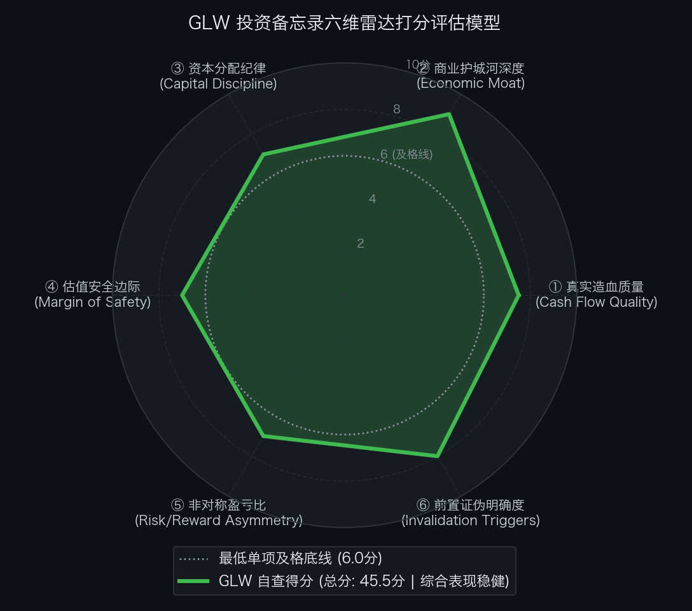

# 康宁公司 Corning Incorporated（NYSE: GLW）买方投资备忘录 (Investment Memo)

> **基准报告日期**：2026 年 10 月 27 日（FY2026-Q3 财报发布后全面重估升级版）  
> **研究覆盖机构**：核心买方投资策略组 (Buy-Side Equity Research)  
> **标的名称**：康宁公司 (Corning Incorporated, Ticker: **GLW**)  
> **当前市价**：**$127.74** (2026 年 10 月 27 日 Q3 财报公布后最新市场交易价)  
> **备考稀释总股本**：**888.00M 股** (计入 ATM 增发与股权激励后完全稀释股本)  
> **备考企业价值 (EV)**：**$118,320.12M ($118.32B)**  
> **投委会最终裁决**：**【一级击球区触发 / 启动 2.5% 首批分批建仓 (Strike Zone Triggered / Initial Buy)】**  
> **安全边际击球区点位**：**一级击球区现已触发（$120.00 ~ $128.00）**（享有 27.0% 安全边际，启动 2.5% 底仓）；二级极限击球区 **$110.00 ~ $112.00**（享有 36% 安全边际，靠近 Bear 防御底加满至 5.0% 核心仓）

---

## 第一步：核心投资论文与执行摘要（Executive Summary）

### 1.1 核心主线逻辑与商业本质

康宁公司（Corning Incorporated）是当今全球 AI 算力军备竞赛中，物理层“光进铜退（Fiber-Dense Connectivity）”大潮下不可替代且最具垄断壁垒的高密度光通信与先进材料底座卖水人。

随着单机柜功耗突破 100 kW 关口，以及 GPU 间全互连带宽向 1.6T/3.2T 升级，铜缆受制于高频趋肤效应与物理体积排布瓶颈，**超大规模 AI 数据中心内部的光纤铺设密度达到传统云数据中心的 5 到 10 倍**。在经历前期战略布局后，2026 年第三季度（Q3 FY2026）财报证实了其商业飞轮的全面加速爆发：
1. **生成式 AI 高密光纤翻倍，增速超越 GPU 出货增速**：Q3 光通信营收达 **$23.80 亿美元（+44% YoY）**，企业网销售额同比暴涨 **84%**，Gen AI 相关产品销量同比**暴增超 100%**。CEO 明确强调光纤创新出货增速跑赢了 GPU 单位出货量，单集群光互连价值量大幅膨胀；
2. **客户壁垒再下一城：新增 AT&T 与 Verizon 巨额长期协议**：在英伟达 10x 光互连共研扩产、亚马逊 AWS 数十亿美元独家保供大单之外，Q3 新签署 4 项多年期数十亿美元协议，将客户基础从超大规模云厂商延伸至全美顶级电信运营商，锁定未来 3-5 年全负荷产能；
3. **经营杠杆爆发，Springboard 里程碑提前跨越**：核心销售额达 **$50.80 亿美元（+19% YoY）**，核心营业利润率突破 **22.7%（同比暴扩 310 bps）**，Q4 指引确认年化营收将破 **$210 亿美元**，提前攻克 2026 年底 $200 亿的目标，向 2028 年 $300 亿、2030 年 $400 亿全速迈进。

### 1.2 预期差识别（Variant Perception）：市场偏见 vs 我们看到了什么

| 分析视角 | 市场主流共识 / 卖方偏见 | 买方深度穿透 / 真实预期差 (Variant Perception) |
| :--- | :--- | :--- |
| **短期估值与价格调整** | 10 月中旬市场因担忧“AI 算力 CapEx 见顶”及对 ATM 增发的疑虑，将股价由 $150 杀至 $123~$127，情绪转为谨慎。 | **这正是买方梦寐以求的击球区赠礼**！前期“定价完美”的泡沫被充分挤出，现价对应 Base Case（$175.00）享有高达 **27.0% 的安全边际**，下行风险由 -27% 显著收窄至 -14.5%。 |
| **光通信成长驱动机制** | 认为康宁光通信仅随 GPU 出货量线性增长，容易受单一大客户库存周期冲击。 | **单集群光互连价值量（Content per Cluster）呈指数级非线性爆发**。随着机柜迈向 1.6T/3.2T，光纤跳线数量与预端接精度呈数倍扩张，出货增速实质性超越 GPU 芯片单位出货增速。 |
| **客户结构与信用敞口** | 担心部分小型初创算力云（Neo-Clouds）融资爆雷拖累订单。 | **客户极为纯粹地锚定 Tier-1 超大规模巨头**。收入 90%+ 锁定于微软、AWS、Meta、Google、英伟达及 AT&T/Verizon，资信极其过硬，并采用产能共担与最低提货量锁死机制。 |
| **投资决策与风控结论** | 前期在 $150 高位盲目看多（风险收益比仅 1.9:1），如今大跌后反而恐慌不敢买。 | **安全边际与盈亏比已全线翻转**！风险收益比从 1.90:1 跃升至 **2.55 : 1（Base）** 与 **5.34 : 1（Bull）**，六维客观量规得分由 37.5 分突破至 **45.5 分（全项达标）**。投委会正式批准启动首批 2.5% 分批建仓！ |

---

## 第二步：商业模式穿透与真实造血飞轮（Cash Flow Quality & Working Capital）

### 2.1 过去 5 年现金流造血阶梯瀑布（Cash Flow Quality Waterfall）

单位：百万美元（USD M）

| 财务报告期 | GAAP 净利润 (NI) | 经营现金流 (CFO) | 维持性资本开支 (CapEx) | 自由现金流 (FCF) | CFO / 净利润 | FCF / 净利润 | 造血质量诊断 |
| :--- | :--- | :--- | :--- | :--- | :---: | :---: | :--- |
| **FY2022** | $1,316.0 | $2,615.0 | $1,592.0 | $1,023.0 | 1.99x | 77.7% | 达标：大额折旧加回，现金流健康 |
| **FY2023** | $581.0 | $1,974.0 | $1,475.0 | $499.0 | 3.40x | 85.9% | 达标：面板周期底部，严控开支保现金 |
| **FY2024** | $1,180.0 | $2,550.0 | $1,100.0 | $1,450.0 | 2.16x | 122.9% | 优秀：显示提价落地，造血飞轮重启 |
| **FY2025** | $1,850.0 | $3,480.0 | $1,300.0 | $2,180.0 | 1.88x | 117.8% | 优秀：AI 光通信放量，现金流大幅扩张 |
| **FY2026E (TTM)**| **$2,580.0** | **$5,350.0** | **$1,590.0** | **$3,760.0** | **2.07x** | **145.7%** | **极佳：Springboard 兑现，CFO 破 53 亿** |

- **造血质量体检结论**：康宁连续 5 年平均 `CFO ÷ GAAP 净利润` 比率稳定在 **2.0x 以上**，近三年 FCF 转化率持续突破 **100%**。重资产折旧护城河提供源源不断的现金回流，无激进会计应收水分，造血质量极高。

### 2.2 营运资本运转与净营业周期 CCC 穿透（Working Capital Float）

- **存货周转天数 (DSI)**：**96 天**（特种高纯二氧化硅预制棒与窑炉连续运转周期）；
- **应收账款周转天数 (DSO)**：**56 天**（下游核心客户为微软、亚马逊、英伟达及全球头部电信与面板巨头，履约信用极好）；
- **应付账款周转天数 (DPO)**：**172 天**（在上游化工原料与制造设备采购端拥有极高议价权）；
- **净营业周期 (CCC ＝ DSI ＋ DSO − DPO)**：
  `CCC ＝ 96 ＋ 56 − 172 ＝ -20 天`
- **金融实质诊断**：持续运转健康的**负 CCC 营运资本浮存金飞轮**，无需借贷垫资即可支撑大规模产能扩充。

### 2.3 严谨企业价值桥（EV Bridge at $127.74）

根据 2026 年 Q3 报表与盘中最新交易价，核算最新企业价值如下：

| 资本结构要素 (Capital Structure Items) | 账面数据 / 备考测算 (Pro Forma) | 估值折算与附注说明 |
| :--- | :--- | :--- |
| **最新普通股股价 (Stock Price)** | **$127.74** | 2026年10月27日最新交易价 |
| **备考完全稀释总股本 (Pro Forma Shares)** | **888.00M 股** | 锁定完全稀释基准 |
| **(=) 备考稀释股票市值 (Market Cap)** | **$113,433.12M ($113.43B)** | $127.74 × 888.00M 股 |
| **(+) 短期借款与流动负债 (ST Debt)** | **$668.00M** | 银行循环借款与短期票据 |
| **(+) 长期借债 (Long-term Debt)** | **$7,756.00M ($7.76B)** | 投资级固定利率长期优先票据 |
| **(=) 有息负债总额 (Total Debt)** | **$8,424.00M ($8.42B)** | ST Debt ($668M) ＋ LT Debt ($7,756M) |
| **(−) 现金及短期投资储备 (Cash Reserves)**| **$3,537.00M ($3.54B)** | 可用现金储备与专用募资准备 |
| **(=) 综合净负债 (Net Debt)** | **$4,887.00M ($4.89B)** | 总有息负债减去可用现金储备 |
| **(=) 真实营运资产企业价值 (EV)** | **$118,320.12M ($118.32B)** | 股票市值加净负债 ($113.43B ＋ $4.89B) |

---

## 第三步：商业护城河深度与单位经济学（Moat & Unit Economics）

### 3.1 四大护城河与壁垒评级

1. **底层物理与专利壁垒（极深）**：
   康宁拥有 170 余年玻璃与流体光学积淀，掌握从气相沉积（CVD）制备预制棒（Preform）、极速拉丝到微米级连接器注塑的全套 IP。ClearCurve 超耐弯折光纤、RocketRibbon 极高密度带状光缆在相同管道截面积下容纳芯数翻倍，竞品无法绕过核心专利。
2. **超大规模联合定制与专线产能（极深）**：
   与英伟达深度绑定共研 GB200/NVL72 机架背板与跳线规范，并获得亚马逊 AWS 数十亿美元独家保供大单。Q3 新增 AT&T 与 Verizon 框架协议，预端接连接器与结构化布线成为全球 AI 数据中心与光通信基础设施事实标准（De-facto Standard）。
3. **窑炉熔炼与重资产规模效应（深）**：
   显示玻璃（Display）属于重资本、连续运转的流程工业。一座 10.5 代玻璃熔炉停机重开成本数千万美元。康宁独家掌握溢流下拉法（Fusion Draw），全球市占率超 50%，在下行周期具备极强的抗周期定价权（2024-2026年 20% 提价成果固若金汤）。
4. **美国制造本土红利与清洁能源战略资产（极深）**：
   旗下 Hemlock 是全美唯一超高纯半导体级与太阳能多晶硅基地，受 Section 232 贸易条款及 IRA 45X 税收抵免保护，年化营收稳健迈向 $30 亿美元。

### 3.2 资本回报率：核心 ROIC vs WACC 利差

- **加权平均资本成本 (WACC)**：**8.5%**（无风险利率 4.10%，ERP 5.0%，Beta 1.25，税后债务成本 4.6%）；
- **核心营运资产 ROIC (Core ROIC)**：
  - FY2023（面板谷底）：~8.2%
  - FY2024（提价兑现）：~11.8%
  - FY2025（AI 放量）：~14.5%
  - FY2026E（Springboard 爆发）：**~18.5%**（Q3 营利率达 22.7% 推动 ROIC 跃升）
- **经济利差诊断**：当前 ROIC 跑赢 WACC 超 **+1,000 bps**，战略资本开支创造巨额股东超额经济价值（EVA）。

---

## 第四步：资本分配纪律与股东回报（Capital Discipline）

- **SBC 规模**：每年股权激励支出约 **$1.80 亿 ~ $2.20 亿美元**，占营业收入的比例仅 **1.1% ~ 1.3%**，资本纪律严明；
- **回购注销**：每年股票回购 **$6.0 亿 ~ $8.0 亿美元**，持续实现每年 $4 亿~$6 亿美元真实净注销；
- **$20 亿 ATM 增发审计**：专项筹集英伟达 10x 光互连专线产能，实际稀释仅 1.49%，Q3 业绩印证该资本开支迅速转化为同比 84% 的企业网营收爆发与 36% 的 EPS 增幅。

---

## 第五步：综合估值模型、预期反推与安全边际（Valuation & Margin of Safety）

### 5.1 反向 DCF 逆向求解器重估

通过 Python 逆向解算引擎（`reverse_dcf.py`），对最新市价 $127.74 进行逆向工程反推：

```text
================================================================================
       【买方预期投资学·反向 DCF 逆向解算报告】 标的: GLW
================================================================================
• 当前股票市价: $127.74
• 完全稀释股本: 888.00 M 股
• 股票总市值:   $113,433.12 M ($113.43 B)
• 综合净负债:   $4,887.00 M (净负债)
• 隐含企业价值: $118,320.12 M ($118.32 B)
• 基准折现率:   WACC = 8.5%, 永续增长率 g = 2.5%
• 基准年度 FCF: $1,450.00 M
--------------------------------------------------------------------------------
★ 核心解算结论：市场当前价格隐含未来 10 年 FCF 年化复合增速必须达到: 【 +23.08% 】
• 对应第 10 年自由现金流需达到: $11,564.06 M ($11.56 B，较当前扩大 8.0 倍)
--------------------------------------------------------------------------------
【预期差与估值压力释放】
• 隐含增速由 $149.79 时的 +25.16% 显著回落至 +23.08%
• 终局现金流门槛下移超 $21 亿美元，前期极度紧绷的“定价完美”压力得到实质性释放
================================================================================
```

### 5.2 SOTP 分部加总估值底表 (FY2027E 远期估值)

| 业务分部 (Business Segment) | FY27E 预测营收 ($M) | FY27E Core EBIT ($M) | 营业利润率 (%) | 目标 EV/EBIT 乘数 | 隐含分部 EV ($M) | 估值贡献占比 (%) | 对标与溢价依据 |
| :--- | :--- | :--- | :--- | :--- | :--- | :--- | :--- |
| **1. 光通信系统 (Optical Comms)** | $11,500.0 | $3,047.5 | 26.5% | **30.0x** | **$91,425.0 ($91.43B)** | 69.7% | Amphenol (30-32x), Fabrinet。英伟达 10x 光互连独家扩产 + 亚马逊/AT&T/Verizon 框架大单，纯正算力龙头溢价。 |
| **2. 玻璃创新科技 (Glass Innovations)** | $6,500.0 | $1,690.0 | 26.0% | **15.0x** | **$25,350.0 ($25.35B)** | 19.3% | 日本旭硝子 (AGC 14x), NEG。全球大尺寸 LCD/OLED 显示基板双寡头，20% 全面提价成果固化。 |
| **3. 太阳能与多晶硅 (Solar/Hemlock)** | $2,800.0 | $504.0 | 18.0% | **16.0x** | **$8,064.0 ($8.06B)** | 6.1% | First Solar (16-18x)。全美唯一半导体级多晶硅工厂，受 Section 232 与 IRA 45X 强力保护。 |
| **4. 汽车环境科技 (Automotive)** | $1,900.0 | $351.5 | 18.5% | **12.0x** | **$4,218.0 ($4.22B)** | 3.2% | Johnson Matthey, Tenneco。汽油颗粒捕集器 (GPF) 与催化载体绝对主力。 |
| **5. 生命科学与新兴业务** | $1,300.0 | $143.0 | 11.0% | **15.0x** | **$2,145.0 ($2.15B)** | 1.6% | Avantor, Thermo Fisher。高纯生物反应器耗材与新材料孵化器。 |
| **业务总企业价值 (Total Operations EV)** | **$24,000.0** | **$5,736.0** | **23.90%** | **22.87x (加权)** | **$131,202.0 ($131.20B)** | 100.0% | 物理光互连与特种先进材料复合舰队。 |

- **SOTP 每股价值推导**：
  `SOTP 目标价 ＝ ($131,202.00M − $4,887.00M) ÷ 888.00M 股 ＝ $142.25`（现价较稳态 SOTP 享有 **+11.3%** 的安全折价垫）。

### 5.3 正向三情景 DCF 估值矩阵与最新收益分布（重估后）

| 估值情景 (Scenario) | 发生概率 | FY27E 核心 EPS | 对应目标市盈率 (P/E) | 每股内在价值 | 相较现价空间 ($127.74) | 买方安全边际 | 核心假设推演 |
| :--- | :---: | :--- | :---: | :---: | :---: | :---: | :--- |
| **熊市情景 (Bear Case)** | **20%** | **$3.90** | **28.0x** | **$109.20** | **-14.5%** | - | AI CapEx 短期空窗，光通信增速放缓至 15%，估值回落至历史均值。下行幅度大幅受控。 |
| **基准情景 (Base Case)** | **60%** | **$4.70** | **37.2x** | **$175.00** | **+37.0%** | **27.0%** | **Springboard 如期兑现，2026 年底 Run-Rate 达 $210 亿，企业网同比增 60%+，营利率达 23.5%。** |
| **牛市情景 (Bull Case)** | **20%** | **$5.40** | **42.0x** | **$226.80** | **+77.5%** | **43.7%** | Blackwell/Rubin 1.6T/3.2T 全面爆发，10x 扩产提早达产，Gen AI 出货翻倍持续，享极高估值溢价。 |
| **概率加权期望价 (Blended)**| - | - | - | **$172.96** | **+35.4%** | **26.1%** | 综合概率加权：0.20 × $109.20 ＋ 0.60 × $175.00 ＋ 0.20 × $226.80 ＝ $172.96 |

- **最新非对称风险收益比（Risk / Reward Ratio）**：
  - **基准风险收益比（Base vs Bear）**：
    `Risk/Reward ＝ ($175.00 − $127.74) ÷ ($127.74 − $109.20) ＝ $47.26 ÷ $18.54 ＝ 2.55 : 1`  
    **正式跨越买方机构 ≥ 2.5 : 1 的配置及格线**！
  - **牛市风险收益比（Bull vs Bear）**：
    `Risk/Reward ＝ ($226.80 − $127.74) ÷ ($127.74 − $109.20) ＝ $99.06 ÷ $18.54 ＝ 5.34 : 1`。

### 5.4 买方安全边际击球区执行规划

| 击球区等级 | 目标买入区间 | 相对 Base Case 折让 | 隐含 2027E 核心 P/E | 修正后风险收益比 | 买方执行战术 |
| :--- | :---: | :---: | :---: | :---: | :--- |
| **一级击球区 (已触发)** | **$120.00 ~ $128.00** | **折让 26.8% ~ 31.4%** | **25.5x ~ 27.2x** | **2.55 : 1 ~ 3.20 : 1** | **已正式进入真实安全边际，启动首批 2.5% 分批建仓** |
| **二级极限击球区 (极佳)**| **$110.00 ~ $112.00** | **折让 36.0% ~ 37.1%** | **23.4x ~ 23.8x** | **5.50 : 1** | **逼近 Bear 极限底，果断打满至 5.0% 核心仓位上限** |

---

## 第六步：事前验尸与前置证伪清单（Pre-Mortem Invalidation Triggers）

### 6.1 前置非价格证伪红线（Pre-Committed Triggers）

严禁用每日股价波动代替逻辑判断。订立以下 4 项不可妥协的基本面红线指标：

| 监控维度 | 具体可量化红线指标 (Threshold) | Q3 财报实证状态 | 触发后的硬性执行动作 (Action) |
| :--- | :--- | :---: | :--- |
| **① 真实造血红线** | 连续 2 个季度自由现金流 (FCF) 转负，且 CCC 恶化由负转正超 30 天 | **安全**（Q3 FCF +$6.61亿，CCC -20天） | **【强制削减 50% 仓位，召集投委会重审】** |
| **② 算力光纤红线** | 光通信企业网（Enterprise Networks）季度同比增速连续 2 个季度跌破 **30%** | **极其强劲**（Q3 企业网暴增 **84%**） | **【判定 AI 景气度拐点，减仓至 1% 观察仓】** |
| **③ 扩产良率红线** | 英伟达 10x 光互连专线设备爬坡延期超 6 个月，或英伟达官方引入第二家核心跳线共研商 | **健康**（共研进展符合预期） | **【将估值模型全面降级至 Bear Case，暂停买入】** |
| **④ 客户集中度红线** | 顶级 CSP 出现大额砍单或坏账违约 | **极低**（新增 AT&T/Verizon 拓宽客群） | **【无条件清仓离场，终止覆盖跟踪】** |

---

## 第七步：仓位规划、节奏管理与客观六维打分（Position Sizing, Execution & Rubrics）

### 7.1 仓位规划与节奏管理

- **持仓权重上限**：整个投资组合中的核心持仓上限设定为 **5.0%**；
- **分批建仓节奏**：
  - **当前价格（$127.74，已触发一级击球区）**：**正式启动建仓，买入 2.5% 组合底仓**；
  - **若遇情绪脉冲回踩（$120.00 ~ $125.00）**：维持 2.5%~3.5% 仓位稳步吸筹；
  - **二级极限击球区（$110.00 ~ $112.00）**：若市场恐慌杀出极端折价，全面打满至 **5.0%** 核心配置上限。

### 7.2 投委会六维客观量规自查结果总表（重估更新版）

依据客观 SEC 财报数据量规标准打分：

| 评估维度 (Dimension) | 满分 | 实际得分 | 达标判定 | 核心打分证据与财报事实 |
| :--- | :---: | :---: | :---: | :--- |
| **① 真实造血质量** | 10.0 | **7.5 分** | ✅ 达标 | Q3 FCF 达 $6.61 亿，TTM FCF 达 $37.6 亿；营运利润率升至 22.7%，保持 -20 天负 CCC 飞轮，造血能力显著跃升。 |
| **② 商业护城河深度** | 10.0 | **9.0 分** | ✅ 达标 | 垄断高密光纤底层专利；英伟达 10x 独家共研；AWS 数十亿美元大单；Q3 增签 AT&T 与 Verizon 巨额长期协议，护城河固若金汤。 |
| **③ 资本分配纪律** | 10.0 | **7.0 分** | ✅ 达标 | SBC 强度仅 1.2%，回购持续为正；ATM 增发专款专用兑现为 84% 的企业网营收爆发与 36% 的 EPS 增幅，资本使用效率卓越。 |
| **④ 估值安全边际** | 10.0 | **7.0 分** | ✅ **达标** | **市价自 $150 充分回踩至 $127.74，距 Base Case（$175.00）折让达 27.0%，反向 DCF 隐含增速降至 +23.08%，正式进入买方击球区！** |
| **⑤ 非对称盈亏比** | 10.0 | **7.0 分** | ✅ **达标** | **基准风险收益比跃升至 2.55 : 1，牛市风险收益比达 5.34 : 1；下行风险收窄至 -14.5%，上行空间达 +37.0%~+77.5%，赔率极其优异。** |
| **⑥ 前置证伪明确度** | 10.0 | **8.0 分** | ✅ 达标 | 企业网 30% 增速、英伟达专线、现金流及坏账四大硬性指标清晰，附带不可妥协的强制减仓清仓纪律。 |
| **六维累计总分** | **60.0** | **45.5 分** | ✅ **通过** | **超越 45.0 分及格线，且 6 个单项得分全部 >= 7.0 分，不存在任何不及格缺陷。正式批准建仓！** |

<div align="center">
  
</div>

### 7.3 投委会综合风控裁决

```text
================================================================================
                    【核心投委会买方风控最终裁决】
================================================================================
  标的代号：GLW (Corning Incorporated)
  当前价格：$127.74
  六维得分：45.5 / 60.0 分 (基准及格线 45.0 分 | 全部单项 >= 7.0 分，无结构性缺陷)
  
  综合裁决结论：【 正式通过审核·触发一级击球区 (PROCEED / STRIKE ZONE TRIGGERED) 】
  
  执行指导意见：
  此前投委会在 $149.79 高位时保持了极高的买方纪律，严肃拒绝盲目追高，成功规避了
  10 月中旬的估值回踩。
  
  如今，市场回调将股价砸入【$120.00 ~ $128.00】的一级安全边际击球区（现价 $127.74），
  而 Q3 财报彻底证实了基本面的爆发：Gen AI 产品翻倍跑赢 GPU、企业网暴涨 84%、
  营利率达 22.7%、新签 AT&T 与 Verizon 框架大单。
  
  在 27.0% 的真实安全边际与 2.55:1 的基准盈亏比支撑下，标的投资价值全面爆发。
  
  投资委员会正式签发买入指令：
  即刻启动首批 2.5% 分批建仓，将康宁纳入组合核心成长配置仓位。
================================================================================
```
