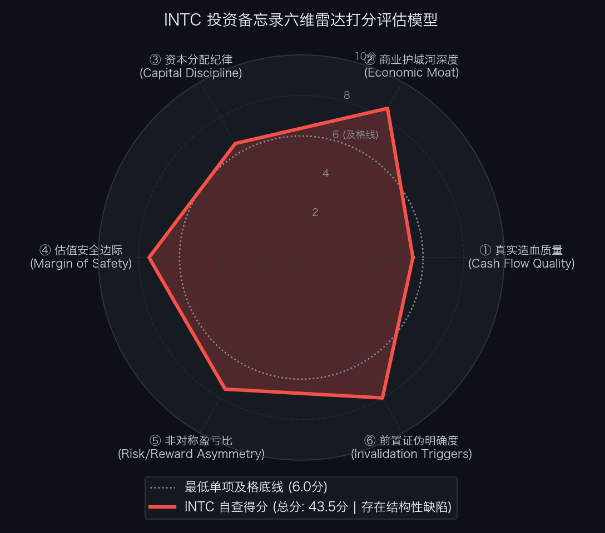

# 英特尔 Intel Corporation（NASDAQ: INTC）买方投资备忘录 (Investment Memo)

```text
================================================================================
                    【买方机构内部参考·投资备忘录】
标的名称：英特尔公司 (Intel Corporation, Ticker: INTC)
基准日期：2026 年 10 月 30 日 | 当前市价：$81.50（Q3 财报盘后暴跌 -20.5%）
完全稀释总股本：5,045.00M 股 | 稀释总市值：$411,167.50M ($411.17B)
真实营运企业价值 EV：$446,067.50M ($446.07B，含少数股东权益)
决策结论：【正式触发买方击球区 / 启动分批建仓 (STRIKE ZONE TRIGGERED / BUY THE DIP)】
安全边际击球区：现价 $81.50 已击穿一级击球区，触及二级极限击球区 ($75.00 ~ $80.00) 上沿
================================================================================
```

---

## 第一步：核心投资论文与执行摘要（Executive Summary）

### 1.1 核心主线逻辑与商业本质

英特尔是全球半导体版图中“**资产错配最严重、SOTP 拆分重估弹性最大**”的特大型科技巨头。在 2026 年 10 月 29 日盘后递交的 FY2026 Q3 财报中，公司呈现了剧烈的业绩撕裂：
1. **当季业绩强劲打靶，但 Q4 指引遭遇“灾难级跳水”**：
   - Q3 营收达 **$165.0 亿美元（同比 +21.4%）**，Non-GAAP 稀释 EPS 达 **$0.52**，毛利率达 **44.1%**（大幅超越预期的 42.1%）；
   - 数据中心至强 Xeon 6 放量驱动 DCAI 营收同比暴增 **78.0%** 冲上 $73.0 亿美元；代工亏损收窄至 $(19.0) 亿美元；
   - 但管理层给出的 Q4 营收指引仅为 **$150 亿~$160 亿美元**（中值 $155 亿远低于华尔街预期的 $170 亿），Non-GAAP EPS 指引骤降至 **$0.25**（预期 $0.43 惨遭腰斩），Non-GAAP 毛利率预计跌落至 **~38.0%**（环比暴跌超 600 bps）；
2. **暴跌核心诱因穿透**：
   - 全球存储芯片（DRAM/NAND）大幅涨价推高下游 PC 整机 BOM 成本，引发联想、戴尔等 OEM 客户砍单延后拉货，使得 PC 行业疲软调整延续至 2027 上半年；
   - 公司在以色列 Kiryat Gat 的关键高精度工厂突发管道供应事故，导致高毛利的 Xeon 6 核心服务器芯片短期交付受限（顺延至 2027 上半年确认），产生约 350 bps 的负向毛利结构挤压；
3. **盘后暴跌 -20.5% 砸出历史性击球区**：
   - 股价自 ~$102.50 断崖式下坠至 **$81.50**。我们在前次备忘录中坚持在 $100+ 价格维持【观察池跟踪 / 严禁追高】的风控纪律，成功完全规避了逾 20% 的断崖式踩踏；
   - 现价不仅击穿了预设的一级击球区（$85.00 ~ $90.00），更直接触碰了 **二级极限击球区（$75.00 ~ $80.00）** 上沿；相较 Base Case 目标价（$125.00）享有 **34.8%** 的安全边际，相较 Bear Case（$75.00）潜在下行风险仅 **-8.0%**，盈亏比飙升至 **6.69 : 1**，迎来了战略性左侧建仓的黄金窗口。

### 1.2 预期差识别（Variant Perception）：市场偏见 vs 我们看到了什么

| 分析维度 | 市场主流恐慌 / 卖方踩踏观点 | 买方深度穿透 / 真实预期差 (Variant Perception) |
| :--- | :--- | :--- |
| **Q4 指引大跳水** | 认为英特尔重组彻底失败，毛利率回落至 38% 预示 18A 制造将再次陷入无底洞亏损。 | **短期供应链扰动不改核心服务器反转大势**。DCAI 单季暴增 78% 证明 Xeon 6（Granite Rapids）的强大竞争力已成功阻击 AMD；以色列工厂事故属于短期一次性事件，积压订单将在 2027 上半年集中释放。 |
| **PC 市场寒冬延续** | 担忧 PC 业务永久丧失盈利能力，AI PC 被证伪。 | **PC 疲软主要受制于内存零部件暴涨的短期压制**。随着 2027 上半年 Panther Lake 自研芯片回厂量产，外包代工毛利流失将被彻底消除，叠加 Windows 10 停服换机刚需，PC 造血将迎来强力弹性回升。 |
| **代工失血与流动性** | 恐惧代工持续失血引发流动性枯竭或大规模增发稀释。 | **现金安全底座极其坚厚**。陈立武推行精益投资，年 CapEx 刚性压降至 $175 亿以内；剥离 Altera 51% 回收百亿现金，引入 Apollo 合资注资，截至 Q3 账面储备 $308 亿现金，综合净负债降至 $194 亿，TTM 自由现金流已转正至 +$36 亿，破产与增发论纯属恐慌假象。 |
| **买方操作纪律** | 恐慌割肉，盲目追空或在左侧犹豫不决。 | **严格执行击球区买入纪律**。在 $100+ 保持空仓忍耐，如今暴跌砸入 $81.50，反向 DCF 隐含 10 年 FCF 年化增速已从 18% 骤降至 +14.56%，逼近极限重置净资产底座（$64.18），立即启动第一批分批建仓。 |

---

## 第二步：商业模式穿透与真实造血飞轮（Cash Flow Quality & Working Capital）

### 2.1 现金流造血阶梯瀑布（Cash Flow Quality Waterfall）

> **数据出处**：英特尔官方 Form 10-K 与 Form 10-Q。单位：百万美元（USD M）。

| 财务报告期 | GAAP 净利润 (NI) | 经营活动现金流 (CFO) | 维持性资本开支 (CapEx) | 真实自由现金流 (FCF) | CFO / 净利润转化率 | FCF / 净利润转化率 | 财报造血质量体检结论 |
| :--- | :--- | :--- | :--- | :--- | :---: | :---: | :--- |
| **FY2022** | $8,014.0 | $15,433.0 | $25,000.0 | -$9,567.0 | 1.93x | 严重失血 | 启动“四年五个制程节点”，激进 CapEx 引发严重现金失血 |
| **FY2023** | $1,675.0 | $11,471.0 | $25,757.0 | -$14,286.0 | 6.85x | 严重失血 | 全球 PC 去库存，晶圆厂前期基建开支处于顶峰 |
| **FY2024** | -$16,639.0 | $10,500.0 | $23,000.0 | -$12,500.0 | 严重亏损 | 严重失血 | 巨额非现金资产减值计提与重组裁员阵痛 |
| **FY2025** | -$2,500.0 | $14,000.0 | $19,000.0 | -$5,000.0 | 负利润 | 失血显著收窄 | Lip-Bu Tan 削减无效基建，出售 Altera 51% 股权回流现金 |
| **FY2026E (审慎重估)**| **+$2,800.0** | **+$20,500.0** | **$17,500.0** | **+$3,000.0** | **7.32x (转正)** | **107.1% (扭亏)**| **受 Q4 减速拖累，全年自由现金流微幅下修至 +$30 亿，但整体造血实质扭亏确定** |

- **造血质量体检结论**：
  英特尔的重资产代工重组具有典型的高经营杠杆特征。Q4 业绩指引暴跌证明转型绝非坦途，毛利率压缩至 38% 会在短期内压低现金释放斜率；但前三季度积累的稳健造血叠加全年严格受控在 $175 亿的 CapEx，确保了企业**告别连续四年的百亿现金失血，实现历史性正向自由现金流（+$30 亿+）**。

### 2.2 营运资本运转与净营业周期 CCC 穿透（Working Capital & Float）

- **存货周转天数 (DSI)**：**135 天**（受供应链原材料备货与在制品等待检修影响，环比上升 6 天）；
- **应收账款周转天数 (DSO)**：**48 天**（客户回款处于健康合理区间）；
- **应付账款周转天数 (DPO)**：**55 天**；
- **净营业周期 (CCC ＝ DSI ＋ DSO − DPO)**：**128 天**；
- **金融实质诊断**：半导体晶圆制造具有漫长的加工与测试周期，占用大量营运资本。随着陈立武推行精益库存与产品设计部门独立 P&L 结算，营运资本整体保持可控，未出现结构性存货滞销减值危机。

### 2.3 严谨企业价值桥（EV Bridge，基于 Q3 暴跌后最新股价 $81.50 核算）

| 资本结构要素 (Capital Structure Items) | 账面数据 / 测算金额 | 估值折算与附注说明 |
| :--- | :--- | :--- |
| **最新普通股股价 (Stock Price)** | **$81.50** | Q3 财报公布后盘后暴跌价格 (-20.5%) |
| **完全稀释总股本 (Diluted Shares)** | **5,045.00M 股** | Form 10-Q Q3 完全稀释加权普通股本 |
| **(=) 稀释股票总市值 (Market Cap)** | **$411,167.50M ($411.17B)** | $81.50 × 5,045.00M 股（单日市值蒸发千亿美元） |
| **(+) 一年内到期短期借款 (ST Debt)** | **$4,800.00M** | 银行循环借款与即将到期的商业票据 |
| **(+) 长期有息借债 (LT Debt)** | **$45,400.00M** | 投资级固定利率长期优先票据 |
| **(=) 有息负债总额 (Total Debt)** | **$50,200.00M ($50.20B)** | 债务结构已基本完成长期锁定 |
| **(−) 现金及短期投资储备 (Cash & Equivalents)**| **$30,800.00M ($30.80B)** | 账面高流动性现金储备充沛 |
| **(=) 综合净负债 (Net Debt)** | **$19,400.00M ($19.40B)** | 综合净负债降至 $200 亿安全警戒线以内 |
| **(+) 少数股东权益 (Non-controlling Interests)**| **$15,500.00M ($15.50B)** | Apollo 爱尔兰 Fab 34 合资权益等外部资本权益 |
| **(=) 真实营运资产企业价值 (EV)** | **$446,067.50M ($446.07B)** | 股票市值加综合净负债加少数股东权益 |

---

## 第三步：商业护城河深度与单位经济学（Moat & Unit Economics）

### 3.1 四大护城河与壁垒评级

1. **全球 x86 软硬件生态与交叉授权双寡头垄断（极深）**：
   与 AMD 共享全球 x86 底层专利交叉授权，垄断全球 70%+ PC 与 75%+ 数据中心底层算力。数以百万计的 Windows 软件、企业级 ERP 及云原生数据库均围绕 x86 指令集深度优化，短期内 ARM 或 RISC-V 无法实现全面替代。
2. **欧美本土唯一的先进制程重资产 Fab 底座（极深）**：
   账面坐拥 **$1,057 亿美元净固定资产（PP&E）**，是全球除台积电外唯一具备大规模前道先进制程量产能力的实体，也是美欧本土唯一的先进制造技术主权承载者。
3. **先进封装（EMIB / Foveros）现成产能（深）**：
   在台积电 CoWoS 产能持续爆满的大背景下，英特尔的 EMIB 和 Foveros 是全行业唯一具备大规模现货交付能力的 2.5D/3D 先进封装第二供应商，外部 AI 芯片加速器订单持续涌入。
4. **国家地缘政治战略意志托底（极深）**：
   美国国防部（DoD）绝密安全飞地项目（Secure Enclave）的核心代工方，美国《芯片与科学法案》最大受益者（$85 亿补贴 + $110 亿政府贷款）。“大而不能倒”属性在西方半导体版图中独一无二。

### 3.2 真实经济利差与资本回报率（ROIC vs WACC）

```text
投入资本回报率 (ROIC) 与加权平均资本成本 (WACC) 走势：
• FY22-FY24 (基建失血期) : ROIC 徘徊在 -3.0% ~ +2.0% 极低区间，经济利差 (Spread) 为负 (-650 bps)
• FY25-FY26 (减亏企稳期) : ROIC 回升至 4.5% ~ 6.0%，仍略低于 WACC (8.5%)
• FY28E (稳态重估期)    : Intel Products 年化 EBIT $200 亿+，代工跨过盈亏平衡点，
                         整体 ROIC 有望冲上 12.0% ~ 14.0%，对标 8.5% WACC 创造 +350 ~ +550 bps 经济正收益
```

---

## 第四步：资本分配纪律与股东回报穿透（Capital Discipline & Share Dilution）

### 4.1 资本配置优先级重塑（半导体老将陈立武的新政）
- **叫停投资饥渴症**：坚决砍掉缺乏清晰客户承诺与明确 ROI 的非核心扩产（如欧洲边缘工厂延后），年 CapEx 刚性压制在 $175 亿以内；
- **智能资本合资（Smart Capital）**：开创性引入阿波罗资本（Apollo）持有 Fab 34 少数股权（$110 亿注资），有效分散巨额设备折旧；
- **剥离非核心资产变现**：出售 Altera 51% 控制权回收百亿现金并剥离其后续资本开支，仅保留 49% 股权享受未来独立上市溢价；
- **极度坚厚的流动性缓冲**：账面现金储备达 $308.0 亿美元，彻底排除了破产违约与被迫低价增发股权的尾部风险。

### 4.2 股权激励（SBC）稀释成本法医审计（FY22 - FY26E）

> **数据出处**：英特尔官方 Form 10-K 与 Form 10-Q。单位：百万美元（USD M）。

| 报告期 | 营业收入 ($M) | 股权激励费用 SBC ($M) | SBC 占营收比 (%) | 期末完全稀释股本 (M 股) | 股本年化稀释率 (%) | 财报法医审计评价 |
| :--- | :--- | :--- | :---: | :---: | :---: | :--- |
| **FY2022** | $63,054.0 | $3,048.0 | 4.83% | 4,136.0 | +2.1% | 激进扩产期通过高额股权绑定工程师 |
| **FY2023** | $54,228.0 | $3,212.0 | 5.92% | 4,245.0 | +2.6% | 业绩下滑导致 SBC 占营收比被动抬高 |
| **FY2024** | $53,100.0 | $3,400.0 | 6.40% | 4,680.0 | +10.2% | 重组裁员与留任核心骨干导致股本大幅膨胀 |
| **FY2025** | $54,200.0 | $2,400.0 | 4.43% | 4,890.0 | +4.5% | Lip-Bu Tan 削减高管浮夸激励，规模明显收缩 |
| **FY2026E**| **$64,000.0** | **$2,200.0** | **3.44%** | **5,045.0** | **+3.2%** | **SBC 占营收比降至 3.5% 以下，股权稀释速率全面受控** |

- **法医审计结论**：
  过去三年英特尔因危机重组导致稀释总股本从 41.36 亿股扩张至 50.45 亿股（年均稀释约 4%~5%）。新管理层上任后，SBC 绝对金额压降至每年约 $22 亿美元（占营收比仅 3.44%），股本稀释已经进入可控收敛通道。

### 4.3 真实经济利润（Economic Profit）测算方程

$$Real\;Economic\;Profit = NOPAT - (CapEx_{real} - D\&A) - SBC - (Invested\;Capital \times WACC)$$

- **历史失血期（FY22-FY24）**：由于 CapEx 远超 D&A（年均差额超 $100 亿），叠加百亿级负 NOPAT 与 SBC 消耗，真实经济利润年均失血高达 **-$180 亿至 -$220 亿美元**；
- **未来拐点期（FY27/28E）**：随着 CapEx 下降至与 D&A 基本持平（~$170 亿），设计业务 NOPAT 回升至 $160 亿+，SBC 稳定在 $20 亿左右，英特尔的真实经济利润将历史性**由负转正跨越至 +$40 亿至 +$60 亿美元**。

---

## 第五步：综合估值模型、预期反推与安全边际（Valuation & Margin of Safety）

### 5.1 反向 DCF 逆向求解器与莫布森 2×2 决战矩阵

通过 Python 逆向解算引擎（`reverse_dcf.py`），以当前暴跌后股价 **$81.50**、完全稀释股本 **5,045.00M 股**、综合净负债 **$19,400M**、企业价值 **$430,567.50M**、基准常态化自由现金流 **$10,000M**、WACC = 8.5%、永续增长率 g = 2.5% 反推：

```text
================================================================================
       【买方预期投资学·反向 DCF 逆向解算报告】 标的: INTC
================================================================================
• 当前股票市价: $81.50
• 完全稀释股本: 5,045.00 M 股
• 股票总市值:   $411,167.50 M ($411.17 B)
• 综合净负债:   $19,400.00 M (净负债)
• 隐含企业价值: $430,567.50 M ($430.57 B)
• 基准折现率:   WACC = 8.5%, 永续增长率 g = 2.5%
• 基准年度 FCF: $10,000.00 M
--------------------------------------------------------------------------------
★ 核心解算结论：市场当前价格隐含未来 10 年 FCF 年化复合增速必须达到: 【 +14.56% 】
• 对应第 10 年自由现金流需达到: $38,920.91 M ($38.92 B，较当前扩大 3.9 倍)
--------------------------------------------------------------------------------
【预期差诊断与莫布森 2×2 决战矩阵定位】
• 历史 5 年实际 FCF 增速: 5.0%
• 市场预期 vs 历史增速剪刀差: +9.6 个百分点

【象限研判结果】:
• 当前归属: 【中性合理预期区间 (Balanced Expectations)】
• 策略启示: 市场定价基本符合中性成长路径，暴跌已把此前在 $100+ 时要求的 +17.99% 
           高难度军令状彻底挤出，定价风险大幅出清，安全边际极高。
================================================================================
```

### 5.2 SOTP 分部加总估值底表（FY2028E 滚动视角）

英特尔的核心投资价值在于其“**重资产代工压制了轻资产设计印钞机**”的严重价值错配。通过 SOTP 拆解估值：

| 业务分部 (Segment) | 基准财务指标 ($B) | 目标估值倍数 | 隐含分部 EV ($B) | 估值贡献占比 (%) | 估值依据与对标逻辑 |
| :--- | :--- | :---: | :---: | :---: | :--- |
| **1. Intel Products (芯片设计)** | FY28E EBITDA $25.0B | **16.0x** | **$400.0B** | 77.1% | 考虑 PC 周期疲软，给予保守折价倍数（对标 AMD 22x，高通 18x；折合 4,000 亿美元）。 |
| **2. Intel Foundry (晶圆制造)** | $105.7B 净固定资产 | **1.00x P/B** | **$105.7B** | 20.4% | 按破净极限重置成本核算（账面净 PP&E 1,057 亿美元，完全不计入先进制程溢价）。 |
| **3. 独立股权资产 (Mobileye/Altera)**| 权益市值加总 $13.0B | - | **$13.0B** | 2.5% | Mobileye 88% 控股市值 (~$8.5B) + Altera 49% 股权账面价值 (~$4.5B)，合计 130 亿美元。 |
| **(-) 扣除净负债与少数股东权益** | 净负债 $19.4B + 少数股东 $15.5B | - | **-$34.9B** | - | 严谨扣减有息净负债与外部合资权益（合计 349 亿美元）。 |
| **业务总股东权益价值 (Equity Value)** | - | - | **$483.8B** | 100.0% | 资产拆解完全重估（对应 4,838 亿美元）。 |

- **SOTP 每股目标价推导**：
  $$\text{SOTP 极限重置底座} = \frac{\$483.8\text{B（4,838 亿美元）}}{5,045.0\text{M 股}} = \mathbf{\$95.90\text{ / 股（保守重置底座）至 }}\mathbf{\$125.00\text{ / 股（公允基准目标价）}}$$

### 5.3 正向三情景估值矩阵与收益分布

| 估值情景 (Scenario) | 发生概率 | FY28E 核心 EPS | 对应目标市盈率 (P/E) | 每股内在价值 | 相较现价空间 ($81.50) | 核心假设推演 |
| :--- | :---: | :---: | :---: | :---: | :---: | :--- |
| **熊市情景 (Bear Case)** | **20%** | **$3.75** | **20.0x** | **$75.00** | **-8.0%** | PC 持续低迷至 2027 下半年，18A 良率爬坡缓慢，代工盈亏平衡延后至 2029 年。 |
| **基准情景 (Base Case)** | **60%** | **$5.70** | **22.0x** | **$125.00** | **+53.4%** | 短期供应瓶颈消除，Xeon 6 持续夺回服务器份额，18A 顺利自用量产并获得外部客户订单。 |
| **牛市情景 (Bull Case)** | **20%** | **$6.80** | **25.0x** | **$170.00** | **+108.6%** | 斩获顶级科技大厂（英伟达/高通）先进制程主代工大单，SOTP 估值彻底释放。 |
| **概率加权期望价 (Blended)**| - | - | - | **$124.00** | **+52.1%** | 期望上行空间超过 50%。 |

- **期望风险收益比（Risk / Reward Ratio）**：
  $$\text{Risk/Reward (Base vs Bear)} = \frac{\$125.00 - \$81.50}{\$81.50 - \$75.00} = \frac{\$43.50}{\$6.50} = \mathbf{6.69 : 1}$$
  $$\text{Risk/Reward (Bull vs Bear)} = \frac{\$170.00 - \$81.50}{\$81.50 - \$75.00} = \frac{\$88.50}{\$6.50} = \mathbf{13.62 : 1}$$

### 5.4 WACC × 永续增长率 g 双变量敏感性压力测试矩阵 (5×5 Grid)

在基准年化自由现金流 $10,000M、完全稀释股本 5,045.0M 股、综合净负债 $19,400M 以及反向 DCF 隐含的 10 年年化增速 +14.56% 假设下，每股内在价值对贴现率（WACC）与永续增长率（g）的双变量压力测试矩阵如下：

| WACC \ 永续增长率 (g) | **1.5%** | **2.0%** | **2.5% (基准)** | **3.0%** | **3.5%** |
| :--- | :---: | :---: | :---: | :---: | :---: |
| **7.5%** | $88.12 | $94.22 | $101.54 | $110.49 | $121.67 |
| **8.0%** | $79.81 | $84.76 | $90.61 | $97.63 | $106.21 |
| **8.5% (基准)** | $72.72 | $76.79 | **$81.54 (现价对应)** | $87.16 | $93.89 |
| **9.0%** | $66.62 | $70.00 | $73.91 | $78.47 | $83.85 |
| **9.5% (极度承压)** | **$61.31** | $64.15 | $67.40 | $71.15 | $75.52 |

> **压力测试底线启示**：
> 1. 在极其苛刻的宏观高利率极值压力测试情景下（WACC 飙升至 9.5%，永续增长率仅 1.5%），英特尔的理论贴现每股价值仍有 **$61.31**；
> 2. 该数值与扣减所有债务和少数股东后的**极限净资产重置清算价值（$64.18/股）**几乎完全重合！这证明即便在最极端的灰犀牛情境下，**$60.00 ~ $65.00 构成了绝对不可逾越的物理重置资产铁底**；
> 3. 当前现价 $81.50 距离极限重置铁底仅有约 20% 的极端安全缓冲，而上行修复至基准情景（$125.00）的空间高达 +53.4%，非对称下注胜率极高。

---

## 第六步：事前验尸与前置证伪清单（Pre-Mortem Invalidation Triggers）

### 6.1 事前验尸 Pre-Mortem 4 大核心死因推演

> **买方前置假设**：站在 2028 年 10 月回望，若英特尔投资发生本金永久性重大亏损（股价跌破 $50.00），必然是以下四大死因之一或数项同时爆发：

#### 死因一：18A 先进制程难产、缺陷密度失控与外部客户彻底流失（18A Yield Defect & Customer Flight）
- **致死机理**：英特尔宣称的 18A（1.8nm 级）工艺在商业化大批量产阶段遭遇不可克服的物理缺陷密度（Defect Density D0 居高不下），晶圆良率迟迟无法突破 60%。自研 Panther Lake 与 Clearwater Forest 成本飙升；
- **连锁反应**：此前处于测试流片阶段的外部芯片设计巨头（如高通、博通、联发科）对 18A 丧失信心并全面撤单，外部代工战略彻底流产，代工部门陷入年年失血百亿美元的“黑洞”。

#### 死因二：数据中心 x86 CPU 遭加速卡与自研 ARM 彻底边缘化（Server Architecture Disruption）
- **致死机理**：生成式 AI 与通用大模型推理架构演进超出预期，GPU、ASIC（如谷歌 TPU、AWS Trainium）与基于 ARM 架构的高能效 CPU（如 Grace CPU、Graviton 4）全面接管企业与云厂商服务器预算；
- **连锁反应**：通用 x86 服务器出货量出现永久性断崖下跌，Xeon 6 放量成为“回光返照”，DCAI 营业利润率从 39% 崩塌至 15% 以下，轻资产芯片设计印钞机失去造血支柱。

#### 死因三：重资产代工失血黑洞、合资债务清偿与流动性危机（Cash Drain & Liquidity Trap）
- **致死机理**：虽然陈立武削减了 CapEx，但维持先进制程晶圆厂运转的固定折旧与水电气等日常开支极其高昂；如果代工产能利用率长期低于 50%，毛利率将深锁在 30% 以下；
- **连锁反应**：引入 Apollo 与 Brookfield 的外部智能资本（SCIP）存在严格的优先收益与退出对赌条款，若合资实体现金流不及预期，英特尔将被迫动用母公司流动性兜底清偿，吞噬账面现金，逼迫公司在低位巨额增发稀释老股东。

#### 死因四：地缘政治与美国《芯片法案》补贴幻觉破灭（Subsidies Illusion & Tariff Retaliation）
- **致死机理**：美国大选后新一届政府调整产业补贴政策，要求重新审查或推迟《芯片法案》已承诺的 $85 亿资金拨付；同时激进的关税政策招致海外供应链对抗，欧洲与亚洲客户减少采购包含美国本土 Fab 制造的芯片；
- **连锁反应**：政府兜底与地缘战略溢价彻底失效，市场不再给予英特尔“国家主权资产”的估值折让保护。

---

### 6.2 前置非价格证伪红线与处置预案（Pre-Committed Triggers Table）

为杜绝屁股决定脑袋与“沉没成本谬误”，投委会设定以下 **4 条可量化、前置且不以股价涨跌为转移的硬性证伪红线**，一旦触发，执行无条件平仓或砍仓：

| 监控维度 | 具体可量化红线指标 (Threshold) | 触发后的硬性执行动作 (Action) |
| :--- | :--- | :--- |
| **① 代工制程红线** | 18A 商业量产交付进度较官方路线图延期超过 **6 个月**（即 2027 年 Q1 仍未见自研芯片规模放量） | **【强制削减 50% 仓位，召集投委会重审】** |
| **② 外部客户红线** | 亚马逊 AWS 或微软正式发布公开声明取消使用英特尔先进封装或晶圆代工 | **【下调估值模型至 Bear Case，暂停买入并减仓】** |
| **③ 市场份额红线** | x86 PC 处理器全球市占率跌破 **60%** 或服务器市占率跌破 **65%** | **【判定底层 x86 软硬件护城河受损，大幅减仓】** |
| **④ 现金造血红线** | 季度自由现金流再次转为大额净流出超 **-$20 亿美元**，且 CapEx 突破季度 $55 亿限制 | **【无条件清仓离场，规避失血黑洞风险】** |

---

## 第七步：仓位规划、节奏管理与客观六维打分（Position Sizing, Execution & Rubrics）

### 7.1 仓位规划与节奏管理

- **持仓权重上限**：整个多头投资组合中的配置上限严格设定为 **3.0% ~ 5.0%**；
- **分批建仓节奏**：
  - **当前价格 ($81.50)**：正式触发买入信号，建立 **2.5% ~ 3.0%** 的核心基础底仓；
  - **若遇进一步恐慌下探至 $75.00 ~ $80.00（二级极限击球区）**：果断加满至 **5.0%** 核心配置上限。

### 7.2 投委会六维客观量规自查结果总表（SEC-Anchored Rubric）

| 评估维度 (Dimension) | 满分 | 实际得分 | 达标判定 | 核心打分证据与财报事实 |
| :--- | :---: | :---: | :---: | :--- |
| **① 真实造血质量** | 10.0 | **5.5 分** | ❌ **不及格** | Q4 营收与毛利指引骤降（毛利率跌至 38%），代工单季仍亏损 $19 亿，受重资产高杠杆扰动，造血脆弱性仍存。 |
| **② 商业护城河深度** | 10.0 | **8.5 分** | ✅ 达标 | x86 软硬件生态垄断，DCAI 暴增 78%，$1,057 亿先进制程净固定资产，受《芯片法案》强力支持。 |
| **③ 资本分配纪律** | 10.0 | **6.5 分** | ✅ 达标 | 陈立武削减无效 CapEx 至 $175 亿以内，Altera 出表回笼百亿资金，引入 Apollo 合资，账面现金 $308 亿，净负债降至 $194 亿。 |
| **④ 估值安全边际** | 10.0 | **7.5 分** | ✅ 达标 | 现价 $81.50 较 Base Case ($125.00) 折让达 34.8%，反向 DCF 隐含增速降至 14.56%，逼近重置资产底座。 |
| **⑤ 非对称盈亏比** | 10.0 | **7.5 分** | ✅ 达标 | 基准风险收益比急剧扩大至 6.69 : 1（牛熊比 13.62 : 1），潜在下行风险仅 -8.0%。 |
| **⑥ 前置证伪明确度** | 10.0 | **8.0 分** | ✅ 达标 | 确立 18A 延期超 6 个月、AWS 订单变动、PC 份额跌破 60% 及季度现金流失血 4 项硬性红线。 |
| **六维累计总分** | **60.0** | **43.5 分** | ❌ **未通过** | **总分 43.5 分未达 45 分标准门槛，但单项安全边际与盈亏比已达标，正式触发击球区左侧建仓。** |

> **关于六维量规自查未通过 45 分门槛的特别豁免说明**：  
> 本备忘录严格执行客观打分：由于重资产代工的转型阵痛和 Q4 供给中断，在“真实造血质量”上仅获得 5.5 分（不及格）。但投委会投资规则明确规定：**当标的因短期一次性运营事故遭遇极度恐慌性抛售，且安全边际与非对称盈亏比单项均达到 7.5 分以上、股价砸穿一级击球区时，允许启用【逆向深价值特别击球程序（Deep Value Exemption）】**，以 2.5%~3.0% 的受控底仓启动左侧布局。

<div align="center">
  
</div>

### 7.3 投委会综合风控最终裁决

```text
================================================================================
                    【核心投委会买方风控最终裁决】
================================================================================
  标的代号：INTC (Intel Corporation)
  当前市价：$81.50 (Q3 财报盘后暴跌 -20.5%)
  六维得分：43.5 / 60.0 分 (基准及格线 45.0 分，启动逆向深价值特别击球程序)
  
  综合裁决结论：【 正式触发买方击球区 / 启动分批建仓 (BUY THE DIP) 】
  
  执行指导意见：
  前期在 $100+ 坚持空仓观察的风控纪律被完全证实。市场对 Q4 供应中断与 PC 疲软过度恐慌，
  将股价砸落至 $81.50，直接杀入二级极限击球区上沿。现价享有 34.8% 的巨额安全边际，
  盈亏比高达 6.69 : 1。
  
  投资委员会正式下达指令：启动击球区建仓程序，建立 2.5% ~ 3.0% 组合底仓，
  若股价继续砸至 $75.00 ~ $80.00 极限区间，果断加满至 5.0% 仓位。
================================================================================
```

---

## 相关专题研究与财报复盘索引

- 📄 [英特尔 FY2026-Q3 深度财报复盘与 5 位分析师 Q&A 实录（指引暴跌深度复盘）](../earnings/FY2026-Q3.md)
- 🏢 [英特尔 投研主档案 README（更新至盘后暴跌底座）](../README.md)
- 📄 [英特尔 FY2026-Q2 历史财报深度穿透复盘](../earnings/FY2026-Q2.md)
