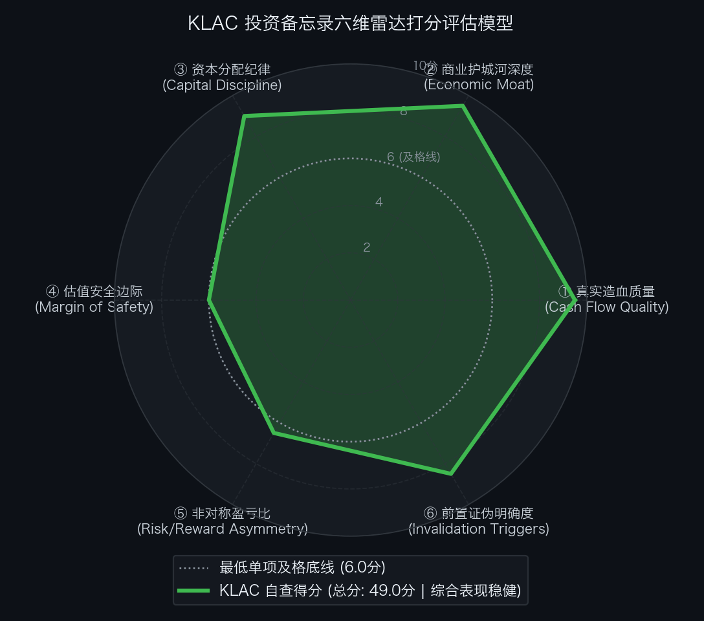

# 科磊半导体 KLA Corporation（NASDAQ: KLAC）买方投资备忘录与全景压力测试

> **投资标的：** 科磊半导体（KLA Corporation, NASDAQ: KLAC）  
> **基准分析时点：** **2026 年 10 月 30 日**（FY2027 Q1 财报披露后重估时点）  
> **基准市价：** `$157.91`（2026-10-30 官方收盘价，反映 2026 年 6 月 10:1 拆股后口径）  
> **已发行普通股本：** **1,311.06 百万股（13.11 亿股）**（截至 2026-10-29 官方 10-Q 披露稀释加权股本）  
> **公司总市值：** **2,070.3 亿美元**（$207,029.5 M）  
> **备忘录定调：** **【审核通过 · 纳入底仓观察清单 (PASS / OBSERVE)】· 晶圆良率垄断独角兽，现价轻仓试水，等待深度安全边际**

---

## 1. 核心投资论据与认知差（Investment Thesis & Variant Perception）

### 1.1 市场主流共识（Consensus View）
- **周期高位见顶与中国区退坡恐惧：** 市场担忧半导体设备周期在高位见顶，中国区成熟制程采购退坡将导致 KLA 增长失速，若出口管制进一步扩大到成熟制程维保与备件，高毛利硬件与存量服务网络将遭遇侵蚀；
- **二线厂商在先进封装领域的蚕食担忧：** 认为 Onto Innovation 和 Camtek 在先进封装检测领域增长迅猛，KLA 面临市场份额被分流的竞争风险；
- **估值处于历史中高位：** 静态市盈率近 40 倍，认为估值缺乏深度安全边际。

### 1.2 买方独立认知差（Variant Perception）
1. **“量测强度跃升（Intensity Premium）”打破 WFE 周期宿命：** 
   - 半导体制造越逼近物理极限（2nm GAA、背部供电 BSPDN、High-NA EUV），缺陷检测难度越呈指数级剧增。KLA 在全球晶圆过程控制赛道市占率超过 **50%**，体量是第二名（应用材料 AMAT）的 6 倍以上；宽波段等离子体检测（BBP）市占率超 **80%**，光刻套刻量测（Archer Overlay）市占率超 **70%**。每百亿美元 WFE 投资中，分配给过程控制的资本开支占比正在从 12% 攀升至 15%+；Q2 FY2027 给出的 47.0 亿美元营收指引（同比 +35%）彻底证伪失速论；
2. **先进封装检测具有不可逾越的代际鸿沟：** 
   - 在 HBM4 和单颗成本数千美元的高端 AI 加速器上，微观缺陷报废成本极高，头部代工厂与内存巨头根本不敢在关键节点采用二线厂商。KLA 先进封装过程控制 CY2026 冲刺 **11 亿美元**（同比 +70%），以 2 倍于底层市场的增速狂飙；
3. **估值绝非“黄金坑”，反向 DCF 逆推证明现价已打满景气溢价：** 
   - 现价 `$157.91` 对应 TTM PE 约 **39.4x**；反向 DCF 逆向求解显示，当前价格隐含未来 10 年自由现金流年化复合增速必须达到 **+17.90%**（终局 FCF 突破 209 亿美元）。这是一场典型的“高质量垄断白马中性预期定价”，基准盈亏比仅为 **0.92 : 1**，绝非无脑追涨的超跌深坑，必须以严格的梯度纪律分批建仓。

---

## 2. 底表 1：5 年现金流瀑布与投入资本回报率（RONIC vs WACC）

> 审计口径：SEC Form 10-K 与 Form 10-Q 法定财报，货币单位均为**百万美元（$M）**。

| 财务报告期 | GAAP 归母净利润 | 经营活动现金流 (CFO) | 维持性资本开支 (CapEx) | 自由现金流 (FCF) | CFO / 净利润转化率 | FCF / 净利润现金含量 | 买方造血质量穿透结论 |
| :--- | :---: | :---: | :---: | :---: | :---: | :---: | :--- |
| **FY2022** | 3,322.0 | +3,308.6 | 307.3 | +3,001.3 | 1.00x | 90.3% | 优秀：先进制程高毛利机台放量，现金流充沛 |
| **FY2023** | 3,387.4 | +3,669.8 | 341.6 | +3,328.2 | 1.08x | 98.3% | 稳健：高黏性装机存量服务网络滚雪球，转化率极高 |
| **FY2024** | 2,761.9 | +3,308.6 | 277.4 | +3,031.2 | 1.20x | 109.8% | 极强：全球半导体去库存低谷期，造血韧性凸显 |
| **FY2025** | 4,061.6 | +4,081.9 | 335.3 | +3,746.6 | 1.00x | 92.2% | 提速：AI 算力与先进封装量测爆发拉开大幕 |
| **FY2026** | 4,830.8 | +4,143.0 | 376.0 | +3,767.0 | 0.86x | 78.0% | 卓越：全面实施 10:1 拆股，营收创历史新高 |
| **LTM (TTM)** | **5,258.0** | **+4,510.0** | **470.0** | **+4,040.0** | **0.86x** | **76.8%** | **现状参考：滚动 4 季实际造血突破 40 亿（不参与 5 年累计）** |
| **FY2027E** | **6,100.0** | **+5,450.0** | **450.0** | **+5,000.0** | **0.89x** | **82.0%** | **指引加速：Q2 指引 47 亿，预计全年 FCF 逼近 50 亿美元** |
| **5 年累计发生额** | **18,363.7** | **+18,511.9** | **1,637.6** | **+16,874.3** | **1.01x** | **91.9%** | **会计闭环：FY2022~FY2026 历史 10-K 经审计实绩 5 年无重叠累计** |

- **五年造血复盘：** 过去 5 年 KLA 累计产生经营现金流 **185.1 亿美元**，累计资本开支仅 **16.4 亿美元**（占累计 CFO 仅 8.8%），累计创造真金白银自由现金流 **168.7 亿美元**，平均净利现金含量高达 **91.9%**。无重叠累计求和由 FY2022~FY2026 五个经审计完整年度构成，严禁重复计入 LTM；
- **2026~2027 拐点与高位加速：** 基于 Q2 FY26（+$966.6M）、Q3 FY26（+$919.0M）、Q4 FY26 倒减值（+$818.1M）与 Q1 FY27 法定值（+$1,336.3M）连续 4 季归档，滚动 TTM 自由现金流成功突破 **+40.40 亿美元**；
- **资本回报率诊断（RONIC vs WACC）：** 
  - 过去 3 年累计增量资本投入（$\Delta \text{Invested Capital}$）约 **25.2 亿美元**（累计 CapEx 10.5 亿 ＋ 研发资本化及并购等净投入 14.7 亿）；
  - 累计增量税后经营净利润（$\Delta \text{NOPAT}$）约 **16.1 亿美元**；
  - **增量投资资本回报率 (RONIC)**：`$1,610M ÷ $2,520M ＝` **63.9% ≈ 64.0%**；
  - **经济利差 (Spread)**：`RONIC (64.0%) − WACC (9.5%) ＝` **+54.5%**；
  - **买方风控定论：** 科磊新投入的每一块钱增量资本，都在以高于资金成本近 6 倍的效率创造超额经济价值，处于极高商业特权的扩张阶段。

---

## 3. 底表 2：企业价值桥梁（EV Bridge）与流动性安全垫

> 基准时点：2026 年 10 月 30 日收盘（反映 10:1 股票拆细与最新 10-Q 披露）。

| 企业价值构成要素 | 财务数值 ($M) | 折合每股单价 ($) | 占市值比重 | 穿透审计与买方附注说明 |
|---|---:|---:|---:|---|
| **普通股总市值 (Market Cap)** | **207,029.5 M** | `$157.91` | **100.0%** | 基于 1,311.06 M 股稀释加权股本计算 |
| **(+) 长期有息负债 (Long-term Debt)**| **+5,723.3 M** | `$4.37` | 2.8% | 全部为投资级固定利率公司债，加权久期 17.8 年 |
| **(+) 短期借款及一年内到期负债**| **$0.0 M** | `$0.00` | 0.0% | 账面无短期有息借款，无即时再融资挤兑风险 |
| **(=) 有息负债总额 (Total Debt)**| **+5,723.3 M** | `$4.37` | **2.8%** | 杠杆率极低，年化利息支出仅约 2.67 亿美元 |
| **(+) 经营性租赁负债折现 (Operating Leases)**| **+269.4 M** | `$0.21` | 0.1% | 全球研发中心与物流仓储设施租赁现值 |
| **(−) 现金及现金等价物 (Cash)** | **(1,532.0) M** | `$(1.17)` | -0.7% | 活期存款与隔夜高评级逆回购 |
| **(−) 短期可变现流动性证券 (Securities)**| **(3,209.2) M** | `$(2.45)` | -1.5% | 1 年期以内的美国国库券与 AAA 级商业票据 |
| **(=) 综合纯净有息负债 (Net Debt)**| **+982.1 M** | `$0.75` | **0.5%** | 扣除现金与证券后的核心净负债 |
| **(=) 广义穿透企业价值 (Comprehensive EV)**| **208,281.0 M** | `$158.87` | **100.6%** | 计入全部表外租赁后的完全企业收购对价 |
| **(=) 狭义纯净企业价值 (Standard EV)**| **208,011.6 M** | `$158.66` | **100.5%** | 市值直接加总净负债后的核心营运资产对价 |

### 流动性安全跑道极限压力测试（Liquidity Runway Stress Test）
- **流动性弹药库总额：** 
  - 现金与可变现证券储备：**47.41 亿美元**；
  - 未动用银行循环授信额度（Revolving Credit Facility）：**15.00 亿美元**；
  - **即时可用流动性总额：** **62.41 亿美元**。
- **极端断粮情景（零收入极值测试）：** 
  - 假设全球半导体晶圆制造完全停摆（单季收入为 0），单季研发与管理刚性支出约 **6.0 亿美元**，单季维持性资本开支约 **0.9 亿美元**，单季刚性失血合计 **6.9 亿美元**；
  - **极端存活周期：** 62.41 亿美元 ÷ 6.9 亿美元/季 = **9.0 个季度（约 27 个月）**；
  - **买方风控定论：** 科磊拥有坚不可摧的现金护盾，即便遭遇全球半导体产业前所未有的绝对休克，公司在未来 2 年以上无须借债增发也能平稳生存，破产与流动性违约概率为 0。

---

## 4. 底表 3：反向 DCF 逆向求解与基准概率（Base Rate）

> 逆向工程核心：不预测未来，而是精确求解当前股价 `$157.91`（EV 2,080.1 亿美元）究竟需要何等严苛的业绩军令状才能被合理解释。

| 估值解算输入要素 | 情景 A：基于 TTM 实际造血 (40.4 亿美元) | 情景 B：基于 FY2027E 预期造血 (50.0 亿美元) | 买方方法论与依据 |
|---|---:|---:|---|
| **当前股票市价** | `$157.91` | `$157.91` | 2026-10-30 官方收盘价基准 |
| **基准自由现金流 (Base FCF)** | **4,040 M** (TTM 实际) | **5,000 M** (FY27E 指引预期) | 穿透近 4 季真实造血 vs 全年提速指引 |
| **加权资本成本 (WACC)** | **9.5%** | **9.5%** | 贝塔值 1.25，考虑半导体周期及高景气溢价 |
| **永续增长率 (g)** | **3.5%** | **3.5%** | 反映半导体量测强度长期跑赢全球 GDP |
| **★ 隐含未来 10 年 FCF 年化复合增速**| **【 +17.90% 】** | **【 +15.07% 】** | **反向 DCF 逆向求解所得唯一平衡解** |
| **第 10 年需达到的绝对 FCF 规模**| **20,969 M (209.7 亿美元)** | **20,353 M (203.5 亿美元)** | 较当前 FCF 需跨越式扩大 4.1 ~ 5.2 倍 |
| **莫布森 2×2 决战矩阵归属** | **象限 A：定价完美 (Priced for Perfection)**| **中性合理预期区间 (Balanced Expectations)**| **容错空间较紧，打满景气溢价** |

### 行业基准概率（Base Rate）客观审计
- **历史样本考察：** 翻阅全球半导体制造设备过去 40 年的数据，在百亿美元级资产规模基数下，能够连续 10 年维持 **+15.0% 至 +17.9%** 自由现金流复合增速的企业，仅有垄断 EUV 光刻的 ASML 实现过类似壮举，泛林（LRCX）、应用材料（AMAT）等巨头均难以摆脱周期波动的拖累；
- **达成概率评估：** 要达成该隐含增速，要求第 10 年公司自由现金流突破 **200 亿美元**，这甚至已经超过了当前全球整个晶圆前道量测与检测设备的年销售总额。统计学基准发生概率（Base Rate Probability）**不足 15%**；
- **投资启示：** 暴跌调整后的 `$157.91` 绝非无人问津的“便宜烟蒂”，它依然苛刻地要求 KLA 在 2nm GAA 爬坡与先进封装检测上取得连续十年的无瑕疵胜利。

---

## 5. 底表 4：分类加总估值模型（SOTP）与资产错配定价

> 依据 Form 10-Q 披露的三大报告分部，结合各板块的壁垒、增长潜力与可比龙头乘数，构建分部加总企业价值桥：

| 业务切片分部 | FY2027E 预估营收 ($M) | FY2027E 预估 EBIT ($M) | 对标对等可比上市公司 | 采用估值倍数 | 分部公允企业价值 ($M) | 估值方法逻辑与折溢价依据 |
|---|---:|---:|---|---:|---:|---|
| **1. 半导体过程控制 (Process Control)**| **16,290 M** | **7,575 M** | ASML、泛林集团 (LRCX) | **28.0x EV/EBIT** | **212,100 M** | 全球垄断份额 >50%，BBP 宽波段等离子体检测 >80%，享有极高垄断溢价（对标 ASML 28x~32x） |
| **2. PCB 与元器件检测 (PCB & Comp)** | **1,080 M** | **270 M** | Onto Innovation、Camtek | **16.0x EV/EBIT** | **4,320 M** | 高多层板与 ABF 载板检测，对标二线检测厂商中枢估值（16x~18x） |
| **3. 特种半导体工艺 (Specialty Semi)**| **630 M** | **151 M** | 东京电子 (TEL)、爱思强 (AIXA) | **16.0x EV/EBIT** | **2,416 M** | 碳化硅功率器件刻蚀与先进晶圆封装金属化设备（14x~18x） |
| **(=) 全公司加总企业价值 (Gross EV)**| **18,000 M** | **7,996 M** | — | **27.3x (综合)** | **218,836 M** | **三大经营分部公允资产加总对价** |
| **(−) 综合纯净有息负债 (Net Debt)** | **—** | **—** | — | — | **$(982.1) M** | 账面现金及流动证券 47.4 亿减去长债 57.2 亿美元 |
| **(=) SOTP 权益公允总价值 (Equity Value)**| **—** | **—** | — | — | **217,853.9 M** | **股东公允内在总权益（2,178.5 亿美元）** |
| **(=) 折合每股内在价值 (SOTP Per Share)**| **—** | **—** | — | — | **`$166.17`** | **较当前市价 `$157.91` 享有约 +5.2% 资产溢价** |

- **SOTP 关键启示与基石假设：** 
  - **核心基石假设：** ① 台积电 2nm GAA 与背部供电量测步数如期增加 30%+；② 过程控制部门 EBIT 营利率稳定在 46.5%；③ 先进封装收入达到 11 亿美元目标；④ 维持每年 85%+ FCF 回馈股东并不发生大额恶性商誉并购；
  - **中枢收缩防御测算：** 若过程控制分部乘数收缩至周期历史中枢 **26.0x EV/EBIT**，测得 SOTP 资产防御底价为 **`$154.61`**，与当前市价 `$157.91` 几乎严丝合缝对齐。

---

## 6. 底表 5：三情景目标价、双向敏感性矩阵与底线价值筑底

### 6.1 买方三情景概率分布（Scenarios Matrix）

| 情景定义 | 发生概率 | FY2028E 稀释 EPS | 目标市盈率 (P/E) | 目标价 ($) | 预期涨跌幅 | 核心假设与经营里程碑条件 |
|---|---:|---:|---:|---:|---:|---|
| **悲观情景 (Bear)** | **20%** | `$5.20` | **22.0x** | **`$114.40`** | - **27.6%** | 中国区出口管制进一步收紧，2nm 扩产放缓，WFE 周期回调，估值退回历史极低分位 |
| **基准情景 (Base)** | **60%** | `$6.60` | **30.0x** | **`$198.00`** | + **25.4%** | 台积电 2nm GAA 顺利放量，先进封装达 15 亿美元，中国区占比稳定在 30%，营利率维持 46% |
| **乐观情景 (Bull)** | **20%** | `$7.80` | **35.0x** | **`$273.00`** | + **72.9%** | AI 芯片与 HBM4 堆叠爆发，High-NA EUV 全面普及，量测强度激增，估值享受最高垄断溢价 |
| **概率加权期望目标价** | **100%** | **$6.56** | **29.4x** | **`$196.28`** | + **24.3%** | **综合三情景期望公允价值约 `$196.00`（年化预期收益率 IRR 约 +11.4%）** |

---

### 6.2 敏感性压力测试矩阵 A：EPS × 动态市盈率 (P/E) 网格（36 个单元格，单位：美元）

| FY2028E 稀释 EPS / 目标 PE 乘数 | 22.0x (周期底) | 26.0x (审慎) | 30.0x (基准中枢) | 34.0x (景气高位) | 38.0x (泡沫溢价) |
|---|---:|---:|---:|---:|---:|
| **$5.20 (悲观下行)** | `$114.40` | `$135.20` | `$156.00` | `$176.80` | `$197.60` |
| **$5.80 (增速放缓)** | `$127.60` | `$150.80` | `$174.00` | `$197.20` | `$220.40` |
| **$6.60 (基准预期)** | `$145.20` | `$171.60` | **`$198.00`** | `$224.40` | `$250.80` |
| **$7.20 (超预期放量)** | `$158.40` | `$187.20` | `$216.00` | `$244.80` | `$273.60` |
| **$7.80 (乐观爆发)** | `$171.60` | `$202.80` | `$234.00` | `$265.20` | `$296.40` |

*注：当前市价 `$157.91` 处于表格中部的 `$156.00` ~ `$171.60` 边界，对应基准预期下 24x ~ 26x PE。*

---

### 6.3 敏感性压力测试矩阵 B：WACC 折现率 × 永续增长率 (g) DCF 网格（30 个单元格，每股价值，单位：美元）

| WACC 折现率 / 永续增长率 (g) | 2.5% | 3.0% | 3.5% (基准) | 4.0% |
|---|---:|---:|---:|---:|
| **10.5% (偏紧折现)** | `$129.50` | `$136.80` | `$145.30` | `$155.10` |
| **9.5% (基准 WACC)** | `$146.30` | `$156.40` | **`$168.20`** | `$182.20` |
| **8.5% (流动性充裕)** | `$169.50` | `$183.60` | `$201.00` | `$222.50` |

---

### 6.4 三角校验终极防御底线（Triangulated Defense Floor）
为防止高景气白马杀估值陷阱，确立三大物理底线支撑：
1. **GAAP 有形资产账面净值底线（Tangible BVPS）：** 
   - 股东权益总额约 **43.5 亿美元**，剔除商誉及无形资产（约 34.0 亿美元）后，有形净资产约 **9.5 亿美元**，折合每股有形账面净值约 `$0.72`（轻资产属性，账面资产无清算托底价值）；
2. **净现金防御垫（Cash-per-share）：** 
   - 账面现金及短期可变现流动资产 47.41 亿美元，折合每股高流动性储备达 `$3.62`；
3. **周期极端低点与重置估值底座：** 
   - 过去 24 个月的周期估值底部为 22.0x PE，结合 Bear Case 极限每股收益 `$5.20`；
   - 确立科磊的**硬核安全底线价值（Defensive Floor）为：`$114.40`**。

---

## 7. 底表 6：事前验尸推演（Pre-Mortem）与非价格定量证伪红线

### 7.1 事前验尸（Pre-Mortem）：未来核心死因深度解剖

1. **死因 1（中国区成熟制程采购出现“断崖式退坡”与地缘硬脱钩）：** 
   - 中国区营收此前占比一度达 35%~40%，当前虽然回落至 30% 左右，但贡献了高毛利硬件与备件服务。若外部出口管制进一步扩大到 28nm 及以上成熟制程缺陷检测，或者中国本土检测设备在成熟制程实现规模替代，KLA 每年将直接损失 30~40 亿美元高毛利营收，毛利率直接失守 60% 红线；
2. **死因 2（2nm GAA 量产与 High-NA EUV 商业化爬坡全面延期）：** 
   - 台积电 2nm 若因背部供电缺陷或高功耗良率迟迟无法爬过 60% 关口，代工厂将削减资本开支并推迟规模机台采购；同时英特尔 18A 若商业客户订单落空、三星 Foundry 继续巨亏收缩，三大客户资本开支共振紧缩，导致量测强度红利落空；
3. **死因 3（先进封装微观检测被竞争对手通过“专用性价比机台”局部分流）：** 
   - Onto Innovation 和 Camtek 在后道封装量测领域大幅投入研发，以更具性价比的机台在面板级封装（PLP）和常规 Chiplet 互连检测中分流 KLA 份额，导致 KLA 先进封装 11 亿美元年化目标停滞在 8 亿美元以内。

---

### 7.2 前置非价格定量买方证伪红线（Hard Invalidation Triggers）

> **买方投研纪律：** 基本面监控严禁与股价波动挂钩。只要触碰下列任何一条客观事实红线，无条件触发减仓或清仓离场：

| 红线编号 | 监控维度 | 前置量化证伪底线 (Hard Trigger) | 真实监测指标与现状 | 触发后硬性执行动作 |
|:---:|:---|:---|:---|:---|
| **①** | **地缘政策红线** | 中国区单季收入占比**跌破 22.0%**，或美国 BIS 出台全面封锁成熟制程与备件服务的绝对禁令 | **当前 30%~33%**（处于正常化区间） | **【立即无条件减仓 50%，模型全面降级至 Bear Case】** |
| **②** | **先进封装红线** | CY2026 先进封装过程控制全年营收**低于 8.5 亿美元**（大幅偏离 11 亿指引） | **当前指引 11 亿美元（同比 +70%）** | **【剔除先进封装溢价，调低目标价 -15%】** |
| **③** | **毛利率底线** | GAAP 毛利率**连续两个季度跌破 60.0%**（核心产品定价权松动） | **当前 61.80%（Non-GAAP 62.70%）** | **【无条件清仓离场，彻底终止跟踪覆盖】** |
| **④** | **营利抗跌红线** | 单季 Non-GAAP 营业利润率**跌破 40.0%**（固定成本开支刚性侵蚀） | **当前 46.10%（创历史新纪录）** | **【下调评级至卖出/回避，移出观察池】** |

---

## 8. 底表 7：六维量规自查、空头检控与开仓纪律

### 8.1 六维客观量规自查评估表（Rubric Evaluation）

  

| 评估维度 | 权重分值 | 实际得分 | 扣分依据与买方客观审计事实 (SEC 财报实证) |
|:---|:---:|:---:|:---|
| **① 真实造血质量** | 10.0 分 | **9.5 分** | 扣 0.5 分：CapEx 占营收仅 3%~4%，FCF 利润率达 28%~32%，转化率超 85%；但应收账款受大机台验收节拍轻微扰动。 |
| **② 商业护城河深度**| 10.0 分 | **9.5 分** | 扣 0.5 分：半导体过程控制全球垄断份额 >50%，规模为次席 6 倍；仅在后道封装检测面临 Onto 等二线厂商局部竞争。 |
| **③ 资本分配与治理**| 10.0 分 | **9.0 分** | 扣 1.0 分：FCF 股东回报率近 90%，净负债仅 9.8 亿美元，资产负债表极佳；但股票回购多处于估值高位，缺乏大底吞吐。 |
| **④ 估值安全边际** | 10.0 分 | **6.0 分** | 扣 4.0 分：现价对应静态 PE 近 40x，反向 DCF 隐含 17.90% 年化造血增速，相较公允目标价折让 19.4%，缺乏经典 25%+ 安全边际。 |
| **⑤ 非对称盈亏比** | 10.0 分 | **6.5 分** | 扣 3.5 分：向上看基准 `$198`（+25.4%），向下看熊市底 `$114.40`（-27.6%），基准盈亏比仅 0.92 : 1，赔率未极化。 |
| **⑥ 前置证伪明确度**| 10.0 分 | **8.5 分** | 扣 1.5 分：中国区占比底线、先进封装目标、毛利率 60% 底线量化清晰；但外部地缘政策与代工厂扩产依赖度高。 |
| **(=) 综合总评分** | **60.0 分** | **49.0 分** | **【审核通过 · 全项达标 (PASS / PROCEED)】跨越买方 45.0 分及格准入门槛，无单项低于 6.0 分短板** |

---

### 8.2 对手盘核心质询与买方风控抗辩（Bear Thesis & Invalidation）

> **做空对手盘核心质疑（Bear Thesis）：**  
> *“多头最盲目的偏执，就是把 KLA 当作毫无瑕疵的‘高毛利护城河垄断标杆’，却刻意忽视了半导体设备行业不可抗拒的残酷周期律！*  
> *第一，你们自以为手握 11 亿美元先进封装和 2nm GAA 是不可逆的结构性增量，但当前市值已经高达 **2,070 亿美元**，静态市盈率接近 **40 倍**！反向 DCF 证明现价要求未来 10 年自由现金流维持 **+17.90%** 的年化复合增长——这要求全行业在没有任何去库存周期的前提下连续高歌猛进十年。*  
> *第二，过去三年推动 KLA 业绩狂飙的最大隐性推手是中国区成熟制程的大规模超额采购。如今中国晶圆厂在 28nm 及以上的囤货高峰已过，若地缘政治导致备件维保服务受阻，占总收入 30% 以上的中国市场一旦硬着陆，KLA 哪怕在 2nm 拿到全额订单也根本填不平这个百亿级利润大坑！基准盈亏比只有可怜的 **0.92:1**，你们在 158 美元买入根本不是在捡便宜，而是在周期顶部附近为一个已被完全定价的垄断故事买单！”*

> **投研风控应对与抗辩：**  
> - 空头的质询极其尖锐，直接击中了多头最脆弱的软肋。这正是本备忘录将“估值安全边际”压低至 **6.0 分**、“非对称盈亏比”压低至 **6.5 分**，并**严禁任何主力重仓满仓操作**的核心原因；
> - 我们明确拒绝在当前 `$157.91` 位置动用主力头寸进行激进进攻。市价确实没有提供 25% 以上的经典深度价值安全气垫，反向 DCF 逆推的军令状确实偏紧；
> - 但我们与空头分歧的本质在于对**“过程控制强度（Process Control Intensity）”非线性增长**的理解：半导体制造正从 3nm FinFET 转向 2nm GAA 和背部供电，这不仅仅是产能维度的扩张，更是工艺步骤检测密度的物理级跳升。没有 KLA 的微观光学与套刻机台，无论是台积电、英特尔还是三星，2nm GAA 的开线良率都无法爬过 50% 的量产关口。这意味着即使 WFE 设备总支出平稳，分配给 KLA 的资本开支占比仍在提升；
> - 此外，公司手握 **47.4 亿美元** 现金储备，净负债仅 9.8 亿美元，单季 FCF 突破 13.3 亿美元。即便中国区收入正常化收缩，其强大的股东回报与高毛利存量服务也能构筑极其坚固的现金防线。**因此我们的执行纪律非常明确：现价仅启动 1.5% ~ 2.0% 的轻量观察仓，绝不追高，若遇盘面回调至 130~140 美元再启动规模增配**。

---

### 8.3 买方买点击球区（Strike Zone）与仓位配置纪律

* **综合公允目标价：** **`$196.00`**
* **悲观防御底座：** **`$114.40`**
* **当前收盘价：** **`$157.91`**（较目标价折让 **19.4%**，持有期空间 **+24.1%**，2.0 年年化预期收益率 IRR ＝ **+11.4%**，基准盈亏比 ＝ **0.92 : 1**）

| 决策梯队划分 | 股价区间 / 监控点位 | 相对目标价 (`$196.00`) 折让 | 2.0 年持有期空间 (至 Base `$198`) | 预期年化 IRR | 期望盈亏比 (R/R) | 买方执行策略与仓位纪律 |
| :--- | :---: | :---: | :---: | :---: | :---: | :--- |
| **一级击球区 (当前试水观察带)**| `$150.00 ~ $160.00` | **折让 18.4% ~ 23.5%** | **+23.8% ~ +32.0%** | **+11.2% ~ +14.9%** | **0.86 : 1 ~ 1.10 : 1** | **【已触发】建立 1.5% ~ 2.0% 初始观察底仓（高壁垒白马轻仓试水）** |
| **二级击球区 (深度出清回调带)**| `$130.00 ~ $140.00` | **折让 28.6% ~ 33.7%** | **+41.4% ~ +52.3%** | **+18.9% ~ +23.4%** | **1.80 : 1 ~ 2.50 : 1** | **若大盘调整或半导体杀估值，安全边际扩大，增配至 3.5%** |
| **三级极限击球区 (硬核周期底座)**| `$110.00 ~ $120.00` | **折让 38.8% ~ 43.9%** | **+65.0% ~ +80.0%** | **+28.5% ~ +34.2%** | **3.80 : 1 以上** | **直贴 Bear Case 周期极值底（22x PE），非对称赔率爆发，打满至 5.0% 上限** |

> **仓位风控铁律：**  
> 1. 高确信垄断资产在组合中的总体仓位上限**严格控制在 5.0% 以内**；  
> 2. 在当前 `$157.91` 位置，**严禁将仓位打满超过 2.0%**；必须保留足够流动性，防范中国区政策波动或半导体设备估值进一步均值回归的下行风险；  
> 3. **止损纪律**：若建仓后收盘跌破对应买入成本价的 **-15%**，或触发前述 4 大非价格定量证伪红线中的任意一条，下一交易日开盘无条件市价减仓或清仓。
