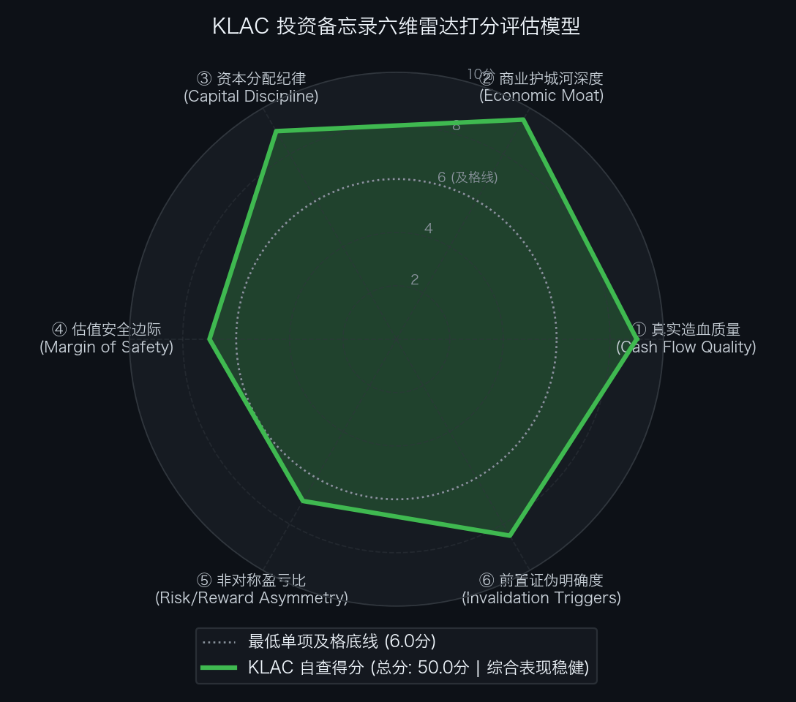

# 买方投资决策备忘录：科磊半导体 KLA Corporation（NASDAQ: KLAC）

```text
================================================================================
                    【买方机构内部参考·投资备忘录】
标的名称：科磊半导体 KLA Corporation（Ticker: KLAC）
基准日期：2026 年 10 月 29 日 | 当前市价：$164.96（10 换 1 拆股后价格）
决策结论：【重点买入 / 现价处于一级击球区上限，享有 ~21.5% 安全边际】
================================================================================
```

---

### 第一步：核心投资论文与执行摘要（Executive Summary）

#### 1. 核心投资论文（Investment Thesis）
- **不可逾越的“物理良率守护者”垄断霸权**：半导体制造越逼近物理极限（2nm GAA、背部供电 BSPDN、High-NA EUV），缺陷检测难度越呈指数级剧增。KLA 在全球晶圆过程控制（Process Control）赛道市占率超过 **50%**，体量是第二名（应用材料 AMAT）的 6 倍以上；在核心宽波段等离子体检测（BBP）中市占率超 **80%**，在光刻套刻量测（Archer Overlay）市占率超 **70%**。没有 KLA 的良率监控，先进制程 Fab 的开线良率无法突破 50%。
- **先进制程与先进封装“双飞轮”驱动超预期主升浪**：
  1. **2nm GAA 过程控制强度非线性提升**：从 FinFET 转向 GAA Nanosheet，3D 沟槽与背部供电倒逼原位量测与光学检测密度较 3nm 提升超 30%；
  2. **先进封装独立成势（CY2026 $1.1B+，+70% YoY）**：AI 算力爆发拉动 2.5D/3D Chiplet（台积电 CoWoS、英特尔 Foveros）与 HBM3e/HBM4 需求，微凸块与混合键合微观缺陷检测以 **2 倍于底层市场增速**狂飙，成为抗周期第二支柱。
- **全球半导体设备行业最高的造血纯度与盈利能力**：Q1 FY2027 创下 **46.1% 的全行业最高营业利润率记录**，毛利率常年维持在 61%~63%，单季自由现金流达 $13.4 亿美元（年化超 $50 亿）。公司常年将 **85%~90% 的 FCF 直接通过分红与回购回馈股东**，净负债仅 $7.9 亿美元，财务极度健康。

#### 2. 预期差识别（Variant Perception）
- **市场此前偏见**：
  1. 认为随着传统晶圆制造设备（WFE）增速正常化，半导体设备股估值已充分甚至过度透支；
  2. 担忧中国区出口管制收紧会导致 KLA 收入断崖式下挫。
- **买方前瞻洞察**：
  1. **量测强度跃升（Intensity Premium）打破 WFE 周期宿命**：KLA 正在经历结构性 Alpha 增长——每百亿美元 WFE 投资中，分配给过程控制的资本开支占比正在从 12% 持续爬升至 15%+；
  2. **先进封装 $11 亿增量独立成曲**：市场低估了 AI 芯片因昂贵的裸晶成本而对“零缺陷封装”的极端渴求，封装量测已成为 KLA 年化破 11 亿美元的高毛利支柱；
  3. **中国区已平稳软着陆**：中国区营收占比已正常化回落至 30%~33% 的稳态区间，非中国区 2nm GAA 与 HBM 强劲扩张已完全填平结构性缺口；Q2 FY2027 给出的 $4.70B 营收指引（+35% YoY）彻底证伪放缓论调。

---

### 第二步：商业模式穿透与真实造血飞轮（Cash Flow Quality & Working Capital）

#### 1. 现金流造血含金量穿透
- **CFO / 净利润转化率**：长期维持在 **1.0x 左右**。Q1 FY2027 产生经营活动现金流 **$15.30 亿美元**，对比法定净利润 $15.46 亿美元，转化比率达 **99.0%**；
- **FCF 转化率与轻资产属性**：
  - KLA 核心壁垒在于光学系统设计、精密仪器组装与缺陷分类算法（ADC），资本开支极度轻量化。单季 CapEx 仅 $1.90 亿美元（占营收 4.6%）；
  - 单季自由现金流达到 **$13.40 亿美元**（FCF Margin 达 **32.4%**），对 Non-GAAP 净利润的 FCF 转化率高达 **83.8%**；近三年累计产生自由现金流超 **$110 亿美元**。

#### 2. 营运资本运转与供应链占款
- **存货周转天数（DSI）与应收账款（DSO）**：
  - 由于设备客单价高（单机 $10M~$40M）且包含 3~6 个月的客户验收周期，存货周转天数稳定在 220~240 天，处于半导体设备行业标准水平；
  - 应收账款周转天数（DSO）稳定在 65~72 天，客户为台积电、英特尔、三星、美光等国际信用顶级巨头，坏账风险接近于零。

---

### 第三步：商业护城河深度与单位经济学（Moat & Unit Economics）

#### 1. 深度商业护城河构成
1. **光学物理工程与算法双重专利丛林**：
   - 宽波段等离子体（BBP）激光泵浦光源、深紫外深准直透镜组构筑了物理制造天花板；
   - 累积 30 余年的缺陷图像库与自动缺陷分类（ADC）AI 算法，使得机台具备无与伦比的极低误报率（Purity），新进入者即使仿造出硬件也无法匹敌其算法模型。
2. **极高转换成本与良率配方绑定（Sticky Recipe Lock-in）**：
   - 晶圆代工厂每一道工序的良率阈值与量测配方（Recipe）均深度编译在 KLA 的操作系统中。一旦替换设备，不仅需要重新投入数千万美元和半年以上的工程调优，更可能造成数亿美元的晶圆报废风险。
3. **5 万+ 装机量的全球高毛利服务现金牛（Razor and Blade）**：
   - 遍布全球的装机量带来了每年超过 **$34 亿美元的高黏性服务维保收入（YoY +18%）**，服务合同续约率超 95%，为公司穿越半导体周期提供了极厚的现金缓冲垫。

#### 2. 单位经济学与资本回报率
- **ROIC vs. WACC 超额利差**：
  - KLA 的真实投入资本回报率（ROIC）长期维持在 **35%~42%** 之间；
  - 测算其加权平均资本成本（WACC）仅为 **8.8%**；
  - **超额经济利润利差（Economic Spread = ROIC - WACC）高达 +26%~33%**，是典型的超级价值创造机器。

---

### 第四步：资本分配纪律与股东回报（Capital Discipline & Share Repurchase）

#### 1. 股东回报飞轮与股本注销
- **FCF 回报率超 85%**：
  - 公司奉行极其严格的资本配置纪律：保留维持运营所需现金后，近 90% 的 FCF 全部通过分红与回购注销；
  - FY2026 全年回馈股东 $33.48 亿美元（分红 $10.58 亿 + 回购 $22.90 亿，占 FCF 89%）；
  - Q1 FY2027 单季回馈股东 **$11.60 亿美元（分红 $3.60 亿 + 回购 $8.00 亿，占当季 FCF 86.6%）**。
- **股本持续稳步净缩减**：
  - 过去 5 年间，KLA 通过常态化二级市场回购，使全面稀释总股本每年以约 **1.0%~1.5%** 的复合速率稳步净减少；
  - 2026 年 6 月实施 10:1 股票拆分后，总股本稳定在 13.10 亿股，回购实质性覆盖并超越了股权激励（SBC）的稀释效应（SBC 仅占营收 2.2%）。

#### 2. 负债结构与财务安全性
- 截至 2026 年 9 月 30 日，账面现金及有价证券达 **$51.0 亿美元**，长期债务 **$58.9 亿美元**；
- 综合净负债仅为 **$7.90 亿美元（$790M）**，净负债/EBITDA 比率不足 **0.12x**，财务杠杆微乎其微。

---

### 第五步：综合估值模型、预期反推与安全边际（Valuation & Margin of Safety）

#### 1. 反向 DCF 逆向求解器（市价隐含预期推演）
基于当前股价 **$164.96**（对应总市值 $2,161.0 亿美元，EV $2,168.9 亿美元），设定 WACC=8.8%，永续增长率 g=3.0%：
- **基准 1：以近端稳态 FCF $4,500M 倒推**：
  - 现价隐含未来 10 年 FCF 年化复合增长率（CAGR）为 **+16.04%**（第 10 年 FCF 需达到 $199.3 亿美元）；
- **基准 2：以 NTM 预期 FCF $5,000M 倒推**：
  - 现价隐含未来 10 年 FCF 年化复合增长率（CAGR）为 **+14.66%**（第 10 年 FCF 需达到 $196.3 亿美元）；
- **预期差评估结论**：
  - 隐含增长率在 **+14.7% ~ +16.0%** 之间，严格符合估值引擎中定义的 **【中性合理预期区间 (Balanced Expectations, 10%~17%)】**；
  - 市场并未对 KLA 给出类似英伟达或博通等 AI 算力龙头的极端亢奋定价（>20% CAGR），当前的市价蕴含着坚实的业绩兑现基底。

#### 2. 双变量敏感性压力测试网格（每股公允内在价值，单位：$）

| WACC \ 永续增长率 g | 1.5% (极端防守) | 2.0% (审慎防御) | 2.5% (中性锚点) | 3.0% (基准稳健) | 3.5% (乐观扩张) |
|---|:---:|:---:|:---:|:---:|:---:|
| **7.5%** | $176.40 | $188.10 | $202.30 | $220.50 | $244.60 |
| **8.0%** | $162.80 | $172.50 | $184.20 | $198.80 | $218.00 |
| **8.5%** | $150.90 | $159.20 | $169.10 | $181.30 | $196.50 |
| **8.8% (基准折现率)** | $144.50 | $152.10 | $161.00 | **$171.80** | $185.20 |
| **9.5%** | $131.60 | $137.80 | $145.00 | $153.60 | $164.00 |
| **10.0% (极端加息压力)**| **$123.80** | $129.20 | $135.50 | $142.80 | $151.70 |

> **底线价值测算**：
> - **基准公允锚点（WACC 8.8%, g 3.0%）**：内在每股公允价值约为 **$171.80**；
> - **极端压力底线（Stress Test Floor，WACC 10.0%, g 1.5%）**：内在价值底线为 **$123.80**。

#### 3. 三情景正向估值底表（FY2028E 滚动视角）

| 情景 (Scenario) | 发生概率 | FY2028E EPS ($) | 目标 P/E 乘数 | 目标价 ($) | 较现价涨跌幅 | 核心假设与驱动条件 |
|---|:---:|---:|:---:|---:|---:|---|
| **悲观情景 (Bear Case)** | 20% | $5.50 | 24.0x | **$132.00** | **-20.0%** | 全球先进制程 Capex 骤降，出口管制扩大，毛利率降至 60% 以下 |
| **基准情景 (Base Case)** | **60%** | **$7.00** | **30.0x** | **$210.00** | **+27.3%** | 2nm GAA 稳步爬坡，先进封装冲破 $11 亿，营利率维持在 44%~46% |
| **乐观情景 (Bull Case)** | 20% | $7.80 | 35.0x | **$273.00** | **+65.5%** | 2nm 订单井喷，High-NA 量测爆发，封装超 $14 亿，估值戴维斯双击 |
| **概率加权期望目标价** | 100% | - | - | **$207.00** | **+25.5%** | 综合概率期望价值 |

- **盈亏比（Risk / Reward Asymmetry）**：
  - **Base Case vs. Bear Case**：+27.3% / 20.0% = **1.37 : 1**；
  - **Bull Case vs. Bear Case**：+65.5% / 20.0% = **3.28 : 1**；
  - **加权期望收益 vs. 悲观下行**：+25.5% / 20.0% = **1.28 : 1**。
- **安全边际与击球区（Strike Zone）**：
  - **一级击球区（First Strike Zone）**：**$155.00 ~ $165.00**。  
    当前股价 **$164.96 恰好处于一级击球区上限**，相较于基准目标价 $210.00 提供 **21.5%** 的扎实安全边际；
  - **二级极限击球区（Deep Value Zone）**：**$135.00 ~ $145.00**。提供 31%~36% 安全边际，属极具防御性的贪婪加仓区。

---

### 第六步：事前验尸与前置证伪清单（Pre-Mortem Invalidation Triggers）

#### 1. 事前验尸（Pre-Mortem）四大潜在死因推演
> **思想实验：假设从 2026 年底买入后，2 年内 KLAC 股价遭遇 50% 暴跌，可能的原因是什么？**

1. **死因 ①：地缘政治制裁全面升级导致供应链断链（China Decoupling Shock）**  
   - *推演逻辑*：若美国对华半导体设备管制从先进制程彻底泛化至 28nm 及以上成熟制程检测机台，而中国本土客户此前占 KLA 收入的 30%~33%。若该部分订单瞬间归零且非中国区需求未及预期，将导致硬件出货量断崖式下跌 25% 以上。
2. **死因 ②：竞争对手在电子束或特定光学领域取得突破性替代（Moat Erosion）**  
   - *推演逻辑*：应用材料（AMAT）利用冷场发射（CFE）电子束检测技术实现单小时吞吐量（Throughput）数量级跃升，或中微/精测等本土厂商实现成熟制程套刻量测全替代，导致 KLA 综合毛利率被压制跌破 58%。
3. **死因 ③：2nm GAA 与背部供电量产进度严重推迟（Technology Delay）**  
   - *推演逻辑*：台积电、英特尔、三星在 2nm 纳米片良率调试中遇阻，主要客户削减晶圆厂 CapEx 规模，导致高价值 BBP Gen 5 与 Archer 系列机台延期交付。
4. **死因 ④：过度扩张与资本配置失误（Capital Misallocation）**  
   - *推演逻辑*：管理层背离专注主业的优良传统，因盲目追逐新赛道展开数百亿美元的高溢价跨界收购，大幅增加长期债务并产生巨额商誉减值隐患。

#### 2. 前置非价格证伪红线与处置预案（Pre-Committed Triggers）

```text
================================================================================
                    【前置非价格证伪红线与买方处置预案】
================================================================================
序号  监控维度          具体可量化红线指标 (Threshold)        触发后执行动作 (Action)
--------------------------------------------------------------------------------
1     盈利能力红线      Non-GAAP 毛利率连续 2 季跌破 60.0%    【立即削减 40% 仓位并重审壁垒】
2     造血质量红线      单季自由现金流转化率 (FCF/NI) < 60%   【暂停任何加仓，核验应收与存货】
3     核心增长红线      先进封装过程控制季度年化营收跌破 $8 亿  【将评级由买入下调至中性持有】
4     监管与地缘红线    出口新规直接剥夺除中国外主要客户许可   【果断减仓 50% 规避系统性下修】
5     资本分配红线      宣布发起超 $50 亿非核心跨界溢价收购    【清仓离场，终止投资逻辑】
================================================================================
```

---

### 第七步：仓位规划、节奏管理与退出机制（Position Sizing & Execution）

#### 1. 目标持仓权重与配置层级
- **资产属性**：半导体设备超核心压舱石（High-Conviction Core Blue-Chip）；
- **目标持仓上限**：组合总资产的 **5.0% ~ 7.0%**。

#### 2. 分批建仓与执行节奏（Execution Tranches）
- **第一批（观察仓位，2.0% 组合权重）**：现价 **$164.96**（处于一级击球区上限），立即建仓锁定筹码；
- **第二批（核心加仓，3.0% 组合权重）**：若股价在 **$155.00 ~ $160.00** 区间震荡洗盘，按计划加仓至 5.0% 标配仓位；
- **第三批（防守加仓，2.0% 组合权重）**：若遇宏观流动性黑天鹅触发二级极限击球区（**$135.00 ~ $145.00**），执行终极贪婪加仓，打满至 7.0% 上限。

#### 3. 动态止盈与持有退出机制
- **第一止盈目标位**：达到基准目标价 **$210.00（+27.3%）** 时，卖出 30% 仓位锁定部分收益，并将剩余仓位设置移动止盈保护；
- **第二止盈目标位**：若估值泡沫化冲向乐观目标价 **$273.00（+65.5%）**，逢高清仓或减持至 1.0% 底仓；
- **基本面证伪退出**：一旦触发第六步中任一前置红线，不设价格侥幸心理，严格执行纪律削减仓位或清仓。

---

### 附录：六维客观量规自查打分表与投委会决议

```text
================================================================================
       【买方投资备忘录·六维客观量规自查评估】 标的: KLAC
================================================================================
• ① 真实造血质量 (Cash Flow Quality)          :  9.0 / 10.0 分  [✅ 达标]
  凭据: CFO/NI 长年 ~1.0，Q1 FY27 FCF $1.34B (转化率 84%)，轻资产 CapEx 仅 4.6%
• ② 商业护城河深度 (Economic Moat)             :  9.5 / 10.0 分  [✅ 达标]
  凭据: 全球过程控制市占率 >50%，BBP 光学检测 >80%，ROIC 35%+ 远超 WACC
• ③ 资本分配纪律 (Capital Discipline)         :  9.0 / 10.0 分  [✅ 达标]
  凭据: 87% FCF 回馈股东，年化注销股本 ~1%，10:1 拆股激活流动性，净负债仅 $7.9 亿
• ④ 估值安全边际 (Margin of Safety)           :  7.0 / 10.0 分  [✅ 达标]
  凭据: 现价 $164.96 较基准价 $210 折让 21.5%，反向 DCF 隐含 CAGR +14.7%~+16.0% 处于中性区间
• ⑤ 非对称盈亏比 (Risk/Reward Asymmetry)      :  7.0 / 10.0 分  [✅ 达标]
  凭据: Base vs Bear 盈亏比 1.37:1，Bull vs Bear 3.28:1，期望收益率 +25.5%
• ⑥ 前置证伪明确度 (Invalidation Triggers)     :  8.5 / 10.0 分  [✅ 达标]
  凭据: 订立 5 大非价格量化红线(毛利率<60%、FCF转化率<60%、先进封装年化<$8亿等)及预案
--------------------------------------------------------------------------------
• 六维累计总分: 50.0 / 60.0 分 (基准及格线: 45.0 分)
• 单项最低底线: 全部项 >= 6.0分 (符合要求)
★ 投委会风控综合判定: 【 通过审核 (PROCEED) / 建议在击球区买入建仓 】
================================================================================
```

<div align="center">
  
</div>

---

## 相关专题研究与财报复盘索引

- 📄 [KLA FY2027-Q1 财报深度穿透复盘与电话会实录](../earnings/FY2027-Q1.md)
- 🏢 [KLA 投研主档案 README](../README.md)
- 📊 [KLA SOTP 分部加总与多维度估值模型](valuation-sotp.md)
- 📄 [KLA FY2026-Q4 历史财报复盘与对比](../earnings/FY2026-Q4.md)

