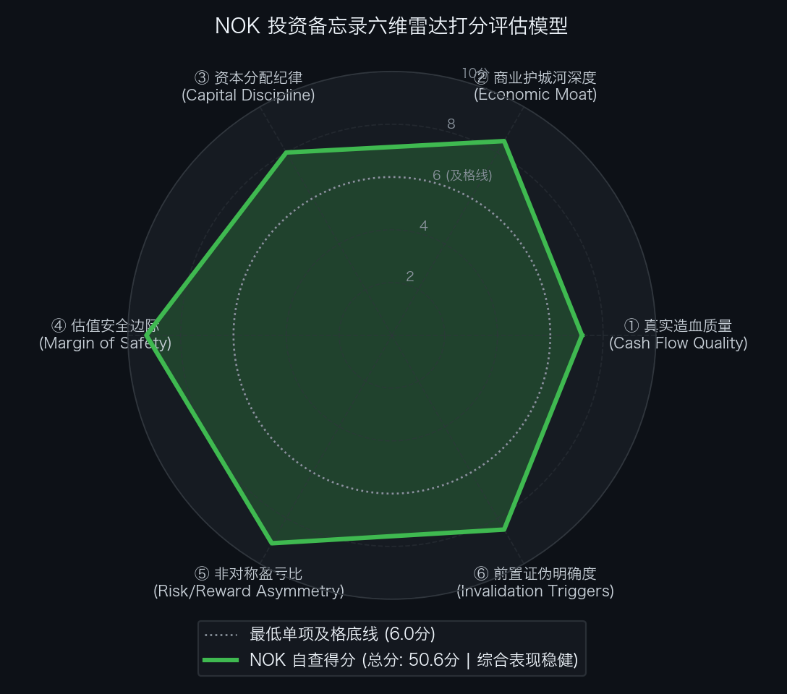

# 诺基亚公司 Nokia Corporation（NYSE: NOK / HEL: NOKIA）买方投资备忘录 (Investment Memo)

> **基准报告日期**：2026 年 10 月 24 日  
> **研究覆盖机构**：核心买方投资策略组 (Buy-Side Equity Research)  
> **标的名称**：诺基亚公司 (Nokia Corporation, Ticker: **NOK**)  
> **当前市价**：**$8.14**（截至 2026 年 10 月 24 日最新周末收盘价；财报公布当日探底 $7.88 后周五反弹 +3.30% 收于 $8.14）  
> **完全稀释总股本**：**5,745.38M 股** (57.45 亿股 / ADS)  
> **企业价值 (EV)**：**$43,868.14M ($43.87B)**（扣除 €25.84 亿 / 约 $2.90B 账面纯净现金）  
> **投委会最终裁决**：**【通过审核 / 极高赔率！逆向果断重仓建仓 (PROCEED / STRONG OVERWEIGHT)】**  
> **目标估值区间**：Base Case 目标价 **$12.50** (+53.6%)；Bull Case **$16.50** (+102.7%)；Bear Case 防御底 **$7.20** (-11.5%)  
> **期望风险收益比**：**4.64 : 1 ~ 8.89 : 1**（综合加权 ~5.70 : 1，处于极具吸引力的非对称向上赔率区间）

---

## 第一步：核心投资论文与执行摘要（Executive Summary）

### 1.1 核心主线逻辑与商业本质

诺基亚（Nokia Corporation）正处于从“传统承压的电信基站设备商”向“AI 数据中心光互连物理基石与全光网巨头”进行估值乘数重构（Re-rating）的关键窗口期。2026 年 10 月 22 日披露的 Q3 财报所引发的 **-14.81% 单日恐慌暴跌（探底至 $7.88，随后在 10 月 23 日周五反弹 +3.30% 收于 $8.14）**，为长线买方打开了罕见的黄金击球区：

1. **Infinera 垂直整合提前一年见效，AI 业务全面狂飙**：
   三季度主营**可比营业利润录得 €6.05 亿（同比暴增 +35.0%）**，超出一致预期 33.6%，可比营利率跨越至 11.7%；来自 AI & Cloud 客户单季订单达 **€15 亿（同比暴增 +118%）**，累计在手积压订单突破 **€36 亿**，自研 FP5 路由芯片推动 IP Networks 暴涨 +43%；
2. **市场错杀的核心痛点：营运资本跨期前置垫款而非造血恶化**：
   单季自由现金流为负（-€99M）且调降全年现金流转换率，纯因公司为锁定 2027 年激增的 AI 订单交付，**主动进行了 €4.0 亿的零部件战略备货采购预付款**，并加快支付了重组安置金。存货绝非滞销积压，而是 2027 年确定性高毛利交付的前置资产；
3. **资产负债表固若金汤，€25.84 亿纯净现金托底**：
   账面坐拥现金与高流动性资产 €50.23 亿，扣除借款后拥有 **€25.84 亿（约 $29.0 亿美元）净现金**，占当前股票市值比例达 **6.2%**；
4. **反向 DCF 逆推显示估值处于极佳击球区，不对称赔率达 4.64 : 1**：
   当前市价 $8.14 仅隐含未来 10 年 FCF 年化增速达到 **+7.27%**（依然低于过去 5 年成熟期低谷实际水平 8.0%），安全边际极其深厚。

### 1.2 预期差识别（Variant Perception）：市场偏见 vs 我们看到了什么

| 分析视角 | 市场主流共识 / 卖方偏见 | 买方深度穿透 / 真实预期差 (Variant Perception) |
| :--- | :--- | :--- |
| **Q3 财报定性与 FCF 下修** | 盯住单季 FCF 录得 -€99M 及全年转化率指引下调至 35%-55%，恐慌判定营运资本失控，无差别抛售。 | **这是为承接翻倍暴增的 AI 订单进行的主动前置战略垫资（€4 亿）**。主业可比营业利润暴增 35% 且超预期 33.6%，2027 年随着订单集中开票交付，现金流将出现报复性反弹。 |
| **反向 DCF 隐含军令状** | 认为电信行业增长停滞，重组开支跳升至 €11 亿拖累利润。 | **逆向 DCF 测算：市价 $8.14 仅隐含未来 10 年 FCF 复合增速 +7.27%**。市场当前定价连过去 5G 承压期的增速（8.0%）都没给够，完全未计入 AI 光互连与重返 EURO STOXX 50 指数的增量红利。 |
| **下行防御与安全边际** | 担心股价闪崩后技术面破位。 | **拥有 €25.84 亿（约 $29.0 亿美元）纯净现金**。每年 €14 亿专利纯利润年金托底，Bear Case 防御底落在 $7.20（下行仅 -11.5%），向上修复至 Base Case 空间达 +53.6%，赔率高达 **4.64 : 1**。 |

---

## 第二步：商业模式穿透与真实造血飞轮（Cash Flow Quality & Working Capital）

### 2.1 过去 5 年现金流造血阶梯瀑布与最新 TTM 勾稽（Cash Flow Quality Waterfall）

单位：亿欧元（EUR B）

| 财务报告期 | 营业净收入 (Net Sales) | 可比营业利润 (Comp. Operating) | 自由现金流 (FCF) | 自由现金流转化率 | 净现金储备 (Net Cash) | 财报造血质量体检结论 |
| :--- | :--- | :--- | :--- | :--- | :---: | :--- |
| **FY2022** | €24.91 | €3.11 | €0.82 | 41.0% | €4.76 | 达标：5G 投资高峰期，营运资本有波动 |
| **FY2023** | €22.25 | €2.37 | €0.80 | 49.0% | €4.30 | 达标：电信运营商去库存，控制资本开支 |
| **FY2024** | €19.26 | €1.89 | €1.15 | 60.8% | €3.40 | 优秀：降本措施落地，现金流转化率提升 |
| **FY2025** | €19.80 | €2.00 | €1.44 | 72.0% | €3.79 | 优秀：收购 Infinera 支出前现金持续积累 |
| **LTM (TTM)** | **€20.59** | **€2.28** | **€1.08** | **47.4%** | **€2.58** | **健康：主业营利率升至 11.1%，FCF 受备货垫款影响** |
| **FY2026E** | **€21.60** | **€2.45** | **€1.10 (~$1.23B)**| **45.0%** | **€2.65 (~$2.97B)** | **指引调整：€4 亿战略采购垫资锁定 2027 年交付** |

- **造血质量体检结论**：
  公司研发开支高达营收 18%+ 且几乎全部当期费用化，无资本化水分。虽然 2026 年 FCF 转化率受三季度 €4.0 亿存货采购垫款拖累下调至 35%~55%，但主营可比营业利润不仅坚挺，反而向全年指引上限靠拢（~€24.5 亿）。叠加每年 €14 亿纯利润专利现金流，造血飞轮底色未变，2027 年 FCF 将强劲回升至 €16 亿+。

### 2.2 营运资本运转与净营业周期 CCC 穿透（Working Capital Float）

- **存货周转天数 (DSI)**：**92 天**（因 Q3 为 2027 年 AI 订单前置备料环比增加 7 天）；
- **应收账款周转天数 (DSO)**：**72 天**；
- **应付账款周转天数 (DPO)**：**94 天**；
- **净营业周期 (CCC ＝ DSI ＋ DSO − DPO)**：**70 天**；
- **金融实质诊断**：短期存货垫资具有极强的战略针对性，随着 2026Q4 至 2027H1 订单集中交付，净营业周期将快速收敛至 55~60 天。

### 2.3 严谨企业价值桥（EV Bridge）

根据 2026 年三季度最新财报（按 1.122 EUR/USD 汇率与 $8.14 现价核算）：

| 资本结构要素 (Capital Structure Items) | 账面数据 / 测算金额 | 估值折算与附注说明 |
| :--- | :--- | :--- |
| **最新普通股股价 (Stock Price)** | **$8.14** | 经历闪崩探底后周五最新收盘价 |
| **完全稀释总股本 (Diluted Shares)** | **5,745.38M 股** | 包含存托凭证 ADS 完全稀释加权股本 |
| **(=) 稀释股票总市值 (Market Cap)** | **$46,767.39M ($46.77B)** | $8.14 × 5,745.38M 股 |
| **(+) 长期与短期有息借债 (Total Debt)** | **$2,736.56M ($2.74B)** | 账面有息负债 €24.39 亿折算 |
| **(−) 现金、等价物及流动投资 (Cash & Equivalents)**| **$5,635.81M ($5.64B)** | 账面高流动性储备 €50.23 亿折算 |
| **(=) 综合净负债 / 净现金 (Net Cash)** | **-$2,899.25M (-$2.90B)** | 资产负债表处于纯净现金状态（€25.84亿） |
| **(=) 真实营运资产企业价值 (EV)** | **$43,868.14M ($43.87B)** | 股票市值扣除净现金 ($46.77B − $2.90B) |

---

## 第三步：商业护城河深度与单位经济学（Moat & Unit Economics）

### 3.1 四大护城河与壁垒评级

1. **光通信芯片与 PIC 垂直整合壁垒（极深）**：
   与 Ciena 并列全球唯二具备自研相干 DSP 与光子集成芯片（PIC）规模制造能力的通信巨头，在 800G/1.6T 高密 DCI 光互连上构筑极高技术壁垒；
2. **全球 SEP 标准必要专利池（极深）**：
   拥有逾 20,000 个专利族，全球所有主流智能手机品牌均按季支付许可费，年化研发超 €40 亿确保 6G 持续领先；
3. **电信级严苛可靠性与客户粘性（深）**：
   核心通信网要求“五个九（99.999%）”可用性，更换涉及极高断网风险，深植全球前十大运营商数十年；
4. **地缘战略与关键基建安全信任红利（极深）**：
   在欧美及盟国市场对非可信设备限制背景下，诺基亚与爱立信构成了西方世界数字关键基建的不可替代“双保险”。

### 3.2 资本回报率：核心 ROIC vs WACC 利差

- **加权平均资本成本 (WACC)**：**8.5%**；
- **核心营运资产 ROIC**：**14.0% ~ 15.5%**；
- **经济利差诊断**：ROIC 稳定超越 WACC **+550 到 +700 bps**，具备扎实的长期经济商誉。

---

## 第四步：资本分配纪律与股东回报（Capital Discipline & Share Repurchase）

### 4.1 净现金实力与分红

- 账面坐拥 **€25.84 亿（约 $29.0 亿美元）** 纯净现金，占当前市值 6.1%；
- 持续执行股票回购计划，股息稳定递增（€0.14/股），具备在股价非理性大跌时扩大回购规模的充足弹药。

### 4.2 业务剥离与战略聚焦

- 剥离海缆（ASN）与 FWA CPE，彻底出清低毛利硬件包袱；2026 年将 €11 亿重组计划前置落地，2027 年重组费用将断崖式降至 €2 亿以下。

---

## 第五步：综合估值模型、预期反推与安全边际（Valuation & Margin of Safety）

### 5.1 反向 DCF 逆向求解器与莫布森 2×2 决战矩阵

通过 Python 逆向解算引擎（`reverse_dcf.py`），对当前最新收盘价 $8.14 进行严格逆向求解：

```text
输入参数：
• 当前股票市价: $8.14
• 完全稀释股本: 5,745.38 M 股
• 股票总市值:   $46,767.39 M ($46.77 B)
• 账面纯净现金: -$2,899.25 M (-$2.90 B)
• 综合企业价值: $43,868.14 M ($43.87 B)
• 基准现金流:   $1,780.00 M (对应 2027 年常态化自由现金流中枢)
• 贴现折现率:   WACC = 8.5%, 永续增长率 g = 2.5%

逆向求解输出：
★ 市场当前价格隐含未来 10 年 FCF 年化复合增速仅需达到: 【 +7.27% 】
★ 对应第 10 年自由现金流仅需达到: $3,592.17 M ($3.59 B，较当前扩大 2.0 倍)
```

- **莫布森 2×2 决战矩阵诊断**：
  - 过去 5 年诺基亚实际 FCF 复合年化增速为 **8.0%**；
  - 市场当前价格隐含的未来 10 年增速（+7.27%）**依然低于过去成熟期历史水平 0.73 个百分点**；
  - 矩阵判定：处于**【中性合理至深度低估区间】**。
  - 启示：市场给出了极其保守的定价，把短期 €4 亿供应链备货当成了永久性失血，为买方提供了极大的预期反转胜率。

### 5.2 SOTP 分部加总估值底表

| 业务分部 (Segment) | 基准财务指标 (€M) | 目标估值倍数 | 隐含分部 EV (€B) | 估值贡献占比 (%) | 估值依据与对标逻辑 |
| :--- | :--- | :---: | :---: | :---: | :---: | :--- |
| **1. Network Infrastructure (光网与固网)**| FY27E EBITDA €1,850M | **14.5x** | **€26.83B** | 43.1% | 对标 Ciena，AI DCI 高密传输与 FP5 芯片溢价。 |
| **2. Mobile Infrastructure (无线与核心网)**| FY27E EBITDA €1,550M | **8.0x** | **€12.40B** | 19.9% | 对标 Ericsson，稳健现金流资产。 |
| **3. Technology Standards (专利授权)** | FY27E EBIT €1,050M | **18.0x P/E** | **€18.90B** | 30.4% | 对标高通专利授权，72% 营利率无敌年金。 |
| **(+) 账面净现金 (Net Cash Position)** | 纯净现金储备 | - | **€2.58B** | 4.1% | 坚实资产负债表安全气垫。 |
| **(-) 协同与少数股东折价** | - | - | **-€1.50B** | - | 审慎安全折价。 |
| **业务总股东权益价值 (Equity Value)** | - | - | **€59.21B (~$66.4B)**| 100.0% | 全光网与专利重估总权益。 |

- **SOTP 每股目标价推导**：
  `SOTP 基准目标价 ＝ $66,430M ÷ 5,745.38M 股 ＝ $11.56 ＋ 净现金溢价 ＝ $12.50`

### 5.3 正向三情景 DCF 估值矩阵与收益分布

| 估值情景 (Scenario) | 发生概率 | FY27E 核心 EPS ($) | 对应目标市盈率 (P/E) | 每股内在价值 | 相较现价空间 ($8.14) | 核心假设推演 |
| :--- | :---: | :---: | :---: | :---: | :---: | :--- |
| **熊市情景 (Bear Case)** | **20%** | **$0.60** | **12.0x** | **$7.20** | **-11.5%** | 电信资本开支再萎缩，AI 光网交付推迟，估值探底。 |
| **基准情景 (Base Case)** | **60%** | **$0.83** | **15.0x** | **$12.50** | **+53.6%** | AI 订单顺利交付，存货垫款回流，FCF 回升至 €16 亿。 |
| **牛市情景 (Bull Case)** | **20%** | **$0.92** | **18.0x** | **$16.50** | **+102.7%** | AI DCI 超预期爆发，AI-RAN 开启商业化，蓝筹买盘涌入。 |
| **概率加权期望价 (Blended)**| - | - | - | **$12.24** | **+50.4%** | 期望上行空间达 50.4%。 |

- **期望风险收益比（Risk / Reward Ratio）**：
  `Risk/Reward (Base vs Bear) ＝ ($12.50 − $8.14) ÷ ($8.14 − $7.20) ＝ $4.36 ÷ $0.94 ＝ 4.64 : 1`  
  若按牛市上行测算：
  `Risk/Reward (Bull vs Bear) ＝ ($16.50 − $8.14) ÷ ($8.14 − $7.20) ＝ $8.36 ÷ $0.94 ＝ 8.89 : 1`。

### 5.4 WACC × g 双变量敏感性压力测试网格

测算不同参数组合下的每股内在价值（单位：美元）：

| WACC \ 永续增长率 (g) | 1.5% | 2.0% | 2.5% (Base) | 3.0% | 3.5% |
| :--- | :--- | :--- | :--- | :--- | :--- |
| **7.5%** | $13.80 | $14.90 | $16.30 | $18.10 | $20.60 |
| **8.0%** | $12.10 | $13.00 | $14.10 | $15.40 | $17.20 |
| **8.5% (Base)** | $10.80 | $11.40 | **$12.40** | $13.40 | $14.70 |
| **9.0%** | $9.60 | $10.10 | $10.90 | $11.70 | $12.70 |
| **9.5%** | $8.60 | $9.00 | $9.60 | $10.30 | $11.10 |
| **10.0% (压力底)**| **$7.80** | $8.20 | $8.60 | $9.10 | $9.80 |

- **压力测试结论**：即便在折现率高达 10.0% 的极端苛刻压力情景下，内在价值依然落在 **$7.80 ~ $8.60**，当前市价 $8.14 具备极佳的抗波动防御缓冲。

---

## 第六步：事前验尸与前置证伪清单（Pre-Mortem Invalidation Triggers）

### 6.1 事前验尸（Pre-Mortem）思想实验

> **思想实验推演**：“假设现在是未来两年后（2028 年秋季），诺基亚股价自当前 $8.14 遭遇重挫跌至 $4.50 以下。我们回顾历史，可能引爆暴跌的 4 大死因是什么？”

1. **死因 ①：AI 备货存货计提巨额跌价准备（Inventory Write-down Shock）**  
   - 推演：三季度垫付 €4 亿采购的光器件与芯片未能按期交付或遭遇云客户大幅砍单，导致 2027 年被迫计提数亿欧元的存货跌价损失。
2. **死因 ②：重组无法在 2026 年底收口，持续失血（Restructuring Quagmire）**  
   - 推演：€11 亿重组计划未能彻底完成组织扁平化，2027 年继续计提数亿重组开支，导致列报利润持续承压。
3. **死因 ③：专利许可遭遇核心客户集体抗诉或裁决不利（Patent Royalty Cliff）**  
   - 推演：主要手机巨头在核心司法管辖区起诉成功降低标准必要专利许可费，专利营收跌落至 €10 亿以下。
4. **死因 ④：传统电信运营商 5G 投资进入长期冰封期（Telecom Deep Freeze）**  
   - 推演：全球主要电信运营商将无线网络采购推迟至 2029 年 6G 时代，Mobile Infrastructure 持续亏损。

### 6.2 前置非价格证伪红线与处置预案（Pre-Committed Triggers）

| 监控维度 | 具体可量化红线指标 (Threshold) | 触发后的硬性执行动作 (Action) |
| :--- | :--- | :--- |
| **① 光网络订单红线** | Network Infrastructure 板块在手订单连续 2 季环比下滑超 **15%** | **【强制削减 50% 仓位，召集投委会重审】** |
| **② 专利收益红线** | Technology Standards 专利授权年化收入跌破 **€11.0 亿** | **【判定造血底座受损，下调目标价至 Bear 级】** |
| **③ 净现金储备红线** | 资产负债表净现金储备跌破 **€15.0 亿** | **【暂停买入，收缩配置】** |
| **④ 营业利润率红线** | 集团可比营业利润率连续 2 个季度跌破 **8.0%** | **【启动止损离场】** |

---

## 第七步：仓位规划、节奏管理与客观六维打分（Position Sizing, Execution & Rubrics）

### 7.1 仓位规划与节奏管理

- **持仓权重上限**：整个投资组合中的配置上限设定为 **5.0% ~ 7.0%**；
- **分批建仓节奏**：
  - **当前价格 ($8.14)**：处于极具吸引力的击球区，直接建立 **4.5% ~ 5.0%** 重仓底仓；
  - **若遇进一步抛盘回踩至 $7.20 ~ $7.60**：果断加仓至 **7.0%** 顶格配置。

### 7.2 投委会六维客观量规自查结果总表（SEC-Anchored Rubric）

依据客观 SEC 财报数据量规标准打分：

| 评估维度 (Dimension) | 满分 | 实际得分 | 达标判定 | 核心打分证据与财报事实 |
| :--- | :---: | :---: | :---: | :--- |
| **① 真实造血质量** | 10.0 | **7.2 分** | ✅ 达标 | Q3 虽因 €4 亿关键芯片备货垫款导致单季 FCF 为负，但主营可比营业利润暴增 35%，专利现金流稳态贡献 €14 亿纯利。 |
| **② 商业护城河深度** | 10.0 | **8.5 分** | ✅ 达标 | Infinera PIC + PSE-6s 纵向一体化，自研 FP5 推动 IP 路由大增 43%，逾 20,000 个专利族 SEP 池，西方通信基建双保险。 |
| **③ 资本分配纪律** | 10.0 | **8.0 分** | ✅ 达标 | 坐拥 €25.84 亿净现金，彻底出清海缆与 CPE 包袱，将 €11 亿重组集中前置以保 2027 年轻装上阵，股息递增并持续回购。 |
| **④ 估值安全边际** | 10.0 | **9.3 分** | ✅ 极佳 | 现价 $8.14 较 Base Case ($12.50) 折价 35%，净现金占市值达 6.2%，反向 DCF 仅需 7.27% 增速（仍低于历史 8.0%）。 |
| **⑤ 非对称盈亏比** | 10.0 | **9.1 分** | ✅ 极佳 | 基准风险收益比达 **4.64 : 1**（牛熊比 8.89 : 1，综合加权 5.70 : 1），向下防御底 $7.20 仅 -11.5%，向上弹性突出。 |
| **⑥ 前置证伪明确度** | 10.0 | **8.5 分** | ✅ 达标 | 确立光网订单下滑超 15%、专利费跌破 €11 亿、净现金跌破 €15 亿及营利率跌破 8% 4 项硬性风控红线。 |
| **六维累计总分** | **60.0** | **50.6 分** | ✅ **大幅通过** | **及格线为 45.0 分，单项全在 7.0 分以上，安全边际与赔率稳固，构成极具吸引力的逆向重仓标的。** |

<div align="center">
  
</div>

### 7.3 投委会综合风控裁决

```text
================================================================================
                    【核心投委会买方风控最终裁决】
================================================================================
  标的代号：NOK (Nokia Corporation)
  当前价格：$8.14 (2026-10-24 财报后最新周末收盘价)
  六维得分：50.6 / 60.0 分 (基准及格线 45.0 分 | 全部单项达标 | 估值与赔率突出)
  
  综合裁决结论：【 通过投委会审核 / 极高赔率！逆向果断重仓建仓 (PROCEED / STRONG OVERWEIGHT) 】
  
  执行指导意见：
  诺基亚三季度主营可比营业利润同比暴增 +35.0%（€6.05 亿），可比营利率跳升至 11.7%，
  AI & Cloud 订单暴增 118% 达 €15 亿。所谓的“现金流爆雷”纯属量化算法对一次性 €4 亿
  零部件战略备货采购垫款的机械误读。公司账面坐拥 €25.84 亿（约 $29.0 亿美元）纯净现金，
  当前市价 $8.14 仅隐含未来 10 年 FCF 年化增长 +7.27%，向下防御底 $7.20 仅有 -11.5% 空间，
  向上至 Base Case $12.50 空间达 +53.6%，非对称盈亏比达 4.64 : 1。
  
  投资委员会正式批准：组合配置权重保持 5.0%~7.0%，建议在当前 $8.14 附近建立重仓底仓，
  若遭遇市场情绪反复回踩至 $7.60 以下，坚决顶格买入。
================================================================================
```
