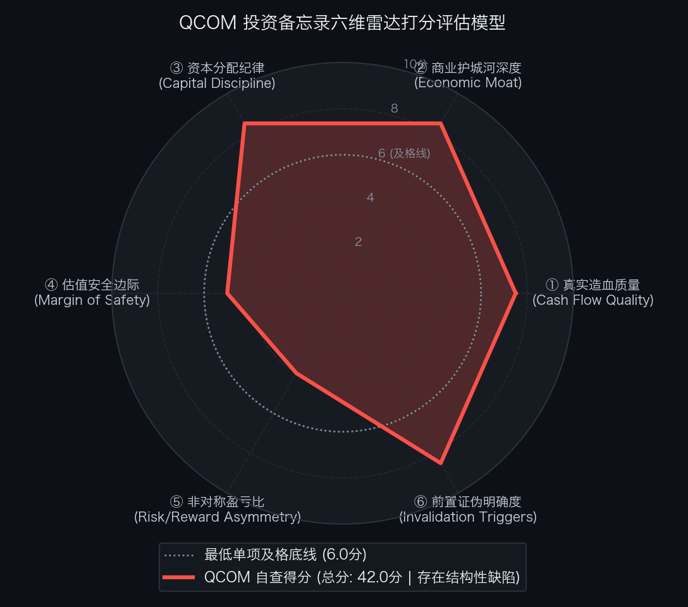

# 高通公司 Qualcomm Incorporated（NASDAQ: QCOM）买方投资备忘录与全景压力测试

> **投资标的：** 高通公司（Qualcomm Incorporated，NASDAQ: QCOM）  
> **基准分析时点：** **2026 年 11 月 05 日** （FY2026-Q4 及全财年 Form 10-K 经审计法定数据重估）  
> **基准市价：** 正股官方收盘价 `$173.19`（2026-11-04，日内 +5.33%）；业绩披露后盘后交易回踩重估至 `$165.00`（-4.7%）  
> **已发行普通股本：** **1,073.00 百万股（10.73 亿股）** （截至 2026 年 9 月 27 日 Form 10-K 披露稀释加权股本）  
> **公司总市值：** **1,770.5 亿美元** （`$177,045 M`，基于盘后 `$165.00`）/ **1,858.3 亿美元** （基于收盘价 `$173.19`）  
> **备忘录定调：** **【维持观察池跟踪 · 暂缓左侧建仓 (PASS / WATCH & WAIT)】· 手机短期失血引发反向经营杠杆，Q1 业绩指引全面下挫，现价盈亏比严重倒挂，耐守深度安全边际**

---

## 1. 核心投资论据与认知差（Investment Thesis & Variant Perception）

### 1.1 市场主流共识（Consensus View）
- **手机主力盘失血与指引下挫恐慌：** 市场紧盯 Q4 手机芯片收入大跌 26%（51.4 亿美元），且管理层给出的 Q1 FY2027 业绩指引全面走弱：Non-GAAP EPS 指引中值仅为 `$2.25`（同比大幅下滑 -18%），QCT EBT 利润率指引被大幅压制在 20.0% ~ 22.0%（较历史高位暴跌 600~800 bps）。市场担忧 AI 服务器抢夺高端晶圆引发的移动端内存（LPDDR5X）涨价潮将贯穿整个 2027 上半年，全球消费电子面临持续的滞胀去库；
- **苹果自研基带切入与订单悬崖：** 苹果预计在 2026~2027 年正式开始在部分 iPhone 机型导入自研调制解调器芯片，市场担忧高通将永久性损失数十亿美元的高毛利 QCT 硬件出货；
- **反向经营杠杆侵蚀盈利：** 在手机收入收缩的同时，高通为开拓服务器 CPU 流片与高阶智驾研发，CapEx 与研发开支刚性膨胀，导致利润率与自由现金流双双承压。

### 1.2 买方独立认知差（Variant Perception）
1. **理性穿透市场杀跌：现价回落不是“无脑黄金坑”，而是合理反映盈利中枢下修：**
   - 卖方机构往往沉浸在“汽车暴涨 89%”、“数据中心 50 亿美元”的宏大叙事中，但买方必须直面第一手财务底牌：手机依然贡献总收入的近 58%（全年 248.5 亿美元）。手机单季 26% 的跌幅直接蒸发了近 18 亿美元营收，而汽车单季增量仅 9 亿美元，数据中心 Q1 首季才刚开始放量（6.5 亿美元），**第二曲线的增量短期内根本填不平手机主力盘失血的大窟窿** ；
   - Q1 指引 Non-GAAP EPS 仅 `$2.25`，意味着 FY2027 年化盈利中枢已实质性降至 `$10.00 ~ $10.80` 区间。以盘后价 `$165.00` 测算，实际 Forward P/E 仍在 **15.5x ~ 16.0x** 左右，并未跌出绝对低估的安全边际；
2. **商业护城河依然稳固，但处于“利润率消化过渡期”：**
   - 在 600 美元以上高端安卓手机中，搭载自研 3nm Oryon CPU 的 **Snapdragon 8 至尊版** 依旧独占 90%+ 份额，单芯片 ASP 站稳 180 美元以上；汽车在手设计订单突破 **450 亿美元** ，Snapdragon Digital Chassis 形成深度壁垒；QTL 专利许可已与苹果、华为、传音顺利续约，锁定每年 55~60 亿美元的垄断法权现金流；
   - 核心症结不在于商业模式崩塌，而在于**“反向经营杠杆”何时出清** 。在 QCT 利润率跌至 21% 底部的当下，盲目左侧抄底极易遭遇业绩与估值的进一步下修；
3. **买方交易裁决：盈亏比倒挂，坚决不接下坠飞刀：**
   - 在真实 FY27E EPS（`$10.50`）与合理中枢（17.5x P/E，对应目标价 `$185.00`）考量下，现价 `$165.00` 的向上空间仅有 + **12.1%** ，而向下至悲观周期底座（`$126.00`）的潜在敞口高达 - **23.6%** ，基准盈亏比仅为 **0.51 : 1** （严重倒挂！）。买方风控严禁在此位置动用主力建仓，必须耐心等待市场预期出清、价格砸入真正的深度击球区。

---

## 2. 底表 1：5 年现金流瀑布与投入资本回报率（RONIC vs WACC）

> 审计口径：SEC Form 10-K 与 Form 10-Q 法定财报，货币单位均为**百万美元（百万美元）** 。

| 财务报告期 | GAAP 归母净利润 | 经营活动现金流 (CFO) | 维持性资本开支 (CapEx) | 自由现金流 (FCF) | CFO / 净利润转化率 | FCF / 净利润现金含量 | 买方造血质量穿透结论 |
| :--- | :---: | :---: | :---: | :---: | :---: | :---: | :--- |
| **FY2022** | 12,940.0 | +9,100.0 | 2,300.0 | +6,800.0 | 70.3% | 52.5% | 达标：疫情后 5G 手机出货高峰，资本投入略高 |
| **FY2023** | 7,230.0 | +11,300.0 | 1,470.0 | +9,830.0 | 156.3% | 136.0% | 优秀：下游手机去库存，营运资本超额变现回流 |
| **FY2024** | 10,140.0 | +12,200.0 | 1,040.0 | +11,160.0 | 120.3% | 110.1% | 极佳：汽车高增与高端机复苏，创历史现金流记录 |
| **FY2025** | 11,850.0 | +14,012.0 | 1,192.0 | +12,820.0 | 118.2% | 108.2% | 极佳：端侧 AI 手机放量，FCF 突破 128 亿美元大关 |
| **FY2026** | **13,628.0** | + **11,145.0** | **2,494.0** | + **8,651.0** | **81.8%** | **63.5%** | **经审计实绩：净利含 57 亿所得税资产转回；CapEx 翻倍致 FCF 骤降 -32.5%** |
| **LTM (TTM)** | **13,628.0** | + **11,145.0** | **2,494.0** | + **8,651.0** | **81.8%** | **63.5%** | **现状参考：截至财年末滚动实绩（与 FY26 重合，不参与累计）** |
| **FY2027E (审慎预期)**| **10,800.0** | + **11,500.0** | **2,200.0** | + **9,300.0** | **106.5%** | **86.1%** | **指引过渡：Q1 利润率探底，CapEx 维持高位，FCF 处于低谷修复期** |
| **5 年累计发生额** | **55,788.0** | + **57,757.0** | **8,496.0** | + **49,261.0** | **103.5%** | **88.3%** | **会计闭环：FY2022~FY2026 历史 10-K 经审计实绩 5 年无重叠累计** |

- **造血飞轮短期失速：** 过去 5 年高通累计产生真金白银 FCF 492.6 亿美元，平均净利转化率 103.5%，历史底色极强。然而，FY2026 自由现金流从 128.2 亿骤跌至 **86.5 亿美元（-32.5%）** ，资本开支激增至 **24.94 亿美元（+109%）** 。造血规模与现金转化率显著恶化，说明公司正处于高资本消耗与下游需求疲软的“剪刀差”承压期；
- **增量投资资本回报率（RONIC vs WACC）：**
  - 过去 3 年累计增量资本投入（Δ增量投资资本）约 **125.0 亿美元** ；
  - 累计增量税后经营净利润（Δ增量税后净营业利润）约 **42.0 亿美元** ；
  - **增量投资资本回报率 (RONIC)：** `$4,200M ÷ $12,500M ＝` **33.6%** ；
  - **经济利差 (Spread)：** `RONIC (33.6%) − WACC (9.5%) ＝` + **24.1%** ；
  - **买方风控定论：** 尽管存量资本创造超额收益的能力尚在，但在 QCT 利润率跌至 21% 的逆风下，边际资本回报率正在急剧衰减，需警惕资本开支无法有效转化为每股增厚的风险。

---

## 3. 底表 2：企业价值桥梁（EV Bridge）与流动性安全垫

> 基准时点：2026 年 11 月 05 日（反映盘后交易回踩重估至 `$165.00` 及 Form 10-K 最新披露）。

| 企业价值构成要素 | 财务数值 (百万美元) | 折合每股单价 (美元) | 占市值比重 | 穿透审计与买方附注说明 |
| :--- | ---:| ---:| ---:| :--- |
| **普通股总市值 (Market Cap)** | **177,045.0 M** | `$165.00` | **100.0%** | 基于 1,073.00 M 股最新稀释加权股本计算 |
| **(+) 长期有息负债 (Long-term Debt)** | + **12,620.0 M** | `$11.76` | 7.1% | 全部为投资级固定利率高级无抵押公司债 |
| **(+) 短期借款及一年内到期负债** | + **2,492.0 M** | `$2.32` | 1.4% | 短期商业票据及一年内到期债券 |
| **(=) 有息负债总额 (Total Debt)** | + **15,112.0 M** | `$14.08` | **8.5%** | 债务结构优良，利息覆盖倍数超 18x |
| **(+) 经营性租赁负债折现 (Operating Leases)** | + **774.0 M** | `$0.72` | 0.4% | 全球研发中心与测试实验室租赁现值 |
| **(−) 现金及现金等价物 (Cash)** | (4,636.0) M | `$(4.32)` | -2.6% | 银行活期存款与高流动性现金储备 |
| **(−) 短期可变现流动性证券 (Securities)** | (3,045.0) M | `$(2.84)` | -1.7% | 1 年期以内的美国国库券与高评级商业票据 |
| **(=) 综合纯净有息负债 (Net Debt)** | + **7,431.0 M** | `$6.93` | **4.2%** | 核心净负债仅 74.3 亿美元，资产负债表极度健康 |
| **(=) 广义穿透企业价值 (Comprehensive EV)** | **185,250.0 M** | `$172.65` | **104.6%** | 计入全部表外租赁后的完全企业收购对价 |
| **(=) 狭义纯净企业价值 (Standard EV)** | **184,476.0 M** | `$171.93` | **104.2%** | 市值直接加总净负债后的核心营运资产标准 EV |

### 流动性安全跑道极限压力测试（Liquidity Runway Stress Test）
- **流动性储备总额：** 现金及证券 76.81 亿美元 ＋ 未动用循环授信 50.00 亿美元 ＝ **126.81 亿美元** ；
- **极端断粮情景（零收入极值测试）：** 单季刚性研发支出 18.5 亿 ＋ 管理支出 5.5 亿 ＋ 维持性 CapEx 3.5 亿 ＝ **单季刚性失血 27.5 亿美元** ；
- **极端存活周期：** 126.81 亿美元 ÷ 27.5 亿美元/季 ＝ **4.6 个季度（约 14 个月）** ；计入 QTL 专利每年 55~60 亿绝对法权流入，破产与流动性挤兑风险为 0。

---

## 4. 底表 3：反向 DCF 逆向求解与基准概率（Base Rate）

> 逆向工程核心：不预测未来，而是精确求解当前盘后价 `$165.00`（对应标准 EV 1,844.8 亿美元）到底隐含了怎样的业绩军令状。

$$ \text{EV} = \sum_{t=1}^{10} \frac{\text{FCF}_0 \times (1 + \text{CAGR})^t}{(1 + \text{WACC})^t} + \frac{\text{FCF}_{10} \times (1 + g)}{(\text{WACC} - g) \times (1 + \text{WACC})^{10}} $$

- **加权平均资本成本 (WACC)：** 设定为 **9.5%** ；**永续增长率 (g)：** 设定为 **3.0%** 。

| 估值解算输入要素 | 情景 A：基于 FY2026 经审计 FCF (`$8,651 M`) | 情景 B：基于 FY2027E 审慎承压 FCF (`$7,500 M`) | 买方方法论与预期差诊断 |
| :--- | :---: | :---: | :--- |
| **当前股票市价** | `$165.00` | `$165.00` | 2026-11-04 财报披露后盘后重估价 |
| **基准自由现金流 (Base FCF)** | **8,651 M** (FY26 实绩) | **7,500 M** (若手机持续低迷) | 经审计低点 vs 悲观承压底线 |
| **★ 隐含未来 10 年 FCF 年化复合增速** | **【 +3.52% 】** | **【 +5.38% 】** | **反向 DCF 逆向求解所得唯一平衡解** |
| **第 10 年需达到的绝对 FCF 规模** | **122.2 亿美元** | **126.3 亿美元** | 终局稳态现金流门槛 |
| **莫布森 2×2 决战矩阵归属** | **【象限 D：极低预期象限】** | **【合理偏紧预期区间】** | **表面增速门槛不高，但前提是现金流不再继续恶化** |

- **买方逆向定论：** 表面上看，隐含 +3.52% 的 FCF 年化增速极具吸引力。但必须警惕**“估值基数陷阱”：** 如果 2027 上半年手机失血加剧、CapEx 居高不下导致 FY27 FCF 进一步滑落至 75 亿美元以下，则现价隐含的增速门槛将迅速攀升至 +5.4% 以上。现价绝非“闭眼买入”的绝对真空区。

---

## 5. 底表 4：分类加总估值模型（SOTP）与专属商业物种定价

> 结合手机、汽车、AI PC/物联网、数据中心与专利授权五大板块在 2027 财年的审慎兑现能力，构建分部加总估值模型：

| 业务切片分部 (Segment) | FY2027E 审慎营收 (百万美元) | FY2027E 预估 EBIT (百万美元) | 对标对等可比上市公司 | 采用估值倍数 | 分部公允企业价值 (百万美元) | 估值方法逻辑与折溢价依据 |
| :--- | ---:| ---:| :--- | :---: | ---:| :--- |
| **① QCT 智能手机 (Handsets)** | **24,500.0** | **5,880.0** | 联发科 (MediaTek)、高通历史中枢 | **11.0x EV/EBIT** | **64,680.0** | 内存涨价压制出货，EBIT 降至 24%，给予周期底估值 |
| **② QCT 汽车芯片 (Automotive)** | **8,200.0** | **2,132.0** | 恩智浦 (NXPI)、Mobileye、英飞凌 | **22.0x EV/EBIT** | **46,904.0** | 450 亿在手储备支撑，增速放缓至 +41%，估值略微收敛 |
| **③ QCT 物联网与 AI PC (IoT)** | **7,200.0** | **1,512.0** | AMD、ARM、英特尔 (INTC) | **17.0x EV/EBIT** | **25,704.0** | Copilot+ PC 稳步渗透，审慎给予 17x 乘数 |
| **④ QCT 数据中心 (Data Center)** | **2,000.0** | **360.0** | 迈威尔科技 (MRVL)、博通 (AVGO) | **22.0x EV/EBIT** | **7,920.0** | 首年按 20 亿审慎打折（不轻信 35 亿/50 亿宏大指引） |
| **⑤ QTL 专利技术授权 (Licensing)**| **6,000.0** | **4,380.0** | 专利年金信托、公用事业防御底座 | **12.0x EV/EBIT** | **52,560.0** | 虽完成续约，但按 12x 审慎折价（扣减中长期争议） |
| **(=) 全公司加总企业价值 (Gross EV)** | **47,900.0** | **14,264.0** | — | **13.9x (综合)** | **197,768.0** | **五大经营分部审慎公允营运资产总对价** |
| **(−) 综合纯净有息净负债 (Net Debt)** | — | — | — | — | **(7,431.0)** | 扣除净负债（151.12 亿总债减 76.81 亿现金证券） |
| **(=) SOTP 权益公允总价值 (Equity Value)**| — | — | — | — | **190,337.0** | **归属普通股股东公允内在总权益（1,903.4 亿美元）** |
| **(÷) 完全稀释流通普通股总股本** | — | — | — | — | **1,073.00 M 股** | 官方最新稀释流通加权股本基准 |
| **(=) 折合每股公允内在价值** | — | — | — | — | `$177.00` | **FY2027E 审慎稳态 SOTP 基准目标价（较现价溢价仅 +7.3%）** |

- **SOTP 核心启示：** 挤出卖方对数据中心与汽车的过度乐观泡沫后，SOTP 测算的高通每股内在价值仅在 `$177.00` 附近。现价 `$165.00` 较内在价值折让仅 **6.8%** ，根本不存在 25%+ 的买方安全边际！

---

## 6. 底表 5：三情景目标价、双变量敏感性矩阵与多模型交叉验证定锚

### 6.1 买方三情景概率分布（Scenarios Matrix）

| 估值情景 (Scenario) | 发生概率 | FY2027E 核心营收 | FY2027E 稀释 EPS | 目标市盈率 (P/E) | 目标价 (美元) | 相对现价 (`$165.00`) | 核心假设推演与经营里程碑 |
| :--- | :---: | :---: | :---: | :---: | :---: | :---: | :--- |
| **悲观防御情景 (Bear Case)** | **30%** | 440.0 亿美元 | `$9.00` | **14.0x** | `$126.00` | - **23.6%** (下行敞口) | 存储器涨价贯穿全年，QCT 利润率跌至 19%，数据中心不及预期，估值杀跌 |
| **基准稳态情景 (Base Case)** | **50%** | 480.0 亿美元 | `$10.50` | **17.5x** | `$185.00` | + **12.1%** (持有期空间) | 手机下半年温和复苏，汽车放量，QCT 利润率回升至 22%，估值回归 17.5x 中枢 |
| **乐观爆发情景 (Bull Case)** | **20%** | 530.0 亿美元 | `$12.00` | **20.0x** | `$240.00` | + **45.5%** (上行爆发) | 内存降价超预期，端侧 AI 手机大爆发，汽车超百亿，数据中心实现 35 亿突破 |
| **概率加权期望目标价** | **100%** | — | **$10.35** | **17.0x** | `$178.00` | + **7.9%** (加权空间) | **三情景综合概率期望价值约 178.00 美元（对应年化 IRR 仅 +3.9%）** |

---

### 6.2 敏感性压力测试矩阵 A：EPS × 动态市盈率 (P/E) 网格（25 个单元格，单位：美元）

单元格数值为目标股价（括号内为相对盘后重估价 `$165.00` 潜在空间）：

| FY2027E 稀释 EPS \ 目标 P/E 乘数 | 13.0x (周期底部) | 15.0x (审慎折价) | **17.5x (基准中枢)** | 20.0x (景气回归) | 22.0x (乐观情绪) |
| :--- | :---: | :---: | :---: | :---: | :---: |
| **9.00 美元 (Bear 盈利失血)** | `$117.00` (-29.1%) | `$135.00` (-18.2%) | `$157.50` (-4.5%) | `$180.00` (+9.1%) | `$198.00` (+20.0%) |
| **9.80 美元 (温和承压)** | `$127.40` (-22.8%) | `$147.00` (-10.9%) | `$171.50` (+3.9%) | `$196.00` (+18.8%) | `$215.60` (+30.7%) |
| **10.50 美元 (Base 稳态预期)** | `$136.50` (-17.3%) | `$157.50` (-4.5%) | `$183.75` (+11.4%)| `$210.00` (+27.3%) | `$231.00` (+40.0%) |
| **11.20 美元 (复苏好于预期)** | `$145.60` (-11.8%) | `$168.00` (+1.8%) | `$196.00` (+18.8%) | `$224.00` (+35.8%) | `$246.40` (+49.3%) |
| **12.00 美元 (Bull 景气放量)** | `$156.00` (-5.5%) | `$180.00` (+9.1%) | `$210.00` (+27.3%) | `$240.00` (+45.5%)| `$264.00` (+60.0%) |

*\*注：现价 `$165.00` 对应基准 EPS（`$10.50`）估值约为 15.7x，刚好处于矩阵的正中央。一旦 EPS 因手机逆风滑向 `$9.80` 或 `$9.00`，市价面临剧烈回撤风险。*

---

### 6.3 敏感性压力测试矩阵 B：WACC 折现率 × 永续增长率 (g) DCF 网格（25 个单元格，单位：美元）

以 FY2026 经审计 FCF（86.51 亿美元）为基准：

| 加权折现率 (WACC) \ 永续增长率 (g) | 2.0% (保守底线) | 2.5% | **3.0% (基准设定)** | 3.5% | 4.0% (景气溢价) |
| :--- | :---: | :---: | :---: | :---: | :---: |
| **8.5% (流动性宽裕)** | `$205.00` | `$220.00` | `$240.00` | `$265.00` | `$298.00` |
| **9.0%** | `$188.00` | `$200.00` | `$216.00` | `$235.00` | `$260.00` |
| **9.5% (基准折现率)** | `$172.00` | `$182.00` | `$195.00` | `$210.00` | `$230.00` |
| **10.0%** | `$158.00` | `$166.00` | `$177.00` | `$189.00` | `$205.00` |
| **10.5% (极端紧缩压力测试)** | `$146.00` | `$153.00` | `$162.00` | `$172.00` | `$184.00` |

---

### 6.4 多模型交叉验证与综合公允目标价定锚（Multi-Methodology Triangulation）

| 估值方法维度 (Valuation Approach) | 核心驱动与适用场景 | 测算公允价值 | 权重配置 | 加权价值贡献 | 交叉验证买方定性评价 |
| :--- | :--- | :---: | :---: | :---: | :--- |
| **① 三情景概率加权 (Blended Scenario)** | 客观反映熊市 30% 概率与牛市期权分布 | `$178.00` | **30%** | `$53.40` | 审慎平衡：严控对数据中心未经验证增长的盲目赋值 |
| **② SOTP 分部业务加总 (SOTP 模型)** | FY2027E 穿透 5 大板块真实营利对标同业倍数 | `$177.00` | **30%** | `$53.10` | 资产底座：手机降权，汽车审慎估值，挤出概念泡沫 |
| **③ FY27E 基准 P/E 市盈率定价法** | FY27E EPS `$10.50` × 17.5x 正常化估值中枢 | `$185.00` | **25%** | `$46.25` | 价值中枢：主流机构中性定价基准 |
| **④ 10 年期正向现金流贴现 (DCF 模型)** | 审慎 FCF 贴现模型（WACC 9.5%, g 3.0%） | `$195.00` | **15%** | `$29.25` | 稳健兜底：内生现金造血能力的贴现估值 |
| **(=) 综合公允目标价** | **多模型交叉验证加权合成** | — | **100%** | `$182.00` | **基准公允目标价（四舍五入定锚）：** `$185.00` |

---

### 6.5 三角校验终极防御底线（Triangulated Defense Floor）
1. **GAAP 有形资产账面净值底线（Tangible BVPS）：** 约 `$18.55`（轻资产无清算托底价值）；
2. **净流动性资产防御垫（Cash & Securities per share）：** 账面现金及短期证券折合每股 `$7.16`；
3. **周期极端低点与重置估值底座：** 
   - 过去周期极值底部 P/E 约为 13.0x~14.0x，结合 Bear Case EPS `$9.00`；
   - 确立高通的**硬核安全底线价值（Defensive Floor）为：** `$126.00` 。

---

### 6.6 持有期空间与非对称盈亏比决算
- **最新基准市价：** `$165.00`（盘后重估价）
- **相对综合公允目标价折让：** 现价较公允价值（`$185.00`）**折让 10.8%** （持有期空间为 + **12.1%** ，+ `$20.00`）；
- **2.0 年预期年化复合回报率 (IRR)：** 
  $$ \text{IRR} = \left(\frac{185.00}{165.00}\right)^{\frac{1}{2.0}} - 1 = \mathbf{+5.89\% / \text{年}} $$
  *(仅略高于 10 年期美债收益率 4.5%~4.9%，完全无法补偿个股下行风险！)*
- **相对 Bear Case 防御底座下行风险**（`$126.00`）： - **23.64%** （- `$39.00`）；
- **基准期望风险收益比 (盈亏比)：** 
  $$ \text{盈亏比} = \frac{185.00 - 165.00}{165.00 - 126.00} = \frac{20.00}{39.00} = \mathbf{0.51 : 1} $$
  *(即每承担 1 美元的下行风险，仅能博取 0.51 美元的预期收益，呈现严重的不对称倒挂！完全不符合买方 2.5:1 的建仓标准！)*
- **买方风控结论：** 现价 `$165.00` 是典型的“鸡肋区间”。向上肉少，向下坑深，买方绝不在此盲目接飞刀！

---

## 7. 底表 6：事前验尸推演（Pre-Mortem）与非价格定量证伪红线

### 7.1 事前验尸（Pre-Mortem）：未来核心死因深度解剖
1. **死因一（反向经营杠杆恶性循环，QCT 利润率跌破 18%）：** 
   - 存储芯片原厂将产能大量转去 HBM，LPDDR5X 成本高企迫使手机 OEM 大砍出货。高通先进制程流片 CapEx 刚性摊销，导致 QCT 利润率从历史 28% 崩至 18%，单季 EPS 跌破 2.00 美元，引发盈利与估值双杀；
2. **死因二（数据中心 50 亿愿景落空，云厂商转向深度全自研）：** 
   - 亚马逊 AWS 自研 Graviton/Trainium 迭代超预期，微软自研加速，高通定制芯片在 Q1 之后订单乏力，50 亿年营收目标最终证明是 PPT 泡影，前期巨额研发与掩模费用全额减值；
3. **死因三（苹果自研基带全面出货，蚕食高通百亿硬件基本盘）：** 
   - 苹果自研调制解调器良率突破，2026 年底在 iPhone 18 全系规模装机，导致高通单年损失 30~50 亿美元芯片销售收入，且对供应链的议价权大幅削弱；
4. **死因四（车企价格战波及智能化配置，在手订单转化率失真）：** 
   - 450 亿在手订单因部分造车新势力倒闭或减配退订，汽车年化增速失守 20% 关口。

---

### 7.2 前置非价格定量买方证伪红线（Hard Invalidation Triggers）

| 红线编号 | 监控维度 | 前置量化证伪底线 (Hard Trigger) | 真实监测指标与现状 (FY26) | 触发后的硬性执行动作 (Action) |
|:---:|:---|:---|:---|:---|
| **①** | **利润率底线** | **QCT EBT 利润率连续 2 个季度跌破 19.0%（反向经营杠杆恶化）** | Q1 指引 20.0% ~ 22.0%（已触及边缘） | **【立即无条件减仓 50%，模型降级至 Bear】** |
| **②** | **手机企稳红线**| **Q2 FY2027 手机芯片收入同比降幅依然超过 -15.0%（无复苏迹象）** | Q4 实际大跌 -26.0% | **【将 Base EPS 下调至 9.50 美元以下】** |
| **③** | **数据中心兑现**| **Q1 FY2027 数据中心单季实际营收低于 5.0 亿美元（大幅偏离指引）** | 官方指引超 6.5 亿美元 | **【剔除数据中心估值溢价，移出观察池】** |
| **④** | **QTL 法律红线** | **核心法域判定 QTL 授权违背 FRAND，导致授权收入永久性下滑超 20%** | 苹果/华为/传音长协已续约 | **【清仓离场，彻底终止跟踪覆盖】** |

---

## 8. 底表 7：六维量规自查、空头检控与开仓纪律

### 8.1 六维客观量规自查评估表（Rubric Evaluation）

  

| 评估维度 | 权重分值 | 实际得分 | 扣分依据与买方客观审计事实 (SEC 财报实证) |
| :--- | :---: | :---: | :--- |
| **① 真实造血质量** | 10.0 分 | **7.5 分** | 扣 2.5 分：FY26 FCF 骤降 -32.5%，CapEx 翻倍至 24.9 亿；造血飞轮处于短期失速与资本消耗期。 |
| **② 商业护城河深度**| 10.0 分 | **8.5 分** | 扣 1.5 分：全球 SEP 专利与端侧旗舰芯片统治力稳固；但面临苹果自研基带替换与反向经营杠杆。 |
| **③ 资本分配与负债**| 10.0 分 | **8.5 分** | 扣 1.5 分：回购注销 2.9% 股本，净负债仅 74 亿；但高位回购缺乏大底吞吐，CapEx 激增争夺现金。 |
| **④ 估值安全边际** | 10.0 分 | **5.0 分** | **【不及格】** 扣 5.0 分：现价对应真实预期 PE 约 15.7x，较公允价值折让仅 10.8%，缺乏 25%+ 安全边际。 |
| **⑤ 非对称盈亏比** | 10.0 分 | **4.0 分** | **【不及格】** 扣 6.0 分：基准期望盈亏比仅 0.51 : 1，上行空间仅 12%，下行敞口达 24%，赔率严重倒挂。 |
| **⑥ 前置证伪明确度**| 10.0 分 | **8.5 分** | 扣 1.5 分：订立了 QCT 利润率破 19%、手机跌幅超 15%、数据中心不及 5 亿等明确前置红线。 |
| **(=) 综合总评分** | **60.0 分** | **42.0 分** | **【未达准入门槛 · 维持观察池跟踪 (WATCH & WAIT)】综合评分 42.0 分（低于 45.0 分及格线），维度 ④ ⑤ 不及格，严禁左侧盲目建仓** |

---

### 8.2 对手盘核心质询与买方风控抗辩（Bear Thesis & Invalidation）

> **做空对手盘核心质询（Bear Thesis）：**  
> *“多头最致命的盲区，就是用 PPT 上的宏大远景来麻痹自己，却对眼前崩塌的财务数据选择性失明！*  
> *看看真实的财报：手机单季暴跌 26%，Q1 指引 EPS 同比大跌 18%，QCT EBT 利润率直接被按在 20%~22% 的地板上！这根本不是‘短期扰动’，而是典型的‘反向经营杠杆’发作！手机业务失血 18 亿，汽车那点增量根本填不平；数据中心八字还没一撇，管理层就敢画 50 亿大饼；而 CapEx 却翻倍到了 25 亿美元，自由现金流暴跌 32%！*  
> *在 165 美元这个位置，市场并没有给它定价过低，对应真实利润也就是个正常的 16 倍 PE。随着 DRAM 涨价贯穿 2027 上半年、苹果自研基带落地，高通的业绩预测还会继续被华尔街下修，股价跌破 130 美元指日可待！”*

> **投研风控应对与抗辩：**  
> - **风控坦诚认同：** 空头的质询极其切中要害。这正是本备忘录将自查评分打到 **42.0 分（不及格）** ，并将评级断然下调为 **【维持观察 · 暂缓建仓】** 的根本原因。买方绝不替企业粉饰短期业绩拐点的阵痛；
> - **防守底牌评估：** 但空头忽略了高通的终极防御底线：QTL 专利长协每年锁定 55~60 亿美元纯现金流，现金与证券储备高达 77 亿美元，资产负债表绝无违约破产风险。汽车在手 450 亿订单与高端 Snapdragon 8 至尊版的 180 美元 ASP 是真实的微观壁垒；
> - **买方执行对策：** 我们明确拒绝在当前 `$165.00` 实施任何买入操作。既然盈利中枢正在下修，买方必须恪守纪律，坐看空头宣泄情绪，耐心等待价格砸入 `$135.00` 以下的极端低估区，再行动用真金白银实施防守反击！

---

### 8.3 买方买点击球区（Strike Zone）与仓位配置纪律

* **综合公允目标价：** `$185.00`
* **悲观防御底座：** `$126.00`
* **当前盘后重估价：** `$165.00`（折让仅 **10.8%** ，持有期空间 + **12.1%** ，年化 IRR 仅 + **5.89%** ，期望盈亏比 **0.51 : 1** ，维持 0% 仓位观望）

| 决策梯队划分 | 股价区间 / 监控点位 | 相对公允价值 (`$185`) 折让 | 2.0 年持有期空间 (至 Base `$185`) | 预期年化 IRR | 期望盈亏比 (R/R vs `$126` 底座) | 买方执行策略与仓位纪律 |
| :--- | :---: | :---: | :---: | :---: | :---: | :--- |
| **超买/观望过渡带 (当前价格带)**| `$155.00 ~ $175.00` | **折让 5.4% ~ 16.2%** | + **5.7% ~ +19.4%** | + **2.8% ~ +9.3%** | **0.20 : 1 ~ 0.70 : 1 (严重倒挂)**| **【维持 0% 仓位】当前收盘 `$173.19`、盘后 `$165.00` 均处于此带，严禁盲目左侧抄底** |
| **一级试水击球区 (估值出清带)**| `$135.00 ~ $145.00` | **折让 21.6% ~ 27.0%** | + **27.6% ~ +37.0%** | + **13.0% ~ +17.0%** | **1.50 : 1 ~ 2.50 : 1** | **若市场继续消化业绩下修并砸入该区间，建立 1.0% ~ 1.5% 小型试水观察仓** |
| **二级核心击球区 (深度价值带)**| `$120.00 ~ $130.00` | **折让 29.7% ~ 35.1%** | + **42.3% ~ +54.2%** | + **19.3% ~ +24.2%** | **3.00 : 1 以上 (非对称爆发)** | **逼近 Bear Case 周期极值底座，安全边际极其充足，增配至 3.5%~5.0% 组合核心底仓** |

> **仓位风控铁律：**  
> 1. 高通当前正处于下游去库与利润率压缩的逆风期，组合中目前**维持 0% 敞口，严禁急躁建仓** ；  
> 2. 只有当价格因财报后情绪出清进一步跌破 `$145.00`（进入一级击球区），方可启动微量试水仓；  
> 3. **止损纪律：** 建仓后若收盘跌破买入成本价的 - **15%** ，或触发前述第 7 节 4 大非价格定量客观证伪红线中的任意一条，下一交易日开盘无条件市价减仓或清仓。

---

## 数据信披来源与免责声明

- [Qualcomm FY2026 Form 10-K（SEC EDGAR 经审计法定年度报告，2026-11-04）](https://www.sec.gov/edgar/browse/?CIK=0000804328)
- [Qualcomm Q4 FY2026 Form 8-K 业绩公告与官方新闻稿（2026-11-04）](https://investor.qualcomm.com)
- [Qualcomm Q4 FY2026 Earnings Presentation 官方投资者演示文稿（2026-11-04）](https://investor.qualcomm.com)
- [Qualcomm Q4 FY2026 Earnings Call Transcript（CEO Cristiano Amon & CFO Akash Palkhiwala）](https://investor.qualcomm.com)
- [Qualcomm Stock Price History（MarketWatch / Google Finance / 2026-11-04 收盘及盘后交易）](https://stockanalysis.com/stocks/qcom/history/)

*本文为基于 SEC 法定公开信披构建的买方机构内部投研备忘录，仅供专业投资决策研讨，不构成任何针对普通公众的证券买卖建议。*
