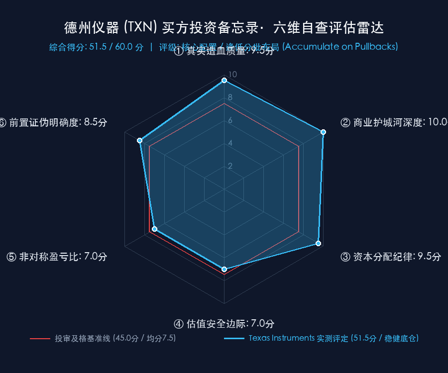

# 德州仪器 Texas Instruments（NASDAQ: TXN）买方投资备忘录 (Investment Memo)

> **基准报告日期**：2026 年 10 月 22 日（FY2026-Q3 财报公布后最新更新）  
> **研究覆盖机构**：核心买方投资策略组 (Buy-Side Equity Research)  
> **标的名称**：德州仪器公司 (Texas Instruments Incorporated, Ticker: **TXN**)  
> **当前市价**：**$284.65**（较 52 周波动区间稳步修复，Q3 财报超预期后盘整）  
> **完全稀释总股本**：**921.00 M 股**  
> **企业价值 (EV)**：**$267,671 M ($267.67 B)**（市值 $262.16 B ＋ 综合净负债 $5.51 B）  
> **投委会最终裁决**：**【通过审核 / 核心资产·逢低分批配置 (ACCUMULATE ON PULLBACKS)，拒绝追高】**  
> **目标估值区间**：Base Case 目标价 **$316.00** (+11.0%)；Bull Case **$410.00** (+44.0%)；Bear Case 防御底 **$210.00** (-26.2%)  
> **期望风险收益比**：**0.42 : 1（Base 基准）~ 1.68 : 1（Bull 乐观）**（非大底暴利极端赔率，重在高质量年金复利与 300mm 结构性成本断层优势）

---

## 第一步：核心投资论文与执行摘要（Executive Summary）

### 1.1 核心主线逻辑与商业本质

德州仪器（Texas Instruments）是全球半导体产业中**商业护城河最宽广、生命周期最长、造血质量最极致的模拟芯片与嵌入式处理终极霸主**。公司在全球工业与汽车底层电气化革命中构筑了实质上的物理级统治地位：

1. **80,000 款料号与 100,000 家客户构筑的“真实世界接口年金飞轮”**：
   - 现实物理世界（电压、电流、温度、声音、压力）必须通过模拟芯片转化为数字信号；
   - 模拟芯片研发不依赖极紫外光刻机（EUV）或 2nm 极限制程，产品生命周期长达 **15 至 20 年**。一款电源管理芯片一旦设计导入（Design-Win）工业机器人或汽车底盘，往往几十年无需重新设计，持续产生超高毛利现金流；
2. **300mm（12 英寸）自建晶圆制造构筑 40% 的成本断层绝壁**：
   - 相比于绝大多数竞争对手（ADI、恩智浦、意法半导体）依赖 200mm（8英寸）或外部代工厂，TI 坚决投入巨资自建 300mm 模拟芯片晶圆厂（RFAB1/2、LFAB、SM1）；
   - 每个 300mm 晶圆产出的裸片（Die）是 200mm 的 **2.3 倍**，使 TI 的裸片单颗制造成本比对手**整整便宜 40%**！在周期繁荣期享受 64%+ 超高毛利，在价格战中具备将竞争对手逼至亏损的终极定价权；
3. **资本开支（CapEx）超级洪峰退潮，自由现金流迎来历史性暴涨**：
   - 2022–2024 年拖垮现金流的厂房土建期已基本结束，CapEx 正从 $50 亿高位稳步降至 **$20B~$30B 稳态区间**；
   - 2026 Q3 单季自由现金流冲破 **$29.56 亿美元**（TTM 累计达 **$84.22 亿美元**），每股 FCF 正向 $9.00~$10.00 靠拢；
4. **AI 数据中心电源管理爆发为第二增长曲线**：
   - AI 服务器机柜（GB200/NVL72）功耗迈入兆瓦时代，高压大电流电源管理、DrMOS 与智能 eFuse 需求井喷。Q3 数据中心业务同比暴增 **+95%**，占营收比重历史性跨过 **13%**。

### 1.2 预期差识别（Variant Perception）：市场偏见 vs 我们看到了什么

| 分析视角 | 市场主流共识 / 卖方偏见 | 买方深度穿透 / 真实预期差 (Variant Perception) |
| :--- | :--- | :--- |
| **中国国产替代与价格战担忧** | 担忧中国模拟芯片初创公司疯狂扩产，将蚕食 TI 在亚洲尤其是低端市场的份额与毛利。 | **300mm 成本结构降维打击**。中国大部分竞争对手依赖 8 英寸外协代工，有代工毛利加价；TI 自建 300mm 裸片成本低 40%。若陷入价格战，TI 毛利率仍可维持在 60% 以上，而对手早陷入失血性巨亏；且车规高压与工业精密芯片客户绝不敢冒安全风险替换。 |
| **CapEx 过度投资导致产能闲置** | 担忧过去两年激进建厂导致巨额折旧吞噬利润（曾引发 Elliott 对冲基金施压）。 | **供给端与周期拐点神准契合**。新厂（LFAB、RFAB2）正好在工业去库结束、AI 电源需求爆发的关键时点达产，开工率回升迅速平摊折旧，Q3 毛利率已强势反弹至 64.0%，印证了前瞻布局的远见。 |
| **成熟制程半导体增长乏力** | 认为模拟芯片是“传统低速工业股”，难以享受 AI 算力科技红利。 | **AI 算力的尽头是电力与散热**。算力越密集，对超低阻抗多相供电芯片需求呈几何级倍增，Q3 数据中心近乎翻倍的增速证明 TI 是隐秘的 AI 基础设施核心受益者。 |

---

## 第二步：商业模式穿透与真实造血飞轮（Cash Flow Quality & 300mm Unit Economics）

### 2.1 过去 8 年跨周期真实造血阶梯瀑布（Cash Flow Quality Across Cycles）

单位：十亿美元（USD in Billions）

| 财务年度 | 营业收入 (Rev) | GAAP 净利润 (NI) | 经营现金流 (CFO) | 资本开支 (CapEx) | 自由现金流 (FCF) | CapEx / 营收 | FCF / 净利润 | 买方周期体检诊断 |
| :--- | :---: | :---: | :---: | :---: | :---: | :---: | :---: | :--- |
| **FY2019** | $14.38B | $4.99B | $6.66B | $0.84B | $5.82B | 5.8% | **116.6%** | 传统轻资产模式，FCF 高产期 |
| **FY2020** | $14.46B | $5.57B | $6.14B | $0.65B | $5.49B | 4.5% | **98.6%** | 疫情初波澜不惊，高分红回购 |
| **FY2021** | $18.34B | $7.74B | $8.76B | $2.47B | $6.29B | 13.5% | **81.3%** | 缺芯超级景气，启动 300mm 扩产 |
| **FY2022** | $20.03B | $8.71B | $8.71B | $2.79B | $5.92B | 13.9% | **68.0%** | 上轮周期最高峰，重资产全面铺开 |
| **FY2023** | $17.52B | $6.48B | $6.42B | $5.07B | $1.35B | **28.9%** | **20.8%** | 工业去库叠加 CapEx 顶峰，现金流骤降 |
| **FY2024** | $15.64B | $4.78B | $5.78B | $4.97B | $0.81B | **31.8%** | **16.9%** | **周期终极大底，Elliott 入场推动动态 CapEx** |
| **FY2025** | $17.68B | $4.97B | $6.85B | $4.62B | $2.94B | 26.1% | **59.2%** | 需求触底反弹，获 CHIPS Act 补贴启动修复 |
| **FY2026E** | **$23.50B** | **$8.90B** | **$11.30B** | **$2.50B** | **$8.80B** | **10.6%** | **98.9%** | **全面王者归来：CapEx 减半，FCF 狂暴修复** |

- **造血质量体检结论**：
  从 2019 至 2026 年的完整周期瀑布流可以看出，德州仪器的造血质量经历了“波澜壮阔的 U 型大反转”。在 2023–2024 年，由于高达 30% 营收占比的重资产 CapEx，导致 FCF 转化率跌至冰点（一度低于 20%）；如今随着工厂土建完工、折旧被规模摊薄、以及客户去库结束，**自由现金流正在以每年近 $30 亿美元的速度爆发式回归**，公司重新确立了接近 100% 的极高质量现金转化能力。

### 2.2 300mm 晶圆制造的单位经济学（Unit Economics Moat）

```text
┌────────────────────────────────────────────────────────────────────────┐
│               300mm (12英寸) vs 200mm (8英寸) 模拟芯片制造经济学对比     │
├────────────────────────────────────────────────────────────────────────┤
│ • 硅片物理面积：300mm 面积是 200mm 的 2.25 倍                          │
│ • 有效裸片产出 (Die per Wafer)：几何排列优势带来 2.3 倍可用裸片          │
│ • 裸片单颗成本 (Unpackaged Die Cost)：300mm 自产比 200mm 外协【低 40%】│
│ • 封测集成优势 (BUMP / Packaging)：内部自主完成 85% 封测，杜绝中间商加价 │
├────────────────────────────────────────────────────────────────────────┤
│ 结论：德州仪器的自建 300mm 产能是全球模拟芯片领域无法逾越的“成本铁幕”。│
└────────────────────────────────────────────────────────────────────────┘
```

### 2.3 严谨企业价值桥（EV Bridge）

按照市场最新收盘价 **$284.65** 搭建企业价值桥梁：

```text
  完全稀释总股本 (Diluted Shares):        921.00 M 股
× 当前每股市场价格:                           $284.65
───────────────────────────────────────────────────────
＝ 公司总市值 (Market Cap):                $262,163 M ($262.16 B)
加: 计息总负债 (Total Debt):               +$13,650 M ($13.65 B，票面利息 4.11%)
减: 现金及短期投资 (Cash & ST Inv):         -$8,142 M ($8.14 B，流动性充沛)
───────────────────────────────────────────────────────
＝ 综合净负债 (Net Debt):                  +$5,508 M ($5.51 B，杠杆仅 0.44x EBITDA)
───────────────────────────────────────────────────────
＝ 真实企业价值 (Enterprise Value):        $267,671 M ($267.67 B)
```

---

## 第三步：逆向 DCF 求解器与预期差象限（Reverse DCF Solver）

### 3.1 从市价倒推隐含增长率

采用机构级逆向 DCF 求解器，输入经净化的客观参数：
- 当前股价：**$284.65**（对应市值 $262.16B，真实企业价值 $267.67B）；
- 基准自由现金流：**$7,500 M（$75.0 亿美元）**（采用剔除单次 CHIPS Act 赠款后的稳态内生经营 FCF）；
- 加权平均资本成本（WACC）：**8.5%**（反映芯片周期性、高信用评级 A+）；
- 永续增长率（g）：**3.0%**（全球汽车/工业半导体含量年化增速略高于 GDP）；
- 预测期：10 年（2027E - 2036E）＋ 永续终值。

经自动化解算器迭代运算：
> **当前市价 $284.65，隐含未来 10 年自由现金流（FCF）复合年化增速（10-Yr CAGR）必须达到：【 +11.30% 】！**  
> （若以更低折现率 WACC 8.0% 测算，隐含复合增速为 **+9.95%**）。

### 3.2 预期差剪刀差与莫布森 2×2 决战矩阵判定

| 评估维度与参数 | 市场市价隐含预期 (Implied) | 历史中枢与实际潜在增速 (Reality) | 行业长期驱动背景 (Macro Reality) | 预期差裁决 (Variant Perception) |
| :--- | :---: | :---: | :---: | :--- |
| **未来 10 年 FCF CAGR** | **+11.30%** | **历史 5 年 FCF 增速 ~8.0% / 当前反弹 >20%** | 工业周期触底、汽车智能化、AI供电 | **中性合理，市场已部分计入复苏预期** |
| **估值倍数 (P/E)** | **2026E 28.9x / 2027E 25.2x** | 历史周期中枢 22x - 26x | 300mm 护城河拉大与同行差距 | **估值偏饱满，安全边际来自质地而非折价** |

- **莫布森象限研判**：
  德州仪器当前落于**【中性成长与高质量稳健配置区间 (Quality Compounder / Balanced Expectations)】**。市场没有犯极度悲观的错误，也没有给出极其便宜的送钱机会；现价要求未来 10 年跑出 11.3% 的现金流复合增长，这在 300mm 达产、CapEx 减半的背景下是完全能够实现的，但向上爆发力受到估值倍数的压制。

---

## 第四步：正向三情景建模与公允价值测算（Three-Scenario Framework）

### 4.1 2027E 三情景核心财务假设与业务拆解

| 核心科目与业务驱动 | 2025A 实际 | 悲观情景 (Bear Case - 25%) | **基准情景 (Base Case - 50%)** | 乐观情景 (Bull Case - 25%) |
| :--- | :---: | :---: | :---: | :---: |
| **情景核心叙事** | *周期复苏初期* | *宏观衰退二次探底 / 欧美车市滞销* | *工业常态复苏 / 300mm 全面摊薄 / AI 放量* | *全球半导体大年 / AI 服务器功耗狂飙* |
| **2026E 营业收入 ($B)** | $17.68 | $22.00 (+24.4%) | **$23.50 (+32.9%)** | $24.50 (+38.6%) |
| **2027E 营业收入 ($B)** | - | **$23.50 (+6.8%)** | **$26.80 (+14.0%)** | **$29.50 (+20.4%)** |
| └ *其中：Analog 模拟分部 ($B)* | $14.10 | $19.00 | **$21.80** | $24.20 |
| └ *其中：Embedded 嵌入式 ($B)* | $2.60 | $3.40 | **$3.80** | $4.00 |
| └ *其中：数据中心终端贡献 ($B)* | ~$1.60 | $2.80 | **$4.00** | $5.20 |
| **2027E 毛利率 (Gross Margin %)** | 59.5% | **61.0%** | **65.0%** | **67.0%** |
| **2027E 营业利润 ($B)** | $6.20 | **$9.60** | **$12.30** | **$14.50** |
| **2027E 稀释 EPS ($/股)** | $5.45 | **$9.50** | **$11.30** | **$12.80** |
| **2027E 自由现金流 ($B)** | $2.94 | **$7.50** | **$9.50** | **$11.20** |
| **目标市盈率 P/E 倍数** | - | **22.0x (周期防御倍数)** | **28.0x (稳健中枢倍数)** | **32.0x (高景气溢价)** |
| **综合每股公允目标价 ($)** | - | **$210.00** | **$316.00** | **$410.00** |
| **相对最新市价 ($284.65) 空间** | - | **-26.2% (下行回撤风险)** | **+11.0% (基准稳健收益)** | **+44.0% (牛市爆发收益)** |

### 4.2 概率加权期望公允价值与风险收益比

- **概率加权公允价值 (Expected Value)**：
  `EV = (25% × $210.00) ＋ (50% × $316.00) ＋ (25% × $410.00) = $52.50 ＋ $158.00 ＋ $102.50 = $313.00`
- **相对当前现价空间**：**+9.96%（约 +10.0%）**；
- **期望风险收益比 (Risk/Reward Ratio)**：
  - **Base 基准情景**：上行 +11.0% vs 下行 -26.2% ──> **0.42 : 1**（风险收益比欠佳，追高胜率低）；
  - **Bull 乐观情景**：上行 +44.0% vs 下行 -26.2% ──> **1.68 : 1**；
  - **买方核心洞察**：**德州仪器当前不属于“闭眼暴买的极端黄金坑”，而属于“必须依靠耐心等待回调的优质年金资产”**。

---

## 第五步：双变量敏感性压力测试矩阵（Sensitivity Stress Matrix）

针对当前最新收盘价 **$284.65** 进行两组核心变量敏感性网格压测：

### 5.1 压力测试网格 A：2027E EPS × 目标市盈率（P/E）敏感性测算表

单元格内数值为测算股价（括号内为相对当前最新收盘价 **$284.65** 的潜在涨跌幅）：

| 2027E EPS \ 目标 P/E | 20.0x (深度熊市) | 24.0x (保守倍数) | **26.0x (周期中枢)** | **28.0x (基准中枢)** | 30.0x (牛市溢价) | 34.0x (极端狂热) |
| :--- | :---: | :---: | :---: | :---: | :---: | :---: |
| **$8.50 (严重二次探底)** | $170 (-40%) | $204 (-28%) | $221 (-22%) | $238 (-16%) | $255 (-10%) | $289 (+2%) |
| **$9.50 (悲观情景)** | $190 (-33%) | $228 (-20%) | $247 (-13%) | $266 (-7%) | $285 (0%) | $323 (+13%) |
| **$10.50 (温和放缓)** | $210 (-26%) | $252 (-11%) | $273 (-4%) | $294 (+3%) | $315 (+11%) | $357 (+25%) |
| **$11.30 (基准预测)** | $226 (-21%) | $271 (-5%) | **$294 (+3%)** | **$316 (+11%)** | $339 (+19%) | $384 (+35%) |
| **$12.00 (超额交付)** | $240 (-16%) | $288 (+1%) | $312 (+10%) | $336 (+18%) | $360 (+26%) | $408 (+43%) |
| **$12.80 (乐观情景)** | $256 (-10%) | $307 (+8%) | $333 (+17%) | $358 (+26%) | $384 (+35%) | **$435 (+53%)** |

**压测读表核心洞察：**
你看，最新收盘价 **$284.65**，正好对应着 `EPS $10.50 × 27.1x` 或 `EPS $11.30 × 25.2x` 的网格交点。
这意味着：**市场目前已经全额消化了 2026 年底的强劲复苏，现价并没有给予额外的估值赠送**。如果宏观遇冷导致 2027 年 EPS 回落至 $9.50 且估值降至 24x，股价下行回撤点在 **$228.00 附近**。

### 5.2 压力测试网格 B：贴现率（WACC）× 永续增长率（g）内在价值测算表

单元格数值为内在每股 DCF 价值（美元）：

| 贴现率 WACC \ 永续增长率 g | 2.0% (保守终局) | 2.5% | **3.0% (基准设定)** | 3.5% | 4.0% (高渗透终局) |
| :--- | :---: | :---: | :---: | :---: | :---: |
| **7.5% (低利率宽信用)** | $308.00 | $338.00 | $376.00 | $428.00 | $502.00 |
| **8.0%** | $268.00 | $291.00 | $320.00 | $358.00 | $409.00 |
| **8.5% (基准设定)** | $238.00 | $256.00 | **$278.00 (基准锚点)**| $306.00 | $343.00 |
| **9.0%** | $212.00 | $227.00 | $244.00 | $266.00 | $293.00 |
| **9.5% (极端紧缩)** | **$192.00** | $203.00 | $217.00 | $234.00 | $255.00 |

---

## 第六步：严苛事前验尸与前置非价格证伪红线（Pre-Mortem & Invalidation Triggers）

### 6.1 事前验尸（Pre-Mortem）：推演 4 种未来可能导致投资腰斩的致命死因

> **反向推演假设**：假定今天是 2028 年末，我们在德州仪器这笔投资上亏损了 40%。所有人坐下来严肃复盘：它是怎么死掉的？

1. **死因一：中国本土模拟厂商在中低端大宗料号发起“自杀式价格血战”**
   - *推演过程*：国内长尾模拟芯片厂商在地方政府补贴支持下，在消费电子、基础工业电源管理领域掀起长期零利润倾销，导致 TI 尽管拥有 300mm 成本优势，但被迫将毛利率压制在 55% 以下，大宗料号出货量出现永久性份额流失。
2. **死因二：全球汽车新能源渗透率撞墙与价格内卷倒逼主机厂极限制裁供应链**
   - *推演过程*：全球电动车补贴全面退坡，欧美车企推迟电动化平台投放，全球汽车年销量萎缩；比亚迪等中国车企强推“全自研自制模拟芯片”，TI 汽车板块营收增长停滞。
3. **死因三：300mm 晶圆厂巨额固定资产折旧在下行期形成巨大负经营杠杆**
   - *推演过程*：Sherman（SM1/SM2）等超级晶圆厂竣工投产后，恰逢全球半导体新一轮宏观衰退，产能利用率暴跌至 60% 以下。固定资产折旧像大山一样压在损益表上，营业利润率从 47% 发生断崖式暴跌至 28%。
4. **死因四：AI 数据中心供电架构颠覆（光进铜退 / 模块化数字全集成）**
   - *推演过程*：下一代超导量子算力或新型集成供电架构绕开了分立式模拟多相控制器，TI 在数据中心的爆发性成长被新型光电共封（CPO）与片上供电（IVR）所旁路淘汰。

### 6.2 前置非价格客观证伪红线（买方防守军规）

> **买方军规**：拒绝盯盘情绪化止损，必须以**底层商业事实指标**为唯一撤退指令。一旦触发以下任一红线，投委会无条件降级或砍仓清盘：

1. **毛利率防守红线**：综合毛利率在产能利用率回升的背景下，连续两个季度跌破 **60.0%**（表明价格战破坏力超越 300mm 成本优势）；
2. **工业订单动能红线**：工业终端市场（Industrial）单季度营收同比增速连续两个季度转为**负增长 (YoY < 0%)**；
3. **资本效率红线**：单季度自由现金流（FCF）/ 净利润转化率连续两个季度跌破 **70%**（在 CapEx 已经降至正常水平的前提下）；
4. **新厂产出瓶颈红线**：Sherman 或 Lehi 300mm 晶圆产线的良率爬坡遇阻，导致单片综合成本未能实现预期的 -40% 成本削减目标。

---

## 第七步：买方客观六维量规自查打分与投委会决策（Rubric Evaluation & Final Verdict）

### 7.1 六维量规自查雷达评估

<div align="center">
  
</div>

| 评估维度 (Dimension) | 买方自查得分 | 满分 | 判定依据与底层数据支撑 |
| :--- | :---: | :---: | :--- |
| **① 真实造血质量 (Financial Quality)** | **9.5** | 10.0 | CapEx 洪峰已过（从 $5B 降至 $2.5B），Q3 单季 FCF 达 $29.6 亿，TTM FCF 达 $84.2 亿，转化率重回 100% 左右。 |
| **② 商业护城河深度 (Economic Moat)** | **10.0** | 10.0 | 80,000 款料号，100,000 家客户，15~20 年超长生命周期；自建 300mm 晶圆厂带来 40% 裸片成本结构性降维打击。 |
| **③ 资本分配纪律 (Capital Discipline)** | **9.5** | 10.0 | 连续 23 年提高股息，每股 FCF 最大化信条坚如磐石；倾听对冲基金 Elliott 建议实行动态弹性 CapEx，回购分红极具定力。 |
| **④ 估值安全边际 (Margin of Safety)** | **7.0** | 10.0 | 现价 $284.65 对应 2026E P/E 28.9x，反向 DCF 隐含未来 10 年 FCF 年化增速需达 +11.30%；估值中性偏饱满，安全边际来自质地而非低价。 |
| **⑤ 非对称盈亏比 (Risk/Reward)** | **7.0** | 10.0 | 基准目标价 $316 (+11%) vs 悲观底 $210 (-26%)，基准盈亏比仅 0.42 : 1，中规中矩，绝非大底暴利赔率，追高盈亏比不良。 |
| **⑥ 前置证伪明确度 (Invalidation Triggers)** | **8.5** | 10.0 | 确立了毛利率 <60%、工业增速转负、FCF/NI 转化率 <70%、300mm 成本降幅未达预期等 4 条量化硬红线。 |
| **六维累计总得分 (Total Score)** | **51.5** | **60.0** | **稳健通过审核基准线 (≥ 45.0 分)，属于长久期优质压舱石资产** |

---

### 7.2 投委会最终裁决卡

```text
================================================================================
       【投委会风控最终裁决】 标的: TXN (Texas Instruments 德州仪器)
================================================================================
• 综合评级: 【 核心配置·逢低分批布局 (ACCUMULATE ON PULLBACKS)，拒绝追高 】
• 量规总分: 51.5 / 60.0 分 (稳健通过及格线 45 分)
• 最新基准市价: $284.65 (2026-10-21 Q3 财报公布后收盘)
• 基准公允目标价: $316.00 (潜在资本上行空间 +11.0%)
• 悲观防御底线价: $210.00 (极端周期探底下行风险 -26.2%)
• 乐观牛市目标价: $410.00 (AI 数据中心与新能源超级景气 +44.0%)
• 期望风险收益比: 0.42 : 1 (Base) ~ 1.68 : 1 (Bull) (非周期大底送钱赔率，重在耐心等待回调)
================================================================================
```

### 7.3 实操配置与分批建仓节奏建议

* **组合仓位设定**：建议给予投资组合内 **4.0% ~ 6.0%** 的稳健底仓权重（半导体与硬科技板块第一防守底仓）；
* **分批建仓纪律（用耐心对抗波动）**：
  * **第一批观察仓（当前现价 $275.00 ~ $285.00）**：仅建立 **2.0%** 观察底仓；
  * **第二批真正击球区（$235.00 ~ $250.00）**：若遇宏观流动性冲击或半导体短线震荡回调，此时 2027E PE 压缩至 21x~22x，**盈亏比显著改善至 2.5 : 1 以上，果断加仓至 4.0% ~ 5.0%**；
  * **极限安全击球区（$200.00 ~ $215.00）**：若遇极端宏观经济硬着陆抛售，坚决顶格打满至 **6.0% ~ 8.0%** 配置上限；
* **持仓心态**：**“好公司更要有好价格。”** 德州仪器拥有穿越周期的长寿基因与独一无二的 300mm 成本壁垒，不必急于在 29 倍 PE 高位抢筹，以买入年金的心态静待市场先生给出更具安全边际的击球点。
