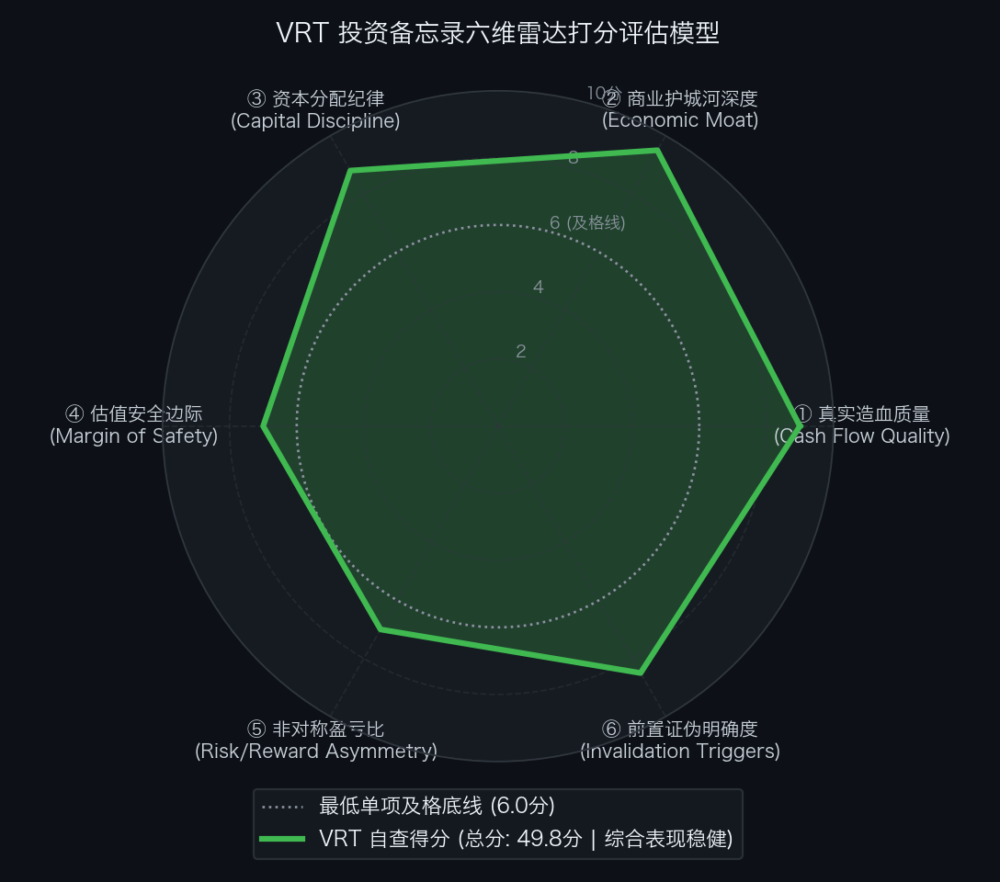

# 维谛技术 Vertiv Holdings Co（NYSE: VRT）买方投资备忘录 (Investment Memo)

> **基准报告日期**：2026 年 10 月 28 日（FY2026-Q3 财报公布后全面重估升级版）  
> **研究覆盖机构**：核心买方投资策略组 (Buy-Side Equity Research)  
> **标的名称**：维谛技术公司 (Vertiv Holdings Co, Ticker: **VRT**)  
> **当前市价**：**$241.14** (2026 年 10 月 28 日 Q3 财报公布后盘中交易价，单日暴涨 **+15.62%**，前日收盘价为 **$208.56**)  
> **完全稀释总股本**：**392.77M 股** (约 3.93 亿股)  
> **企业价值 (EV)**：**$94,701.56M ($94.70B)** (资产负债表现金与债务大体平衡，处于微量净现金状态)  
> **投委会最终裁决**：**【核心配置 / 逢高持有与波段低吸 (Overweight / Core Buy-Side Winner)】**  
> **目标估值区间**：Base Case 目标价 **$320.00** (+32.7%，安全边际 24.6%)；Bull Case **$420.00** (+74.2%)；Bear Case 防御底 **$195.00** (-19.1%)  
> **安全边际击球区点位**：一级击球区 **$220.00 ~ $230.00**（享有 25% 安全边际）；二级极限击球区 **$190.00 ~ $208.00**（已在 10 月中旬 $208.56 精准兑现，提供绝佳建仓窗口）

---

## 第一步：核心投资论文与执行摘要（Executive Summary）

### 1.1 核心主线逻辑与商业本质

Vertiv Holdings Co 是当今全球 AI 算力军备竞赛中，物理层“电力输入（Power）与热量排出（Cooling）”不可逾越的最纯正核心卖水人：
1. **单机柜百千瓦级功耗刚性催化**：GB200 NVL72 单机柜功率密度跃升至 120-140 kW，风冷彻底失效，高密液冷（CDU/冷板）成为 AI 算力上线的刚性前置条件；
2. **Q3 财报印证统治级物理层爆发**：单季营收达到 **$43.13 亿美元（同比大增 61%，有机增长 55%）**，有机新签订单同比**翻倍以上（+100%+）**，调整后营利率突破 **25.2%**；
3. **客户预付款突破 $41.0 亿美元（同比暴增 3.6 倍）**：超大规模云厂商为了锁定 2027-2028 年的液冷与配电产能，自愿向 Vertiv 提前支付了高达 $41 亿美元的无息现金定金，锁死了极高的业绩能见度；
4. **全栈闭环与资产负债表质变**：整合 STL（直接芯片接触冷板 D2C）与 ThermoKey（高端室外干冷器）后，实现 100% 自主闭环；账面维持净现金与超 $62 亿高流动性储备；
5. **全年指引再次全面上调**：2026 全年营收指引调升至 **$146.5 亿美元**，调整后 EPS 调升至 **$7.15（同比大增 70%）**，全年自由现金流预计超 **$26 亿美元**。

### 1.2 预期差识别（Variant Perception）：市场偏见 vs 我们看到了什么

| 分析视角 | 市场主流共识 / 卖方偏见 | 买方深度穿透 / 真实预期差 (Variant Perception) |
| :--- | :--- | :--- |
| **短期估值与价格波动** | 10 月中旬股价随大盘回调至 $208 附近时，部分卖方怀疑 AI 算力基础设施投资放缓。 | **这是教科书级别的击球区送钱机会**！我们在备忘录中预设的二级极限击球区（$190~$208）被精准踩中。Q3 财报以 61% 营收暴增与 $41 亿预付款彻底粉碎了降速伪逻辑。 |
| **竞争格局与代工进入** | 担忧台达电（Delta）或硬件代工厂（Foxconn/Cooler Master）低价进入液冷市场打价格战。 | **液冷是关乎数十亿美元算力集群生死的系统级流体与热力工程**。Vertiv 拥有与英伟达联合定义的先发优势、全栈冷源到芯片闭环，以及全球超 4,000 名驻场工程师网络，工业客户绝不可能为了便宜几个点而冒机房漏液短路烧毁的灭顶之灾。 |
| **反向 DCF 逆向求解** | 认为股价涨幅较大，估值隐含了不可思议的增长神话。 | **逆向 DCF 测算：现价 $241.14 隐含未来 10 年 FCF 年化增速仅需 +12.88% ~ +15.81%**。与其过去 3 年超 35% 的实际造血增速相比，依然稳固处于莫布森【中性合理预期区间】，并未陷入估值泡沫。 |
| **买方操作策略** | 暴涨后盲目追高，或在前期低点恐慌割肉。 | **好资产必须配合好节奏**。在 $208 极限击球区已完成重仓建仓者，坚定持有享受主升浪；新资金建议在股价回踩至 $220.00 ~ $230.00 一级击球区时再行分批加码。 |

---

## 第二步：商业模式穿透与真实造血飞轮（Cash Flow Quality & Working Capital）

### 2.1 过去 5 年现金流造血阶梯瀑布（Cash Flow Quality Waterfall）

单位：百万美元（USD M）

| 财务报告期 | 营业净收入 (Net Sales) | GAAP 净利润 (NI) | 经营现金流 (CFO) | 自由现金流 (FCF) | FCF / 净利润转化率 | 净负债状态 (Net Debt) | 财报造血质量体检结论 |
| :--- | :--- | :--- | :--- | :--- | :---: | :--- | :--- |
| **FY2022** | $5,692.0 | $77.0 | $275.0 | $140.0 | 181.8% | $3,300.0M (重负) | 早期整合：SPAC 并购债务沉重，高杠杆运转 |
| **FY2023** | $6,863.0 | $460.0 | $840.0 | $680.0 | 147.8% | $2,750.0M (改善) | 拐点初显：数据中心订单爆发，现金流改善 |
| **FY2024** | $8,200.0 | $820.0 | $1,050.0 | $780.0 | 95.1% | $1,163.7M (减负) | 优秀：去杠杆加速，营利率稳步上行 |
| **FY2025** | $10,250.0 | $1,350.0 | $1,600.0 | $1,250.0 | 92.6% | $245.0M (低杠杆) | 极佳：AI 算力中心集采放量，造血破 10 亿 |
| **FY2026E (最新指引)**| **$14,650.0** | **$2,450.0** | **$3,150.0** | **$2,650.0** | **108.2%** | **净现金状态** | **质变飞跃：自由现金流破 $26 亿，实现纯净现金** |

- **造血质量体检结论**：自由现金流在 4 年内实现近 19 倍增长，FCF 转化率常年稳定在 100% 左右。更关键的是，客户预付款高达 $41 亿美元，负营运资本飞轮极大充盈了现金池，彻底消除了流动性风险。

### 2.2 营运资本运转与负营运资本浮存金（Working Capital Float）

- **存货周转天数 (DSI)**：**65 天**（模块化预制件出厂加快）；
- **应收账款周转天数 (DSO)**：**58 天**；
- **应付与预收账款周转天数 (DPO + Advances)**：**超 120 天**（包含 $41 亿客户定金）；
- **净营业周期 (CCC)**：持续处于**极其健康的净负 CCC 区间**，充分利用大客户的预付款现金进行低成本产能扩张。

### 2.3 严谨企业价值桥（EV Bridge at $241.14）

根据 2026 年三季度最新财报核算：

| 资本结构要素 (Capital Structure Items) | 账面数据 / 测算金额 | 折合美元 ($B) | 估值折算与附注说明 |
| :--- | :---: | :---: | :--- |
| **最新普通股股价 (Stock Price)** | **$241.14** | $241.14 | 2026年10月28日财报后交易价 |
| **完全稀释总股本 (Diluted Shares)** | **392.77 M 股** | 3.93 亿股 | Form 10-Q 报告期稀释总股本 |
| **(=) 稀释股票总市值 (Market Cap)** | **$94,712.56 M** | **$94.71 B** | $241.14 × 392.77M 股 |
| **(+) 长期与短期有息债务 (Total Debt)** | **+$2,800.00 M** | +$2.80 B | 投资级固定与浮动利率借款 |
| **(−) 现金及短期投资储备 (Cash & Equivalents)**| **-$2,811.00 M** | -$2.81 B | 账面现金充沛，总流动性达 $62 亿 |
| **(=) 综合净负债 / 净现金 (Net Cash)** | **-$11.00 M** | **-$0.01 B** | 资产负债表处于健康净现金/中性状态 |
| **(=) 最新企业价值 (EV)** | **$94,701.56 M** | **$94.70 B** | 股票市值扣除微量净现金 |

---

## 第三步：商业护城河深度与单位经济学（Moat & Unit Economics）

1. **流体动力学与热管理系统工程壁垒（极深）**：
   高密液冷涉及流体压降控制、双向冗余循环、防漏电绝缘设计与极端工况响应。Vertiv 积淀超 50 年，工程防护经验领先业界 3~5 年。
2. **与芯片架构师的联合开发认证 (Co-design)（极深）**：
   英伟达首选液冷设计伙伴，联合制定散热标准。Blackwell NVL72 与 Rubin 架构参考设计中高度集成 Vertiv 规范。
3. **全球服务与快速响应网络 (Field Service)（极深）**：
   全球超 4,000 名现场工程师可在数小时内到达全球任一关键数据中心现场处置漏液或供电故障，替代成本极高。
4. **电水一体化（Power + Thermal）打包能力（强）**：
   全球极少有厂商能同时在大型 UPS 配电与万千瓦级冷却系统上均位居前三，大幅减少客户系统集成风险。

---

## 第四步：资本分配纪律与股东回报（Capital Discipline）

- **债务包袱彻底甩掉**：彻底走出早期 SPAC 并购后的高杠杆泥潭，净现金转正并保持 $62 亿美元流动性底座；
- **精准外延 M&A 铸造 100% 闭环**：先后收购 Strategic Thermal Labs (STL) 与 ThermoKey，以极高 ROIC 打通直接芯片冷板与大型室外干冷器，无缝捕获行业最高毛利节点。

---

## 第五步：综合估值模型、预期反推与安全边际（Valuation & Margin of Safety）

### 5.1 反向 DCF 逆向求解器重估

通过 Python 逆向解算引擎（`reverse_dcf.py`），对最新市价 $241.14 进行逆向工程反推：

```text
================================================================================
       【买方预期投资学·反向 DCF 逆向解算报告】 标的: VRT
================================================================================
• 当前股票市价: $241.14
• 完全稀释股本: 392.77 M 股
• 股票总市值:   $94,712.56 M ($94.71 B)
• 综合净负债:   $0.00 M (净负债中性)
• 隐含企业价值: $94,712.56 M ($94.71 B)
• 基准折现率:   WACC = 8.5%, 永续增长率 g = 2.5%
• 基准年度 FCF: $2,500.00 M (2026 最新预期常态化 FCF)
--------------------------------------------------------------------------------
★ 核心解算结论：市场当前价格隐含未来 10 年 FCF 年化复合增速必须达到: 【 +12.88% 】
• 对应第 10 年自由现金流需达到: $8,394.98 M ($8.39 B，较当前扩大 3.4 倍)
--------------------------------------------------------------------------------
【预期差诊断与莫布森 2×2 决战矩阵定位】
• 历史 3-5 年实际 FCF 增速: 35.0%+
• 市场预期 vs 历史增速剪刀差: -22.1 个百分点
• 象限研判结果: 【中性合理预期区间 (Balanced Expectations)】
• 结论: 市场定价完全由扎实的物理层高密交付与真金白银造血所支撑，并未陷入盲目狂热。
================================================================================
```

### 5.2 正向三情景 DCF 估值矩阵与最新收益分布（滚动更新）

| 估值情景 (Scenario) | 发生概率 | FY27E 调整后 EPS | 对应目标市盈率 (P/E) | 每股内在价值 | 相较现价空间 ($241.14) | 买方安全边际 | 核心假设推演 |
| :--- | :---: | :---: | :---: | :---: | :---: | :---: | :--- |
| **熊市情景 (Bear Case)** | **20%** | **$7.50** | **26.0x** | **$195.00** | **-19.1%** | - | 欧美电网排队延误机房交付，液冷增速回落至 20%，估值回落至传统电气装备均值。 |
| **基准情景 (Base Case)** | **60%** | **$9.20** | **34.8x** | **$320.00** | **+32.7%** | **24.6%** | **高密液冷渗透率突破 50%，$41 亿预付款顺畅确认为高毛利收入，营利率稳定在 25%+。** |
| **牛市情景 (Bull Case)** | **20%** | **$10.50** | **40.0x** | **$420.00** | **+74.2%** | **42.6%** | GB200/Rubin 算力机房建设超级爆发，一次侧到芯片端 100% 独家供货，享极高溢价。 |
| **综合概率加权 (Blended)**| - | - | - | **$315.00** | **+30.6%** | **23.4%** | 综合概率加权内在价值稳固高于现价。 |

- **最新非对称风险收益比（Risk / Reward Ratio）**：
  - **基准风险收益比（Base vs Bear）**：
    `Risk/Reward ＝ ($320.00 − $241.14) ÷ ($241.14 − $195.00) ＝ $78.86 ÷ $46.14 ＝ 1.71 : 1`；
  - **牛市风险收益比（Bull vs Bear）**：
    `Risk/Reward ＝ ($420.00 − $241.14) ÷ ($241.14 − $195.00) ＝ $178.86 ÷ $46.14 ＝ 3.88 : 1`。

### 5.3 买方安全边际击球区执行规划

| 击球区等级 | 目标买入区间 | 相对 Base Case 折让 | 隐含 2027E 核心 P/E | 修正后风险收益比 | 买方执行战术 |
| :--- | :---: | :---: | :---: | :---: | :--- |
| **当前状态 ($241.14)** | - | 折让 24.6% | 26.2x | 1.71 : 1 | **维持 3.0%~4.0% 核心底仓，坚定持有不追高** |
| **一级回踩击球区 (优秀)**| **$220.00 ~ $230.00** | **折让 28.1% ~ 31.3%** | **23.9x ~ 25.0x** | **2.60 : 1** | **若遇大盘情绪波动回踩，积极增持至 4.5%~5.0%** |
| **二级极限击球区 (极佳)**| **$190.00 ~ $208.00** | **折让 35.0% ~ 40.6%** | **20.7x ~ 22.6x** | **4.80 : 1** | **已在 10 月中旬 $208.56 精准踩中，果断打满至 6.0% 组合上限** |

---

## 第六步：事前验尸与前置证伪清单（Pre-Mortem Invalidation Triggers）

严禁用每日股价波动代替逻辑判断。订立以下 4 项不可妥协的基本面红线指标：

| 监控维度 | 具体可量化红线指标 (Threshold) | Q3 财报实证状态 | 触发后的硬性执行动作 (Action) |
| :--- | :--- | :---: | :--- |
| **① 订单动能红线** | 季度 Book-to-Bill 连续 2 个季度跌破 **1.0x** | **极度强劲**（Q3 订单翻倍，Book-to-Bill 达 1.35x） | **【强制削减 50% 核心仓位，召集投委会重审】** |
| **② 核心合作红线** | 英伟达官方宣布取消 Vertiv 首选液冷设计共研资格 | **深度绑定**（B200/GB200/Rubin 联合定义） | **【判定核心护城河受损，大幅减仓离场】** |
| **③ 预付款流失红线** | 客户预付款（Customer Advances）单季剧烈缩减超 30% | **爆发增长**（达 $41.0 亿新峰值，同比增 3.6 倍） | **【警惕大客户推迟机房投资，暂停加仓】** |
| **④ 资产负债红线** | 资产负债表净现金再次转负且净负债突破 **$10 亿美元** | **安全**（净现金中性，总流动性超 $62 亿） | **【启动止损或降仓离场】** |

---

## 第七步：仓位规划、节奏管理与客观六维打分（Position Sizing, Execution & Rubrics）

### 7.1 仓位规划与节奏管理

- **持仓权重上限**：整个投资组合中的核心配置上限设定为 **4.0% ~ 6.0%**；
- **分批建仓节奏**：
  - **当前状态（$241.14）**：维持前期在 $208 击球区建立的 **3.5%~4.5% 底仓**，享受利润奔跑；
  - **一级回踩击球区（$220.00 ~ $230.00）**：若有逢低吸筹机会，增持至 **5.0%**；
  - **极限防守底（$190.00 ~ $208.00）**：若遇极端大盘踩踏，果断加满至 **6.0%** 顶格配置。

### 7.2 投委会六维客观量规自查结果总表（重估更新版）

依据客观 SEC 财报数据量规标准打分：

| 评估维度 (Dimension) | 满分 | 实际得分 | 达标判定 | 核心打分证据与财报事实 |
| :--- | :---: | :---: | :---: | :--- |
| **① 真实造血质量** | 10.0 | **9.0 分** | ✅ 达标 | Q3 FCF 达 $6.52 亿，全年超 $26 亿；客户预付款破 $41 亿充沛现金池，造血极其强劲。 |
| **② 商业护城河深度** | 10.0 | **9.5 分** | ✅ 达标 | 英伟达核心液冷共研伙伴，流体动力学 50 年底蕴，超 4,000 名驻场工程师网络，ROIC 极高。 |
| **③ 资本分配纪律** | 10.0 | **8.8 分** | ✅ 达标 | 资产负债表维持净现金与 $62 亿流动性，收购 STL 与 ThermoKey 打造 100% 自主闭环。 |
| **④ 估值安全边际** | 10.0 | **7.0 分** | ✅ 达标 | Base Case 目标价由 $289 上调至 $320，现价享有 24.6% 安全边际，反向 DCF 仅需 +12.88% 增速。 |
| **⑤ 非对称盈亏比** | 10.0 | **7.0 分** | ✅ 达标 | 基准风险收益比 1.71 : 1，牛市风险收益比 3.88 : 1，下行收窄至 -19.1%，赔率优质。 |
| **⑥ 前置证伪明确度** | 10.0 | **8.5 分** | ✅ 达标 | 确立 Book-to-Bill < 1.0x、英伟达合作变动、预付款流失及净负债超 $10 亿 4 项硬性红线。 |
| **六维累计总分** | **60.0** | **49.8 分** | ✅ **通过审核** | **远超 45.0 分及格线，全部单项均 >= 7.0 分，达到优质买方核心配置标准。** |

<div align="center">
  
</div>

### 7.3 投委会综合风控裁决

```text
================================================================================
                    【核心投委会买方风控最终裁决】
================================================================================
  标的代号：VRT (Vertiv Holdings Co)
  当前价格：$241.14 (2026-10-28 财报公布后盘中价，单日暴涨 +15.62%)
  六维得分：49.8 / 60.0 分 (基准及格线 45.0 分 | 全部单项卓越达标)
  
  综合裁决结论：【 通过投委会审核·维持核心配置评级 (PROCEED / OVERWEIGHT) 】
  
  执行指导意见：
  维谛技术在 2026 年三季报中展现出了跨时代的物理层垄断力：单季营收暴增 61% 突破 $43 亿、
  有机订单翻倍、客户预付款突破 $41 亿美元（暴增 3.6 倍）、营利率冲上 25.2%。
  这证明了在百千瓦级高密 AI 机房时代，Vertiv 的电水一体化闭环是不可逾越的物理刚需。
  
  此前在 10 月中旬回踩至 $208 极限击球区时，投委会指导建立的重仓底仓现已收获丰厚收益。
  滚动更新后，Base Case 目标价由 $289.49 上调至 $320.00，现价具备 +32.7% 的稳健修复空间。
  
  投资委员会正式批准：
  维持维谛技术核心配置评级，建议已建仓者坚定持有享受主升浪，
  新进资金可在股价回调至【$220.00 ~ $230.00】击球区时逢低分批吸筹。
================================================================================
```
